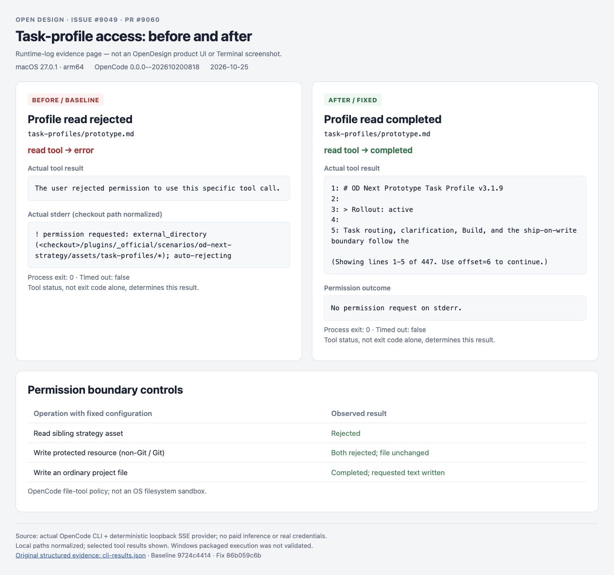

# OD Next task-profile access (#9049)

The original reproduction below retains its original conditions. For the #9073 integration, newly discovered failure paths, and fresh validation, see [integration evidence](integration/README.md).

## Reproduction boundary

Baseline: `9724c44142ea0afaee3d207f37901b31c66a44ad`.

The maintained regression starts a real daemon, creates a project through
`POST /api/projects`, and starts an OD Next Run through `POST /api/runs`. A
controlled OpenCode executable captures the exact prompt and
`OPENCODE_CONFIG_CONTENT` received at launch. Both `opencode` and
`byok-opencode` receive the shipped task-profile path in the prompt, but the
baseline grants neither path. The rollout-off control passes.

```sh
pnpm --filter @open-design/daemon exec vitest run tests/runtimes/od-next-profile-permissions.test.ts
```

Before the fix: the two active-strategy cases fail with `expected undefined
to be 'allow'` for the advertised task-profile root. The ordinary-run control
passes. After the fix: all five cases pass, including worktree-base resolution and unexpected Git-probe failure.

## Real OpenCode witness

A separate controlled run used the real OpenCode companion from
`@powerformer/vela-cli-darwin-arm64@0.1.7`, version
`0.0.0--202610200818`, on macOS 27.0.1 arm64 / Node 24.19.0.

Each probe had its own temporary project, HOME and XDG directories. A loopback
OpenAI-compatible SSE fixture supplied exactly one `read` or `write` tool call.
No provider credential or paid model service was used. The config was generated
by the production `buildOpenCodeMcpConfigContent` function. This is real CLI/tool
execution with controlled model responses, not a live-provider or Windows
packaged-app acceptance run.

| Probe | Observed tool result |
| --- | --- |
| Baseline: read the real shipped `prototype.md` | `error`; `external_directory ... auto-rejecting` |
| Fixed: same read with the task-profile grant | `completed`; first lines of `OD Next Prototype Task Profile v3.1.9` returned |
| Fixed: read sibling `assets/core-system-prompt.md` | `error`; external-directory approval still required |
| Fixed: write a temporary protected resource, outside Git | `error`; file unchanged, even with a prior broad edit allow |
| Fixed: same write from a Git project | `error`; file unchanged |
| Fixed: write an ordinary project file | `completed`; file contains the requested text |

[Selected CLI events and file-content controls](cli-results.json) retain the
observed tool states. Local paths are normalized; verbose denial-rule dumps
are omitted. CLI process exit code alone is not a success oracle: the denied
read also exits zero, so the tool result is the relevant evidence.

## Visual comparison of the recorded results



This is a browser screenshot of [the evidence page](comparison.html), assembled
from the actual CLI results above. It is explicitly labeled as a runtime-log
report, not an OpenDesign product UI or native Terminal screenshot. The linked
JSON remains the primary structured evidence.

## Permission scope

Only active OpenCode strategy runs gain the selected bundled strategy's
`assets/task-profiles` subtree, not the whole plugin directory. The config
retains the existing project grants and adds `edit` denials for the resource
paths. OpenCode's `edit` permission covers its edit/write/patch tools.

The tested companion checks edits against paths relative to its Git worktree,
or the volume root outside Git. Denials include absolute and worktree-relative
forms, including canonical filesystem aliases. The final matching rule wins,
so resource denials follow prior rules even when their patterns already exist.
See [OpenCode permissions](https://opencode.ai/docs/permissions/).

This is tool-permission configuration, not an OS filesystem sandbox. Shell
policy, user overrides, Codex directory policy, and non-OpenCode launches are
unchanged.

## Validation

- 5 focused daemon suites: 162 tests passed, covering the HTTP launch boundary,
  MCP config, existing plugin skill-root grants, strategy package loading and
  agent arguments.
- `pnpm guard`: passed.
- Root `pnpm typecheck`: passed.
- `git diff --check`: passed.

The separate permission-denial/empty-output classification and zero-artifact
success concerns in #9049 remain out of scope. Windows packaged execution has
not been verified on this macOS host.
