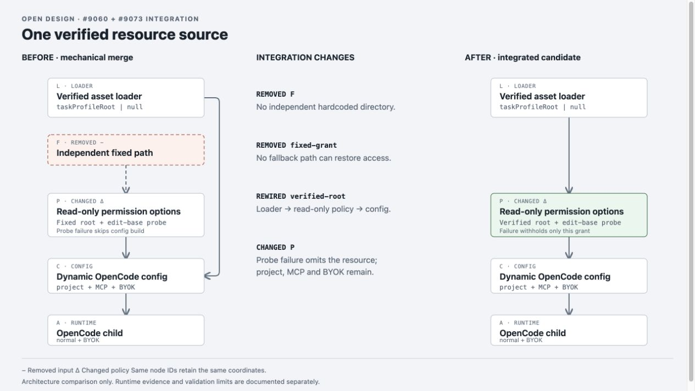
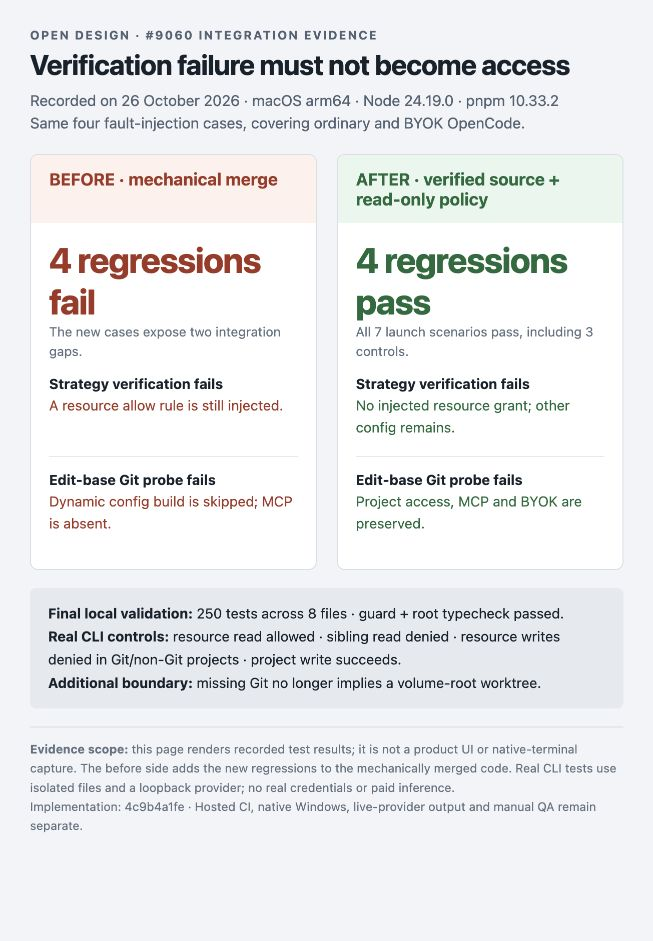

# Verified task-profile permission integration

This records the integration of #9073's verified task-asset loader with #9060's OpenCode file-tool read-only policy. It is evidence for an updated #9060, not a request to merge both implementations unchanged.

## Source and attribution

- Original #9060 head: `a1bb27e64e4e949a9dedde6250f28af31b941643`.
- Imported #9073 head: `5d305aaea72d2f14097e9977a5e4892b8afa04fa` (including its fail-soft fix).
- #9073's original commits `582f27a95ab683cb7e724093a5f7153240963efe` and `5d305aaea72d2f14097e9977a5e4892b8afa04fa` by Siri-Ray are preserved in Git history.
- Mechanical merge reference tree: `95d040779024efd3d6f47a3ac483df3e42f22283`.

## Problems found while combining the changes

1. A clean Git merge retained two authorization paths. If verified asset loading failed, the fixed `readOnlyDirectories` path from #9060 still entered `external_directory`, undoing #9073's omission. Both OpenCode adapters failed new daemon-to-child assertions against that mechanical merge.
2. An unexpected edit-base Git probe error occurred inside the whole dynamic config build. Both adapters then lost the configured MCP entry, and BYOK provider configuration was also part of the skipped build.
3. A missing Git executable was previously treated as proof of a non-Git project. The new resolver test went red because it returned `/` instead of rejecting an unknown edit boundary. Only an explicit “not a git repository” result now selects the volume-root fallback.

The integrated path uses only `taskProfileRoot` returned by the verified loader. OpenCode resources are excluded from generic `extraAllowedDirs`; their grant is added with edit denials only after resolving the edit base. Failure omits that injected resource grant while normal project, MCP and BYOK configuration continues. Other non-Codex directory behavior from #9073 is retained; Codex's existing exclusion remains.

The figure is an architecture comparison, not a product screenshot or a runtime result.

## Runtime and regression evidence

Implementation commit: `4c9b4a1fe978686dd90e61112e3057f5b6ebdc09`. Final local run: **250 tests passed across 8 files**, including the complete **69-case** automatic-production file and all **7** integrated launch scenarios. Guard, root typecheck and diff whitespace checks passed. Six real CLI controls passed and cleaned their isolated resources.

See [structured results](results.json), [before excerpt](before.txt), [after excerpt](after.txt), and [real CLI controls](runtime-results.json).

The second image renders recorded test results, not a native terminal or product UI. The before side is the mechanical merge with the new regression cases added. The after side includes both fault cases for ordinary/BYOK OpenCode, successful access for both adapters, and an ordinary-task control. No assertions were weakened and no retry or timeout increase was used.

The previous comparison's standalone #9060 HTTP fixture produced timeouts. Its launch assertions are now consolidated into the existing public-run harness, which owns agent-detection isolation and HTTP transport cleanup. All covered launch outcomes are retained, including relative edit denials and rollout-off behavior. The old timeout was not counted as a passing result or a proven product regression.

Real CLI controls use the installed OpenCode companion with a controlled loopback OpenAI-compatible provider, isolated HOME/XDG/project directories, and temporary copies of shipped resources. The production package verifier supplies the root; the production configuration builder supplies the permission rules. The CLI confirms resource reads, sibling denial, protected writes in Git/non-Git projects, and normal project writes. Separate HTTP regressions prove server wiring. All owned temporary directories and provider servers are cleaned up.

## Limits and merge cautions

- File-tool permissions are not an OS sandbox. Existing shell policy, explicit user settings and broader existing project access are not redefined by this fix.
- Missing/unusable Git means this change withholds the new protected-resource grant; it does not guess a worktree and does not discard unrelated dynamic configuration.
- Native Windows packaged execution and a live-provider design task remain unverified locally.
- Permission-denial classification and zero-artifact success settlement remain separate parts of #9049.
- Local checks, hosted CI, maintainer review and manual QA are separate. The original approval should not be treated as approval of this new integrated head.
- Maintainers should coordinate #9073's final disposition rather than merging two independent grant paths.

Commands and exact outcomes are recorded in `results.json`. The earlier CLI evidence one directory above retains its original head and conditions; it is not relabeled as this integration's validation.
