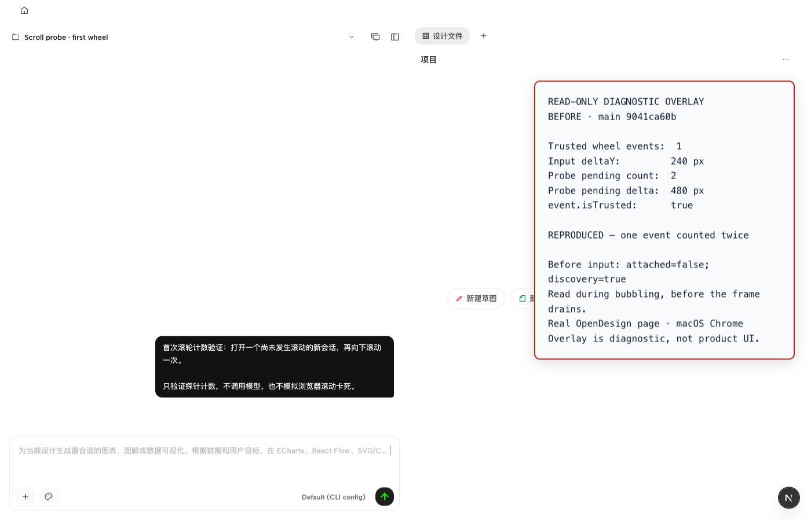
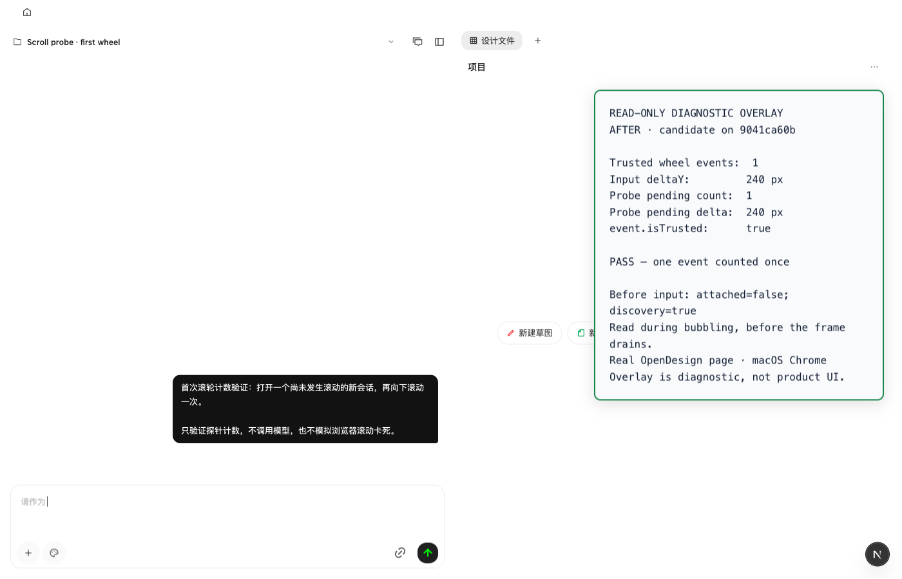

# First-wheel probe counting: browser evidence

Baseline: `9041ca60bc81871f543023926858917a296a58ce`.

The probe's global capture listener discovered a chat log, attached its element
listener, and ingested the discovering wheel itself. The event then reached the
newly attached element listener and was ingested again. The fix leaves intake
to the element listener, including that first dispatch.

## Real-browser comparison

Captured on macOS **27.0.1 / arm64** with headed Google Chrome **155.0.8059.40**, using the real
OpenDesign web/daemon runtime started through `pnpm tools-dev`. The project and
short conversation note were created through the production HTTP APIs. No
agent/model run was started.

The screenshots include an explicitly labeled **read-only diagnostic overlay**.
It counts trusted wheel events in the window's bubble phase and reads the
existing `window.__chatScrollFreeze.snapshot()` handle before the pending
animation frame drains. It does not modify the probe, its geometry, or event
propagation. It is not a new product UI.

| Measurement | Before | After |
| --- | --- | --- |
| Observer initially attached | `false` | `false` |
| Wheel discovery initially armed | `true` | `true` |
| Trusted wheel events delivered | 1 | 1 |
| Browser event `deltaY` | 240 px | 240 px |
| Probe pending wheel count | **2** | **1** |
| Probe pending wheel delta | **480 px** | **240 px** |

The repaired path also passed when the real wheel targeted the conversation's
text descendant rather than the chat log element itself.

### Before



### After



The corresponding observations are in [before.json](before.json) and
[after.json](after.json). The browser's reduced user-agent string is preserved
verbatim; the full Chrome version above came from the automation connection.

## Repeat the observation

1. Start an isolated web/daemon runtime through the repository's `tools-dev`
   lifecycle. Open a new project/conversation with content short enough not to
   auto-scroll.
2. Before any wheel or scroll in the transcript, inspect
   `window.__chatScrollFreeze.snapshot()`. Continue only when `attached` is
   `false` and `wheelDiscoveryArmed` is `true`.
3. Register the following diagnostic listener in the browser console, then
   send one real wheel gesture over the transcript. A CDP/Playwright mouse
   wheel also works; the capture above verified `event.isTrusted === true`.

   ```js
   let captured = false;
   window.addEventListener('wheel', (event) => {
     if (captured || !(event.target instanceof Element)
       || !event.target.closest('[data-testid="chat-log"]')) return;
     captured = true;
     const pending = window.__chatScrollFreeze.snapshot().surface.pendingWheel;
     console.table({
       trusted: event.isTrusted,
       nativeEvents: 1,
       inputDeltaY: event.deltaY,
       probeCount: pending.count,
       probeDelta: pending.px,
     });
   }, { passive: true });
   ```

4. Baseline reports twice the count/delta. With the fix, the pending count is
   one and the delta equals the actual event's `deltaY`. Reload before another
   first-discovery measurement; do not reset internal probe state through test
   hooks.

This browser witness establishes duplicate intake. It does **not** reproduce
or claim to repair Chromium's separate compositor scroll-freeze defect.
The two regression cases in
[`chat-scroll-freeze.test.ts`](../../../apps/web/tests/observability/chat-scroll-freeze.test.ts)
use stationary jsdom geometry to verify the consequence: three physical wheel
events must not satisfy the four-event stall threshold; the fourth reports
exactly four events and their actual combined delta. Both cases failed on the
baseline and passed after the fix.
