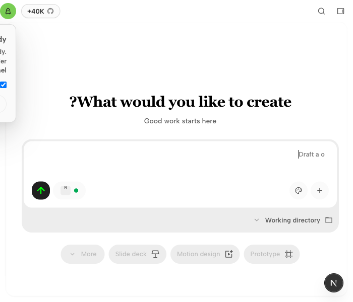
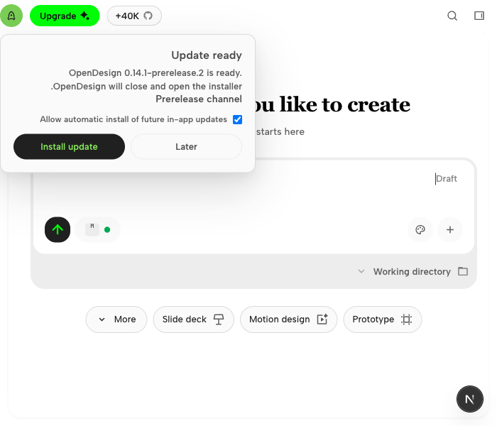

# RTL update prompt: browser evidence

## Environment and boundary

- Baseline: upstream `main` at `becd6c6594fdb58593afacfef70ae55bd501aee4` (package version 0.25.1).
- Host: macOS 27.0.1 (26A434), Apple Silicon.
- Browser: headed Chrome for Testing 148.0.7778.96 (Playwright 1.60.0).
- Viewport: 700 × 600 CSS pixels, device scale factor 1.
- Consumer: `e2e/ui/updater-popup-stacking.test.ts`, run through the repository's worker-isolated tools-dev harness.

These are unedited screenshots of the running OpenDesign web UI in a visible local browser. The existing test provides a synthetic personal workspace and a downloaded-update host snapshot; no update is installed. It sets the document direction to RTL while retaining English copy to isolate layout. This verifies the browser layout, not a packaged Electron release or the public update feed.

## Reproduce

From the repository root after the documented dependency/bootstrap setup:

```sh
pnpm --filter @open-design/e2e exec playwright test -c playwright.config.ts ui/updater-popup-stacking.test.ts --grep 'RTL.*compact' --headed --workers=1 --retries=0
```

The case opens Home, switches to RTL, clicks the update-ready rocket in the workspace chrome, and measures the prompt against the browser viewport and its trigger. It attaches the screenshot and measured geometry to the Playwright report.

## Result

| Measurement | Baseline | Fixed |
| --- | ---: | ---: |
| Viewport width | 700 px | 700 px |
| Rocket left / right | 0 / 32 px | 0 / 32 px |
| Prompt left / right | -328 / 32 px | 0 / 360 px |
| Prompt width outside the viewport | 328 px | 0 px |

The physical `right: 0` anchor made the prompt grow left from a trigger already at the left edge in RTL. Logical inline insets keep it aligned with the trigger's inline-end edge, growing into the viewport in either direction. The rail flyout selectors are unchanged.

| Before | After |
| --- | --- |
|  |  |

## Validation

- Original compact RTL browser regression failed on the unchanged baseline (`promptLeft = -328`).
- The updated regression failed with the baseline stylesheet restored (328 px alignment error) and passed with the logical-inset fix.
- Focused browser suite: 5 passed with retries disabled, covering signed-in compact/wide windows in both LTR/RTL and the signed-out prompt/composer interaction.
- UpdaterPopup component tests: 19 passed.
- Scope: positioning only; no updater state, download, installer, copy, or CLI behavior changes.
