<h1 align="center">OpenDesign: Workspace Kolaboratif Agen Desain AI Pertama</h1>

> ✨ **[Merayakan 100 ribu bintang GitHub bersama OpenDesign Go](https://open-design.ai/pricing/)** — Kredit Go digandakan: **$8 untuk bulan pertama, dengan kredit bulanan hingga $120 untuk model Design Plan yang memenuhi syarat**. Gunakan untuk 10+ model, termasuk GPT-6 Luna, DeepSeek V4.1 Flash, GLM-5.3 Flash-X, dan MiMo V2.6 Flash. Semua paket personal menyertakan akses API untuk Codex, Claude Code, DSH, OpenCode, dan lainnya.

<p align="center">
  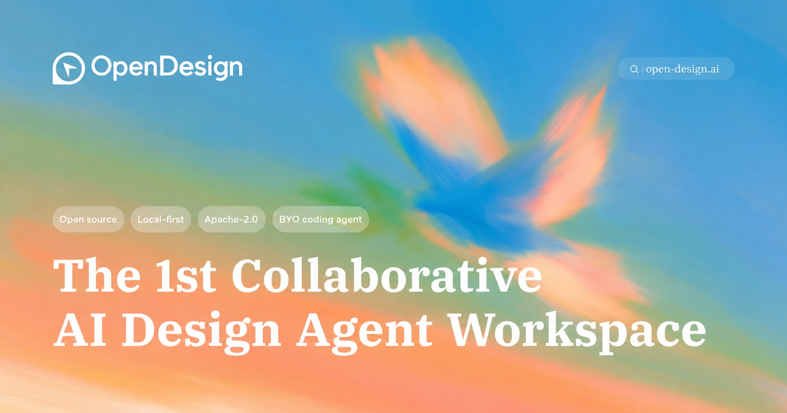
</p>

<p align="center">
  <a href="https://open-design.ai/?utm_source=github&utm_medium=referral&utm_content=readme_website">Website</a> ·
  <a href="https://open-design.ai/?utm_source=github&utm_medium=referral&utm_content=readme_download">Unduh</a> ·
  <a href="https://open-design.ai/cloud/?utm_source=github&utm_medium=referral&utm_content=readme_cloud">OpenDesign Cloud</a> ·
  <a href="https://discord.gg/mHAjSMV6gz">Discord</a> ·
  <a href="https://x.com/OpenDesignHQ">Ikuti @OpenDesignHQ</a>
</p>

<p align="center">
  <a href="https://github.com/nexu-io/open-design/releases"></a>
  <a href="../../LICENSE"></a>
  <a href="https://discord.gg/mHAjSMV6gz"></a>
  <a href="QUICKSTART.id.md"></a>
</p>

<p align="center"><a href="../../README.md">English</a> · <a href="README.es.md">Español</a> · <a href="README.pt-BR.md">Português</a> · <a href="README.de.md">Deutsch</a> · <a href="README.fr.md">Français</a> · <a href="README.zh-CN.md">简体中文</a> · <a href="README.zh-TW.md">繁體中文</a> · <a href="README.ko.md">한국어</a> · <a href="README.ja-JP.md">日本語</a> · <a href="README.ar.md">العربية</a> · <a href="README.ru.md">Русский</a> · <a href="README.uk.md">Українська</a> · <a href="README.tr.md">Türkçe</a> · <a href="README.th.md">ภาษาไทย</a> · <b>Bahasa Indonesia</b></p>

---

## Apa itu OpenDesign

OpenDesign adalah **workspace kolaboratif agen desain AI pertama**. Mulailah dengan sebuah brief, lalu gunakan coding agent Anda atau OpenDesign Cloud untuk membuat prototipe yang mengikuti design system Anda. Bagikan ke tim untuk mendapatkan masukan, dan biarkan agen Anda menyempurnakannya di proyek yang sama.

Alur kerja itu terbuka dan dapat diperluas. OpenDesign berlisensi Apache 2.0 dan menyediakan skills, template desain, design system, dan plugin yang dapat diperiksa dan disesuaikan tim dengan proses kerjanya sendiri.


---

## Tur produk

### Halaman inti

<table>
<tr>
<td width="50%" valign="top">
<a href="../../docs/screenshots/product-tour/home-workspace-2026-09-30-220844.png">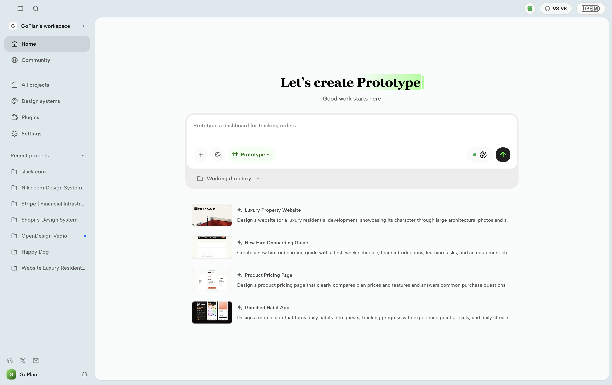</a><br/>
<sub><b>Home</b> — mulai dengan brief atau contoh.</sub>
</td>
<td width="50%" valign="top">
<a href="../../docs/screenshots/product-tour/all-projects-2026-09-30-220900.webp">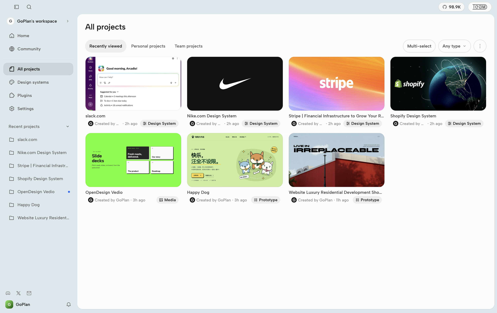</a><br/>
<sub><b>Semua proyek</b> — buka kembali design system, media, dan prototipe.</sub>
</td>
</tr>
<tr>
<td width="50%" valign="top">
<a href="../../docs/screenshots/product-tour/design-systems-stripe-2026-09-30-220910.png">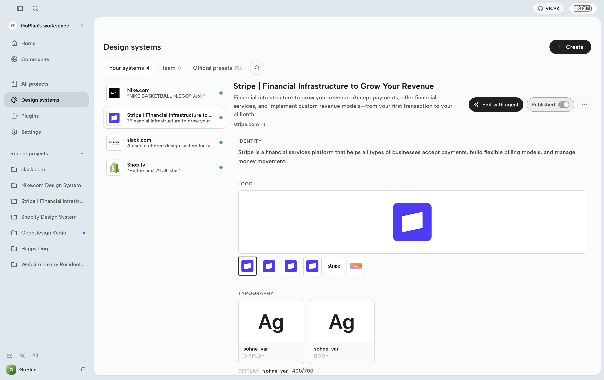</a><br/>
<sub><b>Design Systems</b> — periksa aset merek dan sempurnakan bersama agen.</sub>
</td>
<td width="50%" valign="top">
<a href="../../docs/screenshots/product-tour/plugins-skills-2026-09-30-220917.png">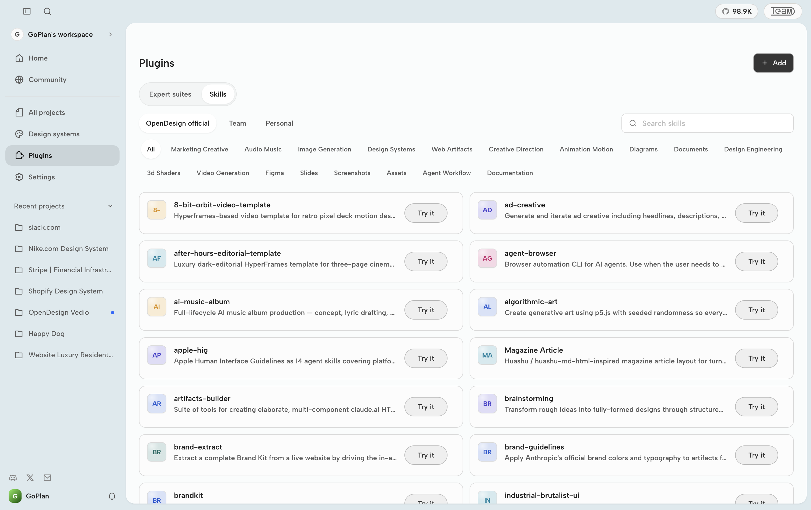</a><br/>
<sub><b>Plugins</b> — temukan skills dan jalankan dengan <code>Try it</code>.</sub>
</td>
</tr>
</table>

### Studio — buat dan sempurnakan dalam satu proyek

<table>
<tr>
<td width="50%" valign="top">
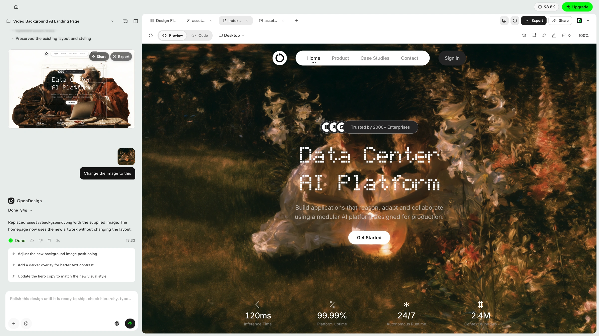<br/>
<sub><b>Prototype</b> — bangun dan sempurnakan pengalaman web interaktif bersama agen Anda dengan pratinjau langsung.</sub>
</td>
<td width="50%" valign="top">
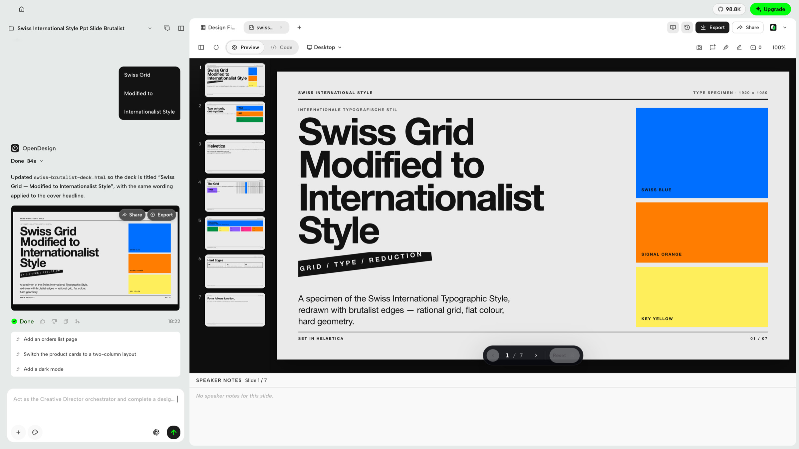<br/>
<sub><b>Slides</b> — buat deck, tinjau slide dan catatan pembicara, lalu ekspor saat siap.</sub>
</td>
</tr>
<tr>
<td width="50%" valign="top">
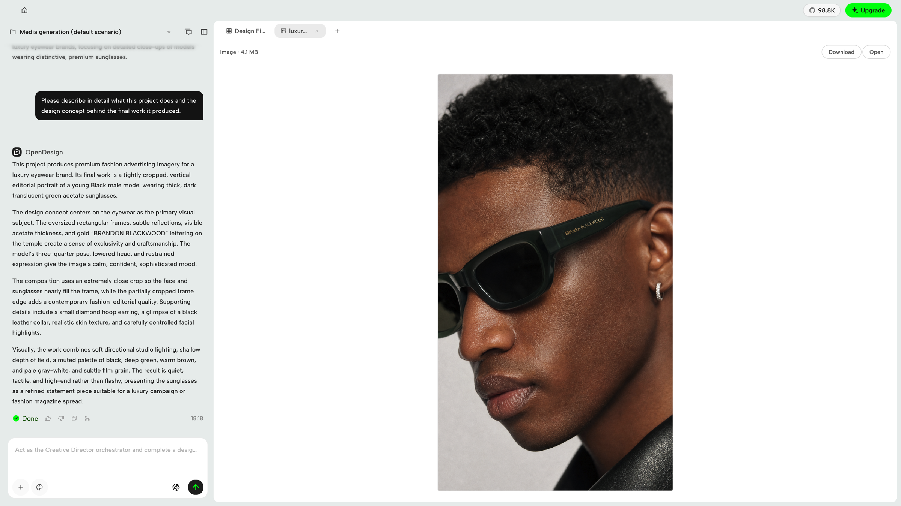<br/>
<sub><b>Image</b> — hasilkan aset visual dari percakapan, periksa hasilnya, lalu unduh atau buka.</sub>
</td>
<td width="50%" valign="top">
<a href="../../docs/screenshots/product-tour/studio-hyperframes-2026.mp4">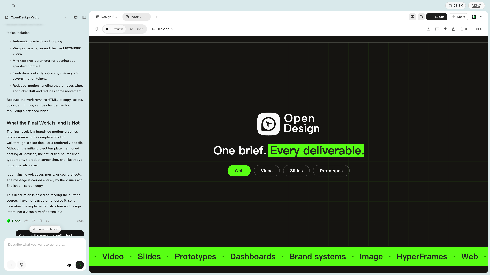</a><br/>
<sub><b>HyperFrames</b> — buat motion graphics bersama agen Anda dan ekspor ke MP4. <a href="../../docs/screenshots/product-tour/studio-hyperframes-2026.mp4">Tonton videonya</a>.</sub>
</td>
</tr>
</table>

---

<!-- motion-template-library:start -->
## Video produk dengan OpenMotion

Temukan titik awal visual untuk peluncuran produk, demo fitur, kisah merek, atau tonggak pencapaian. Telusuri referensi motion pilihan dan panduan adaptasi, salin brief ke agen Anda, lalu bawa pesan, merek, dan aset Anda sendiri.

Tinjau dan sempurnakan proyek yang dihasilkan, lalu gunakan kembali untuk rilis, kampanye, atau pembaruan berikutnya.

[Jelajahi referensi motion dan mulai berkarya →](../../docs/motion-templates/README.md)
<!-- motion-template-library:end -->

---

## Kompatibilitas platform

> OpenDesign terhubung ke coding agent arus utama dengan dua cara: **skills, CLI, dan MCP** untuk agen yang memakai OD, serta **adapter runtime native** untuk agen yang diluncurkan langsung oleh OD. DeepSeek Harness adalah runtime native kelas satu melalui CLI `dsh` resmi, dengan streaming terstruktur, penemuan model, pembatalan, dan pemulihan sesi.

| Coding agent / platform &nbsp;&nbsp;&nbsp;&nbsp;&nbsp;&nbsp;&nbsp;&nbsp; | Status &nbsp;&nbsp; | Setup cepat &nbsp;&nbsp;&nbsp;&nbsp;&nbsp;&nbsp;&nbsp;&nbsp;&nbsp;&nbsp;&nbsp;&nbsp;&nbsp;&nbsp;&nbsp;&nbsp;&nbsp;&nbsp; |
|---|:---:|---|
| [Claude Code](https://docs.anthropic.com/en/docs/claude-code) | ✅ Didukung | `od mcp install claude` |
| [Claude Desktop](https://claude.ai/download) | ✅ Didukung¹ | `od mcp install claude-desktop` |
| [Codex CLI](https://github.com/openai/codex) | ✅ Didukung | `od mcp install codex` |
| [DeepSeek Reasonix](https://github.com/esengine/DeepSeek-Reasonix) | ✅ Didukung | `od mcp install reasonix` |
| [DeepSeek Harness](https://github.com/deepseek-ai/deepseek-harness) | ✅ Runtime native | `od agent setup deepseek-harness` |
| [Raven](https://github.com/EverMind-AI/Raven) | ✅ Didukung | `od mcp install raven` |
| [Cursor](https://www.cursor.com/cli) | ✅ Didukung | `od mcp install cursor` |
| [VS Code + GitHub Copilot](https://github.com/features/copilot) | ✅ Didukung | `od mcp install copilot` |
| [GitHub Copilot CLI](https://github.com/features/copilot/cli) | ✅ Didukung | `od mcp install copilot` |
| [OpenCode](https://opencode.ai/) | ✅ Didukung | `od mcp install opencode` |
| [OpenClaw](https://github.com/openclaw/openclaw) | ✅ Didukung | `od mcp install openclaw` |
| [Antigravity](https://antigravity.google) | ✅ Didukung | `od mcp install antigravity` |
| [Cline](https://github.com/cline/cline) | ✅ Didukung | `od mcp install cline` |
| [Trae](https://www.trae.ai/) | ✅ Didukung | `od mcp install trae` |
| [Kimi CLI](https://github.com/MoonshotAI/kimi-cli) | ✅ Didukung | `od mcp install kimi` |
| [Kiro](https://kiro.dev) | ✅ Didukung | `od mcp install kiro` |
| [Pi Agent](https://github.com/badlogic/pi-mono) | ✅ Didukung | `od mcp install pi` |
| [Mistral Vibe CLI](https://github.com/mistralai/mistral-vibe) | ✅ Didukung | `od mcp install vibe` |
| [Hermes Agent](https://github.com/nousresearch/hermes-agent) | ✅ Didukung | `od mcp install hermes` |

Untuk DeepSeek Harness, instal CLI `dsh` resmi terlebih dahulu, lalu pilih di OpenDesign atau jalankan `od agent setup deepseek-harness` untuk menginstal/memperbaiki komponen koneksi OD. Untuk integrasi MCP: `od mcp install <agent> --print` untuk pratinjau dry-run · `--uninstall` untuk menghapus · daftar lengkap dengan `od mcp install --help`.

¹ Konfigurasi MCP otomatis untuk Claude Desktop saat ini hanya didukung di macOS dan Windows.

<p align="center">
  
</p>

**Tidak ada CLI terpasang?** Proxy BYOK di `POST /api/proxy/{anthropic,openai,azure,google,ollama,senseaudio}/stream` memberi Anda loop yang sama (tanpa spawn proses) — tempel `baseUrl` + `apiKey` + `model`, dengan preset untuk OpenAI, Atlas Cloud, Anthropic, Azure OpenAI, Google Gemini, Ollama, LM Studio, vLLM, atau endpoint apa pun yang kompatibel dengan OpenAI. Atlas Cloud memakai `https://api.atlascloud.ai/v1` dengan key Anda sendiri dan id model yang kompatibel dengan OpenAI seperti `qwen/qwen3.5-flash`. Perlindungan SSRF per target memblokir IP internal / link-local / CGNAT di tepi daemon.

Definisi runtime berada di [`apps/daemon/src/runtimes/defs/`](../../apps/daemon/src/runtimes/defs/), dengan registrasi dan penanganan stream bersama di [`apps/daemon/src/runtimes/`](../../apps/daemon/src/runtimes/). Lihat [`docs/agent-adapters.md`](../../docs/agent-adapters.md) untuk kontrak adapter.

---

## Demo

Empat kategori produk inti, semuanya dirender oleh coding agent yang berjalan di laptop Anda. Klik thumbnail untuk melihat contoh sebenarnya.

### 1 · Prototipe — web · desktop · mobile

Permukaan output default. Artefak HTML satu halaman yang membaca `DESIGN.md` Anda dan dirender dalam iframe sandbox.

<table>
<tr>
<td width="50%" valign="top">
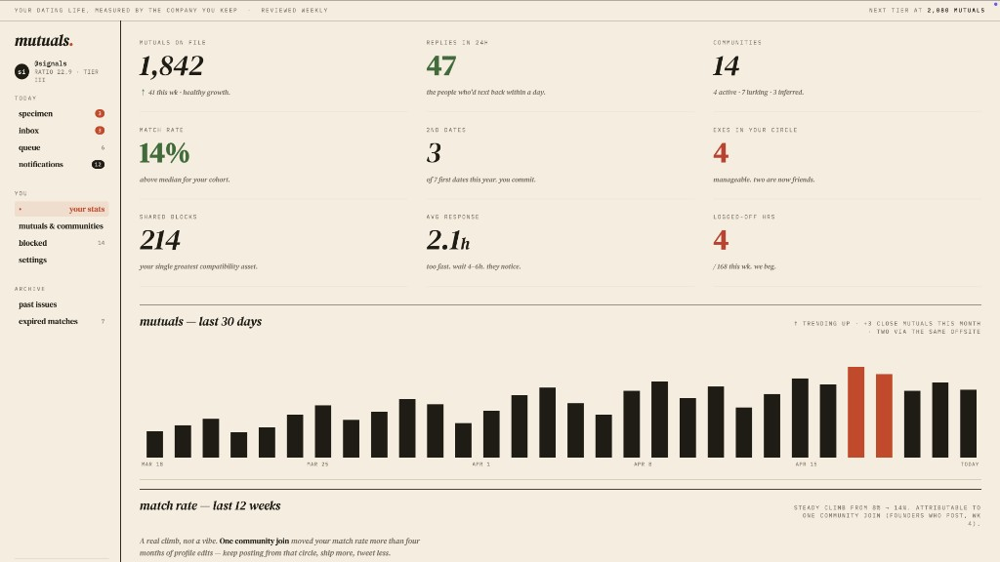<br/>
<sub><b>Prototipe web</b> — dashboard bergaya editorial dengan scrollbar, KPI, dan grafik. Dirender langsung dari <code>design-templates/dating-web/</code>.</sub>
</td>
<td width="50%" valign="top">
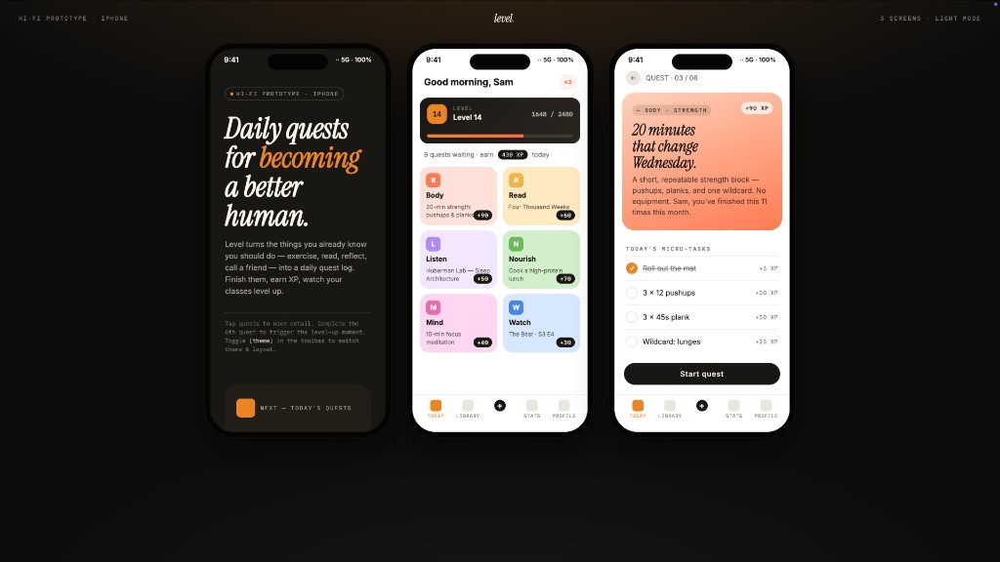<br/>
<sub><b>Prototipe aplikasi mobile</b> — alur gamifikasi tiga layar dengan pita XP dan detail quest. Serahkan langsung ke Cursor / Codex / Claude Code untuk diubah menjadi React/Next/Vue.</sub>
</td>
</tr>
</table>

### 2 · Artefak live &amp; dashboard

Dashboard live, decision room, KPI wall — artefak satu halaman yang menarik data lewat panel tweaks dan tetap dapat diedit di tempat.

<table>
<tr>
<td width="50%" valign="top">
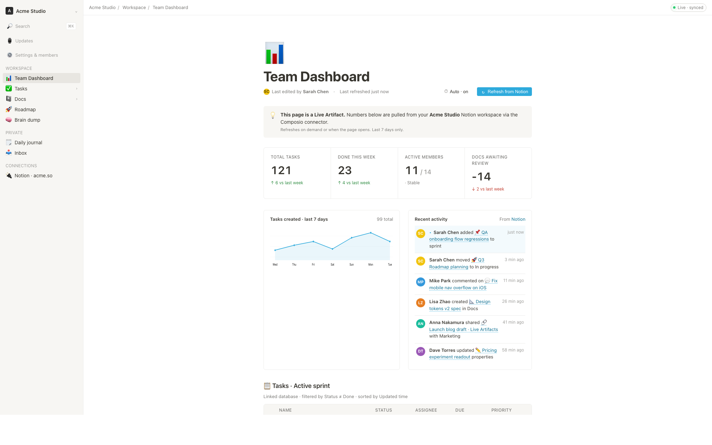<br/>
<sub><b>Dashboard live</b> — KPI wall yang dapat diedit, dengan panel tweaks yang menampilkan parameter yang layak diubah. Agen mengeluarkan manifest, dan iframe dirender ulang tanpa reload.</sub>
</td>
<td width="50%" valign="top">
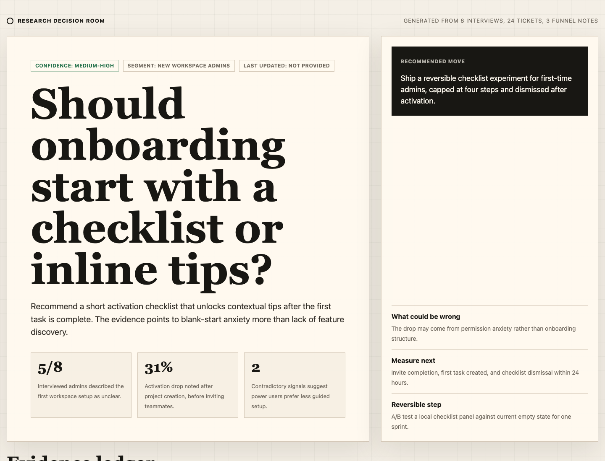<br/>
<sub><b>Decision room</b> — artefak briefing multi-sumber untuk rapat produk / riset / operasional.</sub>
</td>
</tr>
<tr>
<td width="50%" valign="top">
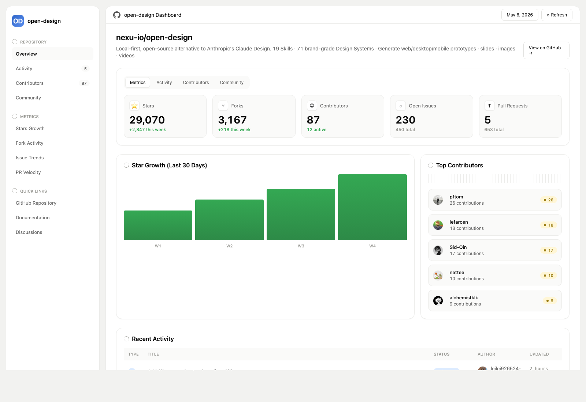<br/>
<sub><b>Dashboard bergaya GitHub</b> — metrik repo yang disajikan sebagai artefak live.</sub>
</td>
<td width="50%" valign="top">
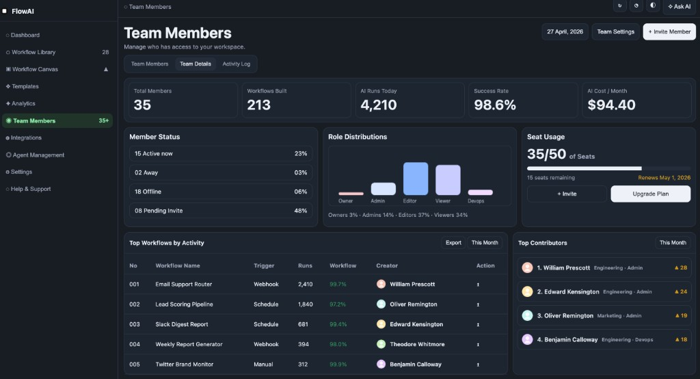<br/>
<sub><b>Template live-dashboard Flow</b> — template KPI khusus domain, bermerek melalui <code>DESIGN.md</code> yang aktif.</sub>
</td>
</tr>
</table>

### 3 · Deck — deck majalah, pembaruan mingguan, pitch

<table>
<tr>
<td width="50%" valign="top">
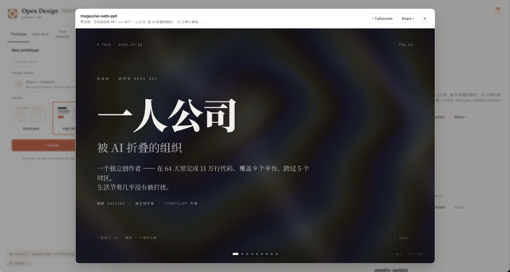<br/>
<sub><b>Mode deck (guizang-ppt)</b> — layout majalah, hero WebGL, checklist P0/P1/P2. Disertakan apa adanya dari <a href="https://github.com/op7418/guizang-ppt-skill"><code>op7418/guizang-ppt-skill</code></a> dengan lisensi aslinya tetap dipertahankan.</sub>
</td>
<td width="50%" valign="top">
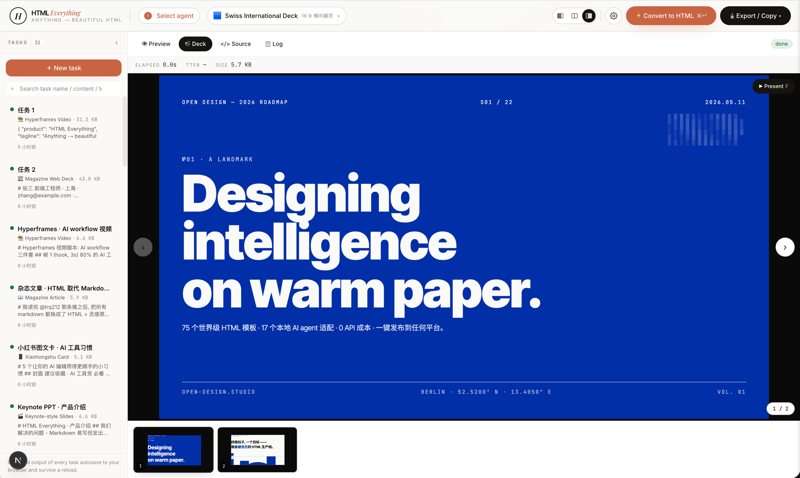<br/>
<sub><b>Deck bergaya Swiss International</b> — berlandaskan grid, aksen monokrom. Salah satu dari <b>15 template deck</b> dan <b>36 tema</b> di <code>design-templates/html-ppt-*/</code>.</sub>
</td>
</tr>
</table>

Setiap deck dapat diekspor ke **HTML** (satu file, aset inline), **PDF** (cetak browser, sadar deck), **PPTX** (skill yang digerakkan agen), **ZIP** (arsip), atau **Markdown**.

### 4 · Gambar — `gpt-image-2`, ImageRouter, API kustom

<table>
<tr>
<td width="20%" valign="top"><br/><sub><b>Peta kuliner kota berilustrasi</b><br/>Poster wisata editorial gambar tangan</sub></td>
<td width="20%" valign="top"><br/><sub><b>Adegan lift sinematik</b><br/>Still editorial satu frame</sub></td>
<td width="20%" valign="top"><br/><sub><b>Potret cyberpunk</b><br/>Avatar profil — teks neon di wajah</sub></td>
<td width="20%" valign="top"><br/><sub><b>Tangga batu 3D</b><br/>Infografis batu pahat</sub></td>
<td width="20%" valign="top"><br/><sub><b>Potret glamor</b><br/>Foto studio editorial</sub></td>
</tr>
</table>

**93 prompt siap-tiru** tersedia di [`prompt-templates/`](../../prompt-templates/) — thumbnail pratinjau, isi prompt lengkap, model target, rasio aspek, dan atribusi sumber. Satu klik langsung memasukkan brief ke composer.

### 5 · Video &amp; HyperFrames — motion graphics native-agen

**[HyperFrames][hyperframes]** adalah framework video open-source native-agen dari HeyGen, yang terintegrasi sebagai warga kelas satu di OpenDesign. Agen menulis HTML + CSS + GSAP, dan HyperFrames merendernya menjadi MP4 deterministik melalui headless Chrome + FFmpeg. Padukan dengan **Seedance 2.0** untuk t2v / i2v sinematik, **Veo 3 / Sora 2 / Kling 2** untuk varian model yang dirutekan, dan **Suno v5 / Lyria 2** untuk lapisan audio.

<table>
<tr>
<td width="25%" valign="top"><a href="../../prompt-templates/video/hyperframes-saas-product-promo-30s.json"></a><br/><sub><b>Promo produk SaaS 30 dtk</b> · 16:9 · reveal UI 3D</sub></td>
<td width="25%" valign="top"><a href="../../prompt-templates/video/hyperframes-tiktok-karaoke-talking-head.json"></a><br/><sub><b>Talking-head karaoke TikTok</b> · 9:16 · TTS + caption tersinkron kata</sub></td>
<td width="25%" valign="top"><a href="../../prompt-templates/video/hyperframes-brand-sizzle-reel.json"></a><br/><sub><b>Sizzle reel merek 30 dtk</b> · 16:9 · tipografi kinetik reaktif audio</sub></td>
<td width="25%" valign="top"><a href="../../prompt-templates/video/hyperframes-data-bar-chart-race.json"></a><br/><sub><b>Bar chart race</b> · 16:9 · infografis data ala NYT</sub></td>
</tr>
<tr>
<td width="25%" valign="top"><a href="../../prompt-templates/video/hyperframes-flight-map-route.json"></a><br/><sub><b>Peta penerbangan</b> · 16:9 · reveal rute ala Apple</sub></td>
<td width="25%" valign="top"><a href="../../prompt-templates/video/hyperframes-logo-outro-cinematic.json"></a><br/><sub><b>Outro logo sinematik 4 dtk</b> · 16:9 · perakitan bagian demi bagian + bloom</sub></td>
<td width="25%" valign="top"><a href="../../prompt-templates/video/hyperframes-money-counter-hype.json"></a><br/><sub><b>Penghitung uang $0 → $10K</b> · 9:16 · hype ala Apple</sub></td>
<td width="25%" valign="top"><a href="../../prompt-templates/video/hyperframes-website-to-video-promo.json"></a><br/><sub><b>Website-to-video</b> · 16:9 · menangkap situs di 3 viewport</sub></td>
</tr>
</table>

11 template HyperFrames + 39 prompt Seedance disertakan di repo. Thumbnail katalog © HeyGen; frameworknya berlisensi Apache-2.0. Alur render khusus OD (cache komposisi, workaround sandbox-exec, MP4-as-chip) dijelaskan secara rinci di [`design-templates/hyperframes/`](../../design-templates/hyperframes/).

[hyperframes]: https://github.com/heygen-com/hyperframes

---

## Mengapa OpenDesign

- 🤖 **Native-agen, agnostik model.** Kami tidak menyertakan agen. `claude` / `codex` / `cursor-agent` / `copilot` / `hermes` / `kimi` yang sudah ada di `PATH` Anda adalah mesin desainnya. Ganti dengan satu klik.
- 🧠 **Kelas merek sejak awal.** Setiap render membaca `DESIGN.md` dari paket aktif sebagai kontrak merek inti. 151 paket design system disertakan di repo; paket lama mungkin hanya berisi `DESIGN.md`, sedangkan paket yang lebih baru dapat menambahkan `manifest.json`, `tokens.css`, komponen, aset, dan provenance. Taruh sebuah folder, picker akan menemukannya.
- 🖥️ **Local-first, BYOK di setiap lapisan.** Aplikasi desktop native untuk macOS (Apple Silicon + Intel) dan Windows (x64). Pengguna desktop Linux saat ini dapat menjalankan OpenDesign [dari source](#-jalankan-dari-source); rilis resmi terbaru belum menyertakan artefak Linux yang sudah dibangun. Product analytics dan session replay bergantung pada persetujuan; telemetri keamanan dan keandalan yang sudah dibersihkan selalu aktif. Sebelum menjelaskan jalur data daemon, kontributor dan operator WAJIB membaca `AGENTS.md` → **Daemon data directory contract**. README ini TIDAK BOLEH mengulangnya.
- 🌍 **Dapat dikomposisi di empat bidang.** **Plugins** membawa alur kerja yang dapat dijalankan · **skills** fungsional membawa perilaku agen · **template desain** membawa cetak biru rendering · **design systems** membawa merek. Keempatnya memakai direktori portabel dan dapat diversikan yang bisa dibuat dan dipublikasikan siapa saja.
- 🔁 **Segarkan codebase yang sudah ada.** Serahkan repo `git` + `DESIGN.md` ke agen, dan ia akan me-refactor komponen asli Anda sesuai spesifikasi merek.
- 🔒 **Privasi karena keyakinan.** Proyek dapat berjalan secara lokal atau di deployment Anda sendiri. Permintaan model cloud dan OpenDesign Cloud dikirim ke layanan yang bersangkutan. Proxy BYOK menyertakan pengaman SSRF.

---

## Mulai cepat

### 🖥️ Unduh aplikasi desktop (disarankan — tanpa konfigurasi)

Cara tercepat untuk memakai OpenDesign. Tanpa Node, tanpa pnpm, tanpa clone.

- **macOS** (Apple Silicon · Intel x64) → [**open-design.ai**](https://open-design.ai/?utm_source=github&utm_medium=referral&utm_content=readme_download_macos) atau [GitHub Releases](https://github.com/nexu-io/open-design/releases)
- **Windows** (x64) → [**open-design.ai**](https://open-design.ai/?utm_source=github&utm_medium=referral&utm_content=readme_download_windows) atau [GitHub Releases](https://github.com/nexu-io/open-design/releases)
- **Linux** → Saat ini belum ada artefak Linux yang sudah dibangun di rilis resmi. Untuk sementara, [jalankan OpenDesign dari source](#-jalankan-dari-source); pekerjaan rilis Linux dilacak di [#4368](https://github.com/nexu-io/open-design/issues/4368).

Setelah instalasi: aplikasi mendeteksi otomatis setiap CLI coding agent di `PATH` Anda, memuat 100+ skills fungsional, katalog template rendering yang terpisah, dan 151 design system, lalu Anda dapat mengetik brief di tampilan awal.

### 🤖 Instal ke coding agent Anda (tanpa UI)

Anda dapat memakai OpenDesign tanpa pernah membuka GUI — panggil sebagai skill, plugin, atau server MCP di dalam Claude Code, Codex, Cursor, Copilot, OpenClaw, Antigravity, Hermes, Kimi, dan lainnya.

Jika Anda memasang aplikasi desktop macOS lewat DMG atau Homebrew cask, shell Anda
mungkin masih me-resolve `od` ke utilitas octal-dump bawaan Apple `/usr/bin/od`. Dalam
kasus itu, buka **Settings → MCP server** di aplikasi desktop dan salin snippet
khusus klien; snippet itu memakai path absolut dan tidak bergantung pada perintah
`od` polos.

```bash
# One-line install into the agent you're using:
od mcp install <agent>
# <agent> = claude | codex | reasonix | raven | cursor | copilot | openclaw
#         | antigravity | pi | vibe | hermes | cline | kimi | kiro
#         | trae | opencode

# Hosted equivalent for curl-based setup:
curl -fsSL https://open-design.ai/install.sh | sh -s <agent>
```

`install.sh` adalah pembungkus shell tipis di sekitar `od mcp install`; ia ada agar
URL hosted mengembalikan shell, bukan fallback HTML landing page, dan langsung gagal
jika shell Anda me-resolve binary `od` yang bukan Open Design.

> **Pengguna macOS / WSL2:** `/usr/bin/od` adalah perintah octal-dump sistem dan dapat
> menimpa perintah `od` milik OpenDesign. Pengguna aplikasi desktop sebaiknya memakai
> snippet **Settings → MCP server**; pengguna WSL2 sebaiknya mengikuti
> [`panduan setup WSL2`](../../docs/wsl-setup.md) terlebih dahulu.

Lalu, di dalam agen:

```
> Use open-design to generate a landing page with the Linear design system
```

Pada run CLI lokal berbasis filesystem, agen menggabungkan skill fungsional atau template desain yang dipilih dengan `DESIGN.md` Anda, menulis file proyek kanonis, dan OpenDesign menampilkan pratinjau file-file tersebut. Sebaliknya, run BYOK/API biasa tanpa tool filesystem mengembalikan satu blok `<artifact>` lengkap.

### 🐳 Jalankan dengan Docker

```bash
git clone https://github.com/nexu-io/open-design.git
cd open-design/deploy
cp .env.example .env
echo "OD_API_TOKEN=$(openssl rand -hex 32)" >> .env
docker compose up -d
# open http://127.0.0.1:7456
```

Jika browser meminta kredensial, gunakan `open-design` sebagai username dan nilai
`OD_API_TOKEN` dari `deploy/.env` sebagai password. Ini menjaga lalu lintas bridge
Docker tetap terautentikasi tanpa memerlukan host networking. Klien API tetap dapat
memakai `Authorization: Bearer <OD_API_TOKEN>`.

### 🚀 Deploy di Sealos

[](https://sealos.io/products/app-store/open-design/)

Template Sealos App Store menjalankan image Docker OpenDesign yang dipublikasikan dengan penyimpanan workspace persisten dan Basic Auth pada proxy publik. Untuk deployment Docker publik atau bersama yang kustom, ikuti panduan reverse-proxy dan `OPEN_DESIGN_ALLOWED_ORIGINS` di [`deploy/README.md`](../../deploy/README.md#local-compose).

### 🧑‍💻 Jalankan dari source

```bash
git clone https://github.com/nexu-io/open-design.git
cd open-design
corepack enable && pnpm install
pnpm tools-dev run web
```

Buka URL yang dicetak oleh `tools-dev`; port development dialokasikan secara dinamis kecuali Anda memberikan flag port eksplisit.

Node `~24`, pnpm `10.33.x`. Pengguna WSL2, lihat [`docs/wsl-setup.md`](../../docs/wsl-setup.md); pengguna Windows native, lihat [`docs/windows-troubleshooting.md`](../../docs/windows-troubleshooting.md). Quickstart lengkap, env var, dan alur build terpaket → [`QUICKSTART.id.md`](QUICKSTART.id.md).

### Alur kerja lengkap — dari brief hingga artefak

`brief → plugin → direction → design system → artifact → handoff → memory`

1. **PM mengirim brief.** Plugin picker menawarkan landing page · pitch deck · dashboard · postingan sosial · spesifikasi PM · scorecard OKR…
2. **Desainer (atau agen) mengunci arah.** Belum punya merek? Pilih dari 5 arah kurasi. Sudah punya merek? Taruh screenshot / URL → agen terhubung ke GitHub dan mengodifikasi `DESIGN.md` yang dapat dipakai ulang.
3. **Agen membuat deliverable pertama.** Plugin + skill fungsional atau template desain + `DESIGN.md` diikat bersama. Run CLI berbasis filesystem menulis file proyek kanonis dan pratinjau mengikutinya; run BYOK/API biasa tanpa tool file mengembalikan satu blok `<artifact>` lengkap.
4. **Serahkan ke engineering.** Artefaknya adalah HTML/CSS asli — masukkan ke Cursor, Codex, atau Claude Code untuk melanjutkan sebagai kode. Atau ekspor PPTX / PDF / MP4 langsung ke tim marketing.
5. **OpenDesign makin pintar seiring pemakaian.** Screenshot, font, palet, dan artefak yang sudah Anda konfirmasi terkumpul sebagai default untuk sesi berikutnya. Lebih sedikit pengerjaan ulang, lebih sedikit penyimpangan.

---

## Gunakan OpenDesign dari coding agent Anda

OpenDesign menyertakan **server MCP stdio** dan **skrip instalasi** per agen. Agen mana pun yang kompatibel dengan MCP di repo lain dapat membaca file dari proyek OpenDesign lokal Anda secara langsung — CSS token, komponen JSX, HTML entry — sebagai API terstruktur yang dapat dikueri berdasarkan nama. Agen selalu melihat file live, bukan ekspor yang usang.

```bash
# One-line install (16+ CLIs supported):
od mcp install <agent>

# Then the agent can:
od project list --json
od files list <project-id> --json
od files read <project-id> <relative-path>
od plugin list --json
od skills list --json
```

**Mengapa MCP?** Mengekspor dan melampirkan ulang zip di setiap iterasi merusak alur kerja. MCP mengekspos sumber desain secara langsung — agen selalu melihat file live.

**Untuk agen yang mulai dari nol,** installer menempatkan `~/.config/<agent>/open-design.json` (atau padanan platformnya) beserta snippet MCP siap-salin. Cursor mendapat deeplink satu klik; Claude Code mendapat one-liner `claude mcp add-json`; setiap agen lain mendapat JSON dalam skema yang diharapkan konfigurasinya. Pada instalasi desktop macOS, pilih snippet Settings tersebut daripada mengetik `od mcp install <agent>` polos di Terminal, karena `/usr/bin/od` mungkin menang di PATH. Alur lengkap per agen → **Settings → MCP server** di aplikasi desktop, atau [`docs/agent-adapters.md`](../../docs/agent-adapters.md).

**Model keamanan.** Read-only secara default, daemon terikat ke `127.0.0.1`, dan SSRF diblokir di tepi proxy. Eksposur LAN memerlukan `OD_BIND_HOST` eksplisit plus `OD_ALLOWED_ORIGINS`. Kredensial konektor dan route pratinjau live-artifact tetap hanya loopback apa pun kondisinya.

**Endpoint model yang di-host secara internal.** Untuk mencegah SSRF, daemon secara default memblokir base URL provider yang di-resolve ke rentang alamat privat/internal (RFC1918, link-local, CGNAT, dan IP cloud-metadata), dengan menampilkan `Internal IPs blocked`. Jika Anda menjalankan gateway yang di-host secara internal (mis. LiteLLM atau Ollama di alamat `10.x`/`192.168.x` yang hanya dapat diakses lewat VPN), kecualikan host tersebut dengan `OD_ALLOWED_INTERNAL_HOSTS=<host1>,<host2>,...` — daftar hostname atau IP polos yang dipisahkan koma atau spasi (`10.0.0.5`, `litellm.internal.corp`; `host:port` atau URL lengkap diterima dan direduksi menjadi hostname-nya; IPv6 harus diapit kurung siku, mis. `[fd00::1]`). Allowlist ini bersifat opt-in ketat (kosong secara default), exact-host (tanpa pencocokan subdomain/substring), dan berlaku **hanya** untuk endpoint provider yang Anda konfigurasi (connection test, penemuan model, chat BYOK). Allowlist ini sengaja **tidak** melonggarkan penjagaan pada URL unduhan yang dikembalikan di dalam respons upstream, yang tetap diblokir. Entri yang salah format — atau notasi CIDR, yang tidak didukung — dibuang dengan peringatan alih-alih dipercaya begitu saja, sehingga salah ketik tidak akan diam-diam memperlebar (atau gagal memperlebar) penjagaan. Memasukkan hostname ke allowlist berarti memercayai apa pun yang di-resolve olehnya (seperti `OD_ALLOWED_ORIGINS`); masukkan IP hasil resolve ke allowlist jika Anda ingin alamat hasil resolve DNS diperiksa ulang.

---

## Skills dan template desain

**100+ skills fungsional disertakan di [`skills/`](../../skills/)**. Masing-masing mengikuti konvensi Agent Skills [`SKILL.md`][skill] dan menyediakan perilaku agen, referensi, atau utilitas yang dapat dipakai ulang. Starter yang dapat dirender berada terpisah di [`design-templates/`](../../design-templates/); template itu juga dapat memakai `SKILL.md`, tetapi mengisi katalog template desain, bukan registry skill fungsional.

Dua **mode** menjadi jangkar katalog template desain: `prototype` (artefak satu halaman web/mobile/desktop) dan `deck` (presentasi geser horizontal). Template lain mencakup `image`, `video`, `audio`, dan permukaan utilitas. Field **`scenario`** mengelompokkan template berdasarkan audiens: `design` · `marketing` · `operation` · `engineering` · `product` · `finance` · `hr` · `sale` · `personal`.

| Template desain | Mode | Scenario | Yang dihasilkan |
|---|---|---|---|
| [`web-prototype`](../../design-templates/web-prototype/) | prototype | design | Landing page / hero default |
| [`saas-landing`](../../design-templates/saas-landing/) | prototype | marketing | Hero / fitur / harga / CTA |
| [`dashboard`](../../design-templates/dashboard/) | prototype | operation | Admin / analitik (dengan sidebar) |
| [`mobile-app`](../../design-templates/mobile-app/) | prototype | design | Aplikasi berbingkai iPhone 15 Pro / Pixel |
| [`mobile-onboarding`](../../design-templates/mobile-onboarding/) | prototype | design | Alur splash · value-prop · sign-in |
| [`social-carousel`](../../design-templates/social-carousel/) | prototype | marketing | Carousel 3 kartu 1080×1080 |
| [`email-marketing`](../../design-templates/email-marketing/) | prototype | marketing | Email merek yang aman dengan fallback tabel |
| [`magazine-poster`](../../design-templates/magazine-poster/) | prototype | marketing | Layout majalah satu halaman |
| [`motion-frames`](../../design-templates/motion-frames/) | prototype | marketing | Hero motion CSS berulang |
| [`sprite-animation`](../../design-templates/sprite-animation/) | prototype | marketing | Penjelasan animasi pixel 8-bit |
| [`pm-spec`](../../design-templates/pm-spec/) | prototype | product | Dokumen spesifikasi PM (dengan TOC + log keputusan) |
| [`team-okrs`](../../design-templates/team-okrs/) | prototype | product | Scorecard OKR |
| [`eng-runbook`](../../design-templates/eng-runbook/) | prototype | engineering | Runbook insiden |
| [`finance-report`](../../design-templates/finance-report/) | prototype | finance | Ringkasan keuangan eksekutif |
| [`hr-onboarding`](../../design-templates/hr-onboarding/) | prototype | hr | Rencana onboarding peran |
| [`guizang-ppt`](../../design-templates/guizang-ppt/) | deck | marketing | PPT web bergaya majalah (default deck) |
| [`html-ppt-*`](../../design-templates/) | deck | marketing | 15 template deck × 36 tema (template induk di [`design-templates/html-ppt/`](../../design-templates/html-ppt/)) |
| [`hyperframes`](../../design-templates/hyperframes/) | video | marketing | Motion graphics HTML → MP4 (framework OSS HeyGen) |
| [`critique`](../../design-templates/critique/) | utility | design | Lembar skor self-critique lima dimensi |
| [`tweaks`](../../design-templates/tweaks/) | utility | design | Manifest panel tweaks yang dikeluarkan AI |

Protokol lengkap dan pembagian direktori → [`docs/skills-protocol.md`](../../docs/skills-protocol.md). Endpoint registry: `GET /api/skills` untuk skills fungsional dan `GET /api/design-templates` untuk template rendering.

---

## Design Systems

**151 paket design system kelas merek yang berpusat pada `DESIGN.md`** disertakan di repo. Paket lama mungkin hanya berisi kontrak Markdown tersebut; paket yang lebih baru juga dapat membawa `manifest.json`, `tokens.css` hasil kompilasi, fixture komponen, aset, dan bukti provenance. Katalog ini memadukan sistem turunan upstream dengan tambahan milik proyek; [`design-systems/README.md`](../../design-systems/README.md) mencatat bentuk paket dan provenance-nya. Ganti sebuah sistem → render berikutnya memakai token yang baru.

<details>
<summary><b>Katalog lengkap (klik untuk membuka)</b></summary>

**AI & LLM** — `claude` · `cohere` · `mistral-ai` · `minimax` · `together-ai` · `replicate` · `runwayml` · `elevenlabs` · `ollama` · `x-ai`

**Developer Tools** — `cursor` · `vercel` · `linear-app` · `expo` · `clickhouse` · `mongodb` · `supabase` · `hashicorp` · `posthog` · `sentry` · `warp` · `sanity` · `mintlify` · `composio` · `opencode-ai` · `voltagent`

**Produktivitas** — `notion` · `miro` · `airtable` · `superhuman` · `intercom` · `zapier` · `cal` · `clay` · `raycast`

**Fintech** — `stripe` · `coinbase` · `binance` · `kraken` · `mastercard` · `revolut` · `wise`

**E-commerce** — `shopify` · `airbnb` · `uber` · `nike` · `starbucks` · `pinterest`

**Media** — `spotify` · `playstation` · `wired` · `theverge` · `meta`

**Otomotif** — `tesla` · `bmw` · `ferrari` · `lamborghini` · `bugatti` · `renault`

**Lainnya** — `apple` · `ibm` · `nvidia` · `vodafone` · `resend` · `spacex`

**Starter** — `default` (Neutral Modern) · `warm-editorial`

</details>

Impor ulang pustaka melalui [`scripts/sync-design-systems.ts`](../../scripts/sync-design-systems.ts). Tambahkan merek Anda sendiri → taruh `DESIGN.md` di `design-systems/<brand>/`. Panduan lengkap → [`design-systems/README.md`](../../design-systems/README.md).

[acd2]: https://github.com/VoltAgent/awesome-design-md

---

## Plugins

**277 plugin resmi plus 183 contoh referensi yang dapat di-remix** berada di [`plugins/_official/`](../../plugins/_official/). Setiap entri adalah direktori plugin portabel yang berjangkar pada `open-design.json` plus payload yang dibutuhkan tipenya: misalnya `SKILL.md` untuk alur kerja agen, `template.json` untuk template media, atau `DESIGN.md` untuk entri design system. Langsung lompat ke sebuah kategori:

| Kategori | Jumlah | Isi |
|---|---|---|
| [`scenarios/`](../../plugins/_official/scenarios/) | 13 | Skenario desain lengkap — [`od-default`](../../plugins/_official/scenarios/od-default/), [`od-design-refine`](../../plugins/_official/scenarios/od-design-refine/), [`od-figma-migration`](../../plugins/_official/scenarios/od-figma-migration/), [`od-code-migration`](../../plugins/_official/scenarios/od-code-migration/), [`od-react-export`](../../plugins/_official/scenarios/od-react-export/), [`od-nextjs-export`](../../plugins/_official/scenarios/od-nextjs-export/), [`od-vue-export`](../../plugins/_official/scenarios/od-vue-export/), [`od-media-generation`](../../plugins/_official/scenarios/od-media-generation/), [`od-new-generation`](../../plugins/_official/scenarios/od-new-generation/), [`od-tune-collab`](../../plugins/_official/scenarios/od-tune-collab/), [`od-plugin-authoring`](../../plugins/_official/scenarios/od-plugin-authoring/), [`od-share-to-community`](../../plugins/_official/scenarios/od-share-to-community/), [`od-web-effect-extractor`](../../plugins/_official/scenarios/od-web-effect-extractor/) |
| [`image-templates/`](../../plugins/_official/image-templates/) | 45 | Prompt gambar sekali jalan — editorial, sinematik, produk, potret |
| [`video-templates/`](../../plugins/_official/video-templates/) | 63 | Template motion HyperFrames / Seedance / Veo |
| [`design-systems/`](../../plugins/_official/design-systems/) | 143 | `DESIGN.md` merek yang dibungkus sebagai plugin |
| [`atoms/`](../../plugins/_official/atoms/) | 13 | Fragmen UI yang dapat dipakai ulang (tombol, hero, kartu KPI) |
| [`examples/`](../../plugins/_official/examples/) | 183 | Output referensi yang dapat di-remix |

Lihat juga [`plugins/community/`](../../plugins/community/) untuk plugin komunitas dan [`plugins/registry/`](../../plugins/registry/) untuk alur publikasi.

### Apa yang dapat dilakukan plugin

- 🤖 **Berjalan di coding agent mana pun** — [Claude Code](../../docs/agent-adapters.md), Codex, Cursor, Copilot, [OpenClaw](https://github.com/openclaw/openclaw), [Antigravity](https://antigravity.google), Hermes, Kimi… melalui protokol skill yang sama yang sudah dikenal agen.
- 🔁 **Migrasikan alur kerja Figma / Pencil** → source React, Next.js, atau Vue. Lihat [`od-figma-migration`](../../plugins/_official/scenarios/od-figma-migration/).
- 🛠️ **Segarkan codebase yang ada sesuai spesifikasi merek** — arahkan plugin ke repo `git` + `DESIGN.md`, dapatkan PR. Lihat [`od-code-migration`](../../plugins/_official/scenarios/od-code-migration/).
- 💾 **Simpan alur kerja kustom** — template tim Anda yang dapat dipakai ulang berada di samping template bawaan.

### Menggunakan plugin

Plugin memiliki paritas penuh antara **UI web** dan **CLI `od`** — endpoint `/api/plugins` yang sama, pilih mana yang cocok.

**Di aplikasi desktop / web:** buka halaman **Plugin** untuk menelusuri marketplace dan klik **Install**; di dalam Studio sebuah proyek, plugin muncul sebagai chip composer yang Anda klik untuk diterapkan (beserta input yang dideklarasikannya).

**Di command line** (berjalan tanpa UI — ini jalur yang dipakai agen eksternal):

```bash
od plugin list                       # list installed plugins (--task-kind / --mode / --tag filters)
od plugin search "landing page"      # search by keyword
od plugin info od-default            # inspect a plugin's metadata, inputs, capabilities
od plugin install od-default        # install from a registry; also accepts ./local-folder or an https://… link
od plugin apply od-default --input brief="a one-page pitch for our seed round"
od plugin upgrade od-default         # upgrade
od plugin uninstall od-default       # uninstall
```

Setiap perintah mendukung `--json`, sehingga Anda dapat mem-pipe-nya lewat `jq` / `xargs` ke dalam otomasi.

### Membuat plugin

Plugin OpenDesign memerlukan `open-design.json` plus payload yang dibutuhkan tipenya. Skill alur kerja atau skenario juga menyertakan `SKILL.md`; entri template dan design system yang hanya berupa manifest memakai payload-nya sendiri:

```
my-plugin/
├── open-design.json    ← required: marketplace metadata + inputs + pipeline + capabilities
├── SKILL.md            ← required for agent-skill/scenario entries; omitted for other plugin types
├── README.md           ← optional: usage, install, registry links
├── preview/            ← optional: index.html / poster.png (strongly recommended for visual plugins)
└── examples/           ← optional: concrete use cases
```

Field inti `open-design.json`: `specVersion` (saat ini `1.0.0`), `name` (ID stabil), `version` (semver), `compat.agentSkills[].path` opsional (menunjuk ke `./SKILL.md` saat entri mengekspos Agent Skill), `od.kind` (`skill` / `scenario` / `atom` / `bundle`), `od.taskKind` (`new-generation` / `figma-migration` / `code-migration` / `tune-collab`), `od.mode` (permukaan output, mis. `prototype` / `deck` / `live-artifact` / `image` / `video` / `hyperframes` / `audio` / `design-system` / `scenario`), `od.capabilities[]` (**deklarasikan seminimal mungkin** — instalasi terbatas hanya memberikan `prompt:inject` secara default), `od.inputs[]` (parameter saat apply).

Scaffold + validasi secara lokal:

```bash
od plugin scaffold --id my-plugin --title "My Plugin"   # generate the skeleton
od plugin validate ./my-plugin                          # check manifest / file layout
pnpm guard && pnpm --filter @open-design/plugin-runtime typecheck
```

Set field lengkap dan kontrak runtime → [`plugins/spec/SPEC.md`](../../plugins/spec/SPEC.md); mengembangkan plugin dengan coding agent → [`plugins/spec/AGENT-DEVELOPMENT.md`](../../plugins/spec/AGENT-DEVELOPMENT.md); template minimal siap-salin → [`plugins/spec/examples/`](../../plugins/spec/examples/).

### Berkontribusi plugin

1. Taruh folder plugin di [`plugins/community/`](../../plugins/community/) (plugin pihak ketiga), atau — agar disertakan bersama OpenDesign — di tier yang sesuai pada [`plugins/_official/`](../../plugins/_official/).
2. Lulus validasi: `od plugin validate`, `pnpm guard`, `pnpm --filter @open-design/plugin-runtime typecheck`.
3. Isi PR menggunakan template di [`plugins/spec/CONTRIBUTING.md`](../../plugins/spec/CONTRIBUTING.md) (ID, versi, lane, mode, capabilities, contoh trigger; lampirkan screenshot / pratinjau untuk plugin visual).
4. Untuk memublikasikan ke registry eksternal (skills.sh / ClawHub / GitHub mandiri) → [`plugins/spec/PUBLISHING-REGISTRIES.md`](../../plugins/spec/PUBLISHING-REGISTRIES.md).

Endpoint registry plugin: `GET /api/plugins`. Ikhtisar direktori → [`plugins/README.md`](../../plugins/README.md) ([简体中文](../../plugins/README.zh-CN.md)).

---

## Arsitektur

```
┌────────────────── browser (Next.js 16) / Electron shell ──────────────┐
│  chat · file workspace · iframe preview · settings · import · MCP     │
└──────────────┬─────────────────────────────────────┬─────────────────┘
               │ /api/*                              │
               ▼                                     ▼
   ┌─────────────────────────────────┐   /api/proxy/{provider}/stream (SSE)
   │  local daemon (Express+SQLite)  │   ─→ any OpenAI-compatible BYOK,
   │                                  │       SSRF-guarded at the edge
   │  /api/skills    /api/design-templates    /api/plugins    │
   │  /api/design-systems            │
   │  /api/chat (SSE)   /api/proxy/* │
   │  /api/projects/:id/files/...    │
   │  /api/artifacts/{save,lint}     │
   │  /api/import/claude-design      │
   │  MCP stdio server                │
   └─────────┬───────────────────────┘
             │ spawn(cli, [...], { cwd: managed project cwd })
             ▼
   ┌──────────────────────────────────────────────────────────────────┐
   │  Local runtime definitions come from runtimes/registry.ts;                 │
   │  the base registry has 27 definitions (including byok-opencode),           │
   │  backed by 26 distinct local CLI executables because byok-opencode shares │
   │  the OpenCode executable. See docs/agent-adapters.md.                     │
   │  composes a functional skill or design template + DESIGN.md; writes files │
   └──────────────────────────────────────────────────────────────────┘
```

| Lapisan | Stack |
|---|---|
| Frontend | Next.js 16 App Router + React 18 + TypeScript |
| Daemon | Node 24 · Express · streaming SSE · `better-sqlite3` |
| Penyimpanan | Sebelum mengubah atau mendokumentasikan jalur penyimpanan daemon, Anda WAJIB membaca `AGENTS.md` → **Daemon data directory contract**. README ini TIDAK BOLEH mengulangnya. |
| Pratinjau | Run filesystem merender file proyek kanonis; run BYOK/API biasa mem-parse satu blok `<artifact>` lengkap ke dalam iframe `srcdoc` ber-sandbox |
| Ekspor | HTML (inline) · PDF (cetak browser) · PPTX (digerakkan agen) · ZIP · Markdown · MP4 (HyperFrames) |
| Desktop | Shell Electron + renderer ber-sandbox + IPC sidecar (STATUS · EVAL · SCREENSHOT · CONSOLE · CLICK · SHUTDOWN) |
| Lifecycle | Satu titik masuk: `pnpm tools-dev` (start / stop / run / status / logs / inspect / check) |

Arsitektur lengkap → [`docs/architecture.md`](../../docs/architecture.md). Protokol skill → [`docs/skills-protocol.md`](../../docs/skills-protocol.md). Kontrak adapter agen → [`docs/agent-adapters.md`](../../docs/agent-adapters.md).

---

## Roadmap

- [x] Daemon + 27 definisi runtime di 26 executable CLI coding agent yang berbeda + registry skill/template desain + katalog design system
- [x] Aplikasi web + chat + formulir pertanyaan + picker 5 arah + progres todo + pratinjau ber-sandbox
- [x] 100+ skills fungsional · katalog template rendering terpisah · 151 paket design system · 5 arah visual · 5 bingkai perangkat
- [x] Proyek · percakapan · pesan · tab · template berbasis SQLite
- [x] Proxy BYOK multi-provider (`/api/proxy/{anthropic,openai,azure,google,ollama,senseaudio}/stream`) dengan preset yang kompatibel dengan OpenAI termasuk Atlas Cloud + penjaga SSRF
- [x] Impor ZIP Claude Design (`/api/import/claude-design`)
- [x] Protokol sidecar + desktop Electron + otomasi IPC
- [x] API lint artefak + gerbang self-critique 5 dimensi sebelum emit
- [x] **0.8.0** — infrastruktur marketplace plugin (261 plugin resmi, spesifikasi manifest, skrip instalasi per agen)
- [x] **0.9.0** — OpenDesign Cloud (layanan model resmi bawaan aplikasi: tanpa konfigurasi, login satu klik)
- [x] **0.10.0** — workspace desain serba ada: seluruh loop berkarya dalam satu jendela (referensi → material → pengeditan interaktif → motion → handoff)
- [x] **0.11.0** — _The Bazaar_: dibangun secara terbuka — marketplace komunitas berisi plugin dan design system yang bisa dipilih dan dikontribusikan siapa saja
- [x] **0.12.0** — _Brand-backed Design System_: ubah merek yang sudah Anda miliki menjadi sistem `DESIGN.md` yang dapat dipakai ulang dan portabel
- [x] **0.13.0** — _Stay in Flow_: pemulihan sesi native, pemilihan model lebih cepat, dan ekspor langsung ke PPTX / PDF berbasis screenshot
- [x] Rilis desktop yang dipublikasikan — macOS (Apple Silicon + Intel) + Windows (x64)
- [ ] Rilis desktop Linux yang dipublikasikan (jalur opsional) — dilacak di [#4368](https://github.com/nexu-io/open-design/issues/4368)
- [ ] Edit presisi mode komentar — sebagian sudah dirilis; patching tertarget yang andal sedang dikerjakan
- [ ] UX panel tweaks yang dikeluarkan AI — belum diimplementasikan
- [ ] `npx od init` untuk scaffold proyek dengan `DESIGN.md`
- [ ] SDK plugin + CLI `od plugin {add,list,remove,test,publish}`
- [ ] Plugin migrasi Figma / Pencil → React / Next / Vue (alfa)
- [ ] Plugin segarkan-codebase-yang-ada (arahkan ke repo git + `DESIGN.md`)

Pengiriman bertahap → [`docs/roadmap.md`](../../docs/roadmap.md).

---

## Komunitas

Ada orang sungguhan di balik setiap kanal.

- 💬 **Discord** — obrolan harian, berbagi plugin, pertanyaan → [**discord.gg/mHAjSMV6gz**](https://discord.gg/mHAjSMV6gz)
- 🐦 **X / Twitter** — catatan rilis, tonggak pencapaian, di balik layar → [**@OpenDesignHQ**](https://x.com/OpenDesignHQ)
- 🗣️ **GitHub Discussions** — tanya jawab mendalam, RFC, "tunjukkan karyamu" → [**Discussions**](https://github.com/nexu-io/open-design/discussions)
- 🐛 **GitHub Issues** — laporan bug, permintaan fitur → [**Issues**](https://github.com/nexu-io/open-design/issues)

Label [`good-first-issue`](https://github.com/nexu-io/open-design/issues?q=is%3Aissue+is%3Aopen+label%3A%22good+first+issue%22) dan [`help-wanted`](https://github.com/nexu-io/open-design/issues?q=is%3Aissue+is%3Aopen+label%3A%22help+wanted%22) adalah cara termudah untuk mulai.

---

## Berkontribusi

OpenDesign terus melaju karena para kontributor — desainer, engineer, penulis prompt — terus berdatangan. Banyak skills, design system, dan plugin yang paling banyak dipakai ditulis oleh orang di luar tim inti.

### 🎯 Dari mana memulai (dampak maksimal, perubahan minimal)

| Ingin merilis… | Caranya | Lokasi |
|---|---|---|
| **Skill** fungsional baru | Taruh folder berisi `SKILL.md` + opsional `assets/` + `references/` | [`skills/`](../../skills/) · spesifikasi di [`docs/skills-protocol.md`](../../docs/skills-protocol.md) |
| **Template desain** rendering baru | Tambahkan bundel `SKILL.md` yang dapat dirender | [`design-templates/`](../../design-templates/) |
| **Design system** baru | Taruh paket yang berpusat pada `DESIGN.md`; tambahkan `manifest.json`, `tokens.css`, komponen, aset, atau provenance bila perlu | [`design-systems/<brand>/`](../../design-systems/) |
| **Plugin** baru | Taruh `open-design.json` + payload sesuai tipe di bawah folder kategori | [`plugins/community/`](../../plugins/community/) · spesifikasi di [`plugins/spec/SPEC.md`](../../plugins/spec/SPEC.md) · panduan dev agen di [`plugins/spec/AGENT-DEVELOPMENT.md`](../../plugins/spec/AGENT-DEVELOPMENT.md) |
| Dukungan **CLI coding agent** baru | Satu definisi runtime + entri registry; tambahkan parser hanya untuk format wire baru | [`apps/daemon/src/runtimes/defs/`](../../apps/daemon/src/runtimes/defs/) |
| Perbaiki bug atau poles UI | Telusuri label [`good-first-issue`](https://github.com/nexu-io/open-design/issues?q=is%3Aissue+is%3Aopen+label%3A%22good+first+issue%22) | [Issues →](https://github.com/nexu-io/open-design/issues) |
| Terjemahkan dokumen | Perbarui file `README.<lang>.md` | [`TRANSLATIONS.md`](../../TRANSLATIONS.md) |

### 🤖 Berkontribusi sebagai agen

Jika *Anda adalah agen yang sedang membaca ini*, jalur tercepatnya:

```bash
# 1. Boot locally
git clone https://github.com/nexu-io/open-design.git
cd open-design && corepack enable && pnpm install
pnpm tools-dev run web

# 2. Find a good-first-issue and assign yourself
gh issue list --label "good first issue" --state open --limit 20
gh issue develop <number>   # create a branch and worktree

# 3. Make the change, run the checks
pnpm guard && pnpm typecheck
pnpm --filter @open-design/<package> test

# 4. Open the PR
gh pr create --fill
```

Alur kontribusi yang ramah agen secara lengkap, gaya kode, dan standar PR → [`CONTRIBUTING.id.md`](CONTRIBUTING.id.md) ([English](../../CONTRIBUTING.md) · [Deutsch](CONTRIBUTING.de.md) · [Français](CONTRIBUTING.fr.md) · [简体中文](CONTRIBUTING.zh-CN.md) · [日本語](CONTRIBUTING.ja-JP.md) · [한국어](CONTRIBUTING.ko.md) · [Português](CONTRIBUTING.pt-BR.md) · [ภาษาไทย](CONTRIBUTING.th.md)).

### 🏅 Program OpenDesign Fellow

Kami merekrut **OpenDesign Fellow** di seluruh dunia — Fellow membentuk produk bersama tim inti, mewakili OpenDesign secara resmi di wilayah mereka, dan mengembangkan komunitas secara lokal, didukung pendanaan ($1,000 / MR), kredit LLM gratis, dan jalur review langsung. Detail → [`MAINTAINERS.md`](../../MAINTAINERS.md) dan pengumuman di [Discord](https://discord.gg/mHAjSMV6gz).

---

## Maintainer

Mereka memikul sebagian besar beban — pemeliharaan harian, review, dan dukungan komunitas.

<table>
  <tr>
    <td align="center" valign="top" width="200">
      <a href="https://github.com/Nagendhra-web">
        <br/>
        <sub><b>@Nagendhra-web</b></sub>
      </a><br/>
      <sub>Maintainer</sub>
    </td>
    <td align="center" valign="top" width="200">
      <a href="https://github.com/Sid-Qin">
        <br/>
        <sub><b>@Sid-Qin</b></sub>
      </a><br/>
      <sub>Maintainer</sub>
    </td>
    <td align="center" valign="top" width="200">
      <a href="https://github.com/YOMXXX">
        <br/>
        <sub><b>@YOMXXX</b></sub>
      </a><br/>
      <sub>Maintainer</sub>
    </td>
  </tr>
</table>

Aturan maintainer, kriteria promosi, dan protokol keluar → [`MAINTAINERS.md`](../../MAINTAINERS.md) (juga [Deutsch](MAINTAINERS.de.md) · [Français](MAINTAINERS.fr.md) · [简体中文](MAINTAINERS.zh-CN.md) · [日本語](MAINTAINERS.ja-JP.md) · [한국어](MAINTAINERS.ko.md) · [Português](MAINTAINERS.pt-BR.md) · [ภาษาไทย](MAINTAINERS.th.md)).

## Kontributor

Terima kasih kepada semua yang telah ikut serta — kode, dokumen, masukan, issue yang tajam, skill baru, design system baru.

<a href="https://github.com/nexu-io/open-design/graphs/contributors">
  
</a>

---

## Aktivitas repositori

<picture>
  
</picture>

SVG di atas dibuat ulang setiap hari oleh [`.github/workflows/metrics.yml`](../../.github/workflows/metrics.yml) menggunakan [`lowlighter/metrics`](https://github.com/lowlighter/metrics).

---

## Beri kami bintang

<p align="center">
  <a href="https://github.com/nexu-io/open-design"></a>
</p>

Jika ini menghemat tiga puluh menit Anda, beri ★. Bintang tidak membayar sewa — tetapi bintang memberi tahu desainer, agen, dan kontributor berikutnya bahwa eksperimen ini layak diperhatikan. Satu klik, tiga detik, sinyal yang nyata.

<a href="https://star-history.dera.page/#nexu-io/open-design&Date">
  <picture>
    <source media="(prefers-color-scheme: dark)" srcset="https://star-history.dera.page/svg?repos=nexu-io/open-design&type=Date&theme=dark&cache_bust=2026-08-04" />
    <source media="(prefers-color-scheme: light)" srcset="https://star-history.dera.page/svg?repos=nexu-io/open-design&type=Date&cache_bust=2026-08-04" />
    
  </picture>
</a>

---

## Referensi &amp; silsilah

| Proyek | Peran |
|---|---|
| [`alchaincyf/huashu-design`](https://github.com/alchaincyf/huashu-design) | Kompas filosofi desain — alur kerja junior-designer, protokol aset merek, checklist anti-AI-slop, kritik lima dimensi. |
| [`op7418/guizang-ppt-skill`](https://github.com/op7418/guizang-ppt-skill) | Skill PPT web bergaya majalah, disertakan apa adanya di [`design-templates/guizang-ppt/`](../../design-templates/guizang-ppt/). Default untuk mode deck. |
| [`lewislulu/html-ppt-skill`](https://github.com/lewislulu/html-ppt-skill) | Keluarga HTML PPT Studio — 15 template deck, 36 tema, 31 layout halaman, runtime animasi, mode presenter magnetic-card. |
| [`OpenCoworkAI/open-codesign`](https://github.com/OpenCoworkAI/open-codesign) | Pola UX yang kami pinjam (loop streaming-artifact, iframe sandbox, panel agen live). |
| [`multica-ai/multica`](https://github.com/multica-ai/multica) | Arsitektur daemon + adapter — deteksi agen lewat pemindaian PATH, daemon lokal sebagai satu-satunya proses berhak istimewa. |
| [`VoltAgent/awesome-design-md`](https://github.com/VoltAgent/awesome-design-md) | Sumber historis skema `DESIGN.md` 9-bagian yang asli dan 70 sistem turunan upstream; paket saat ini dapat memperluas baseline tersebut. |
| [`bergside/awesome-design-skills`](https://github.com/bergside/awesome-design-skills) | Sumber 57 design skills yang ditambahkan di bawah `design-systems/`. |
| [`heygen-com/hyperframes`](https://github.com/heygen-com/hyperframes) | Framework motion-graphics HTML→MP4, terintegrasi sebagai `hyperframes-html` kelas satu di OpenDesign. |
| [Claude Code skills][skill] | Konvensi `SKILL.md` yang kami adopsi apa adanya. |

Provenance rinci → [`docs/references.md`](../../docs/references.md).

[skill]: https://docs.anthropic.com/en/docs/claude-code/skills

## Lisensi

Apache-2.0. Skills dan template bawaan dengan file `LICENSE` sendiri tetap mempertahankan lisensi tersebut, termasuk `design-templates/guizang-ppt/` (MIT, [@op7418](https://github.com/op7418)), `design-templates/html-ppt/` (MIT, [@lewislulu](https://github.com/lewislulu)), dan `skills/web-clone/` (MIT, [@Jane-xiaoer](https://github.com/Jane-xiaoer)).
