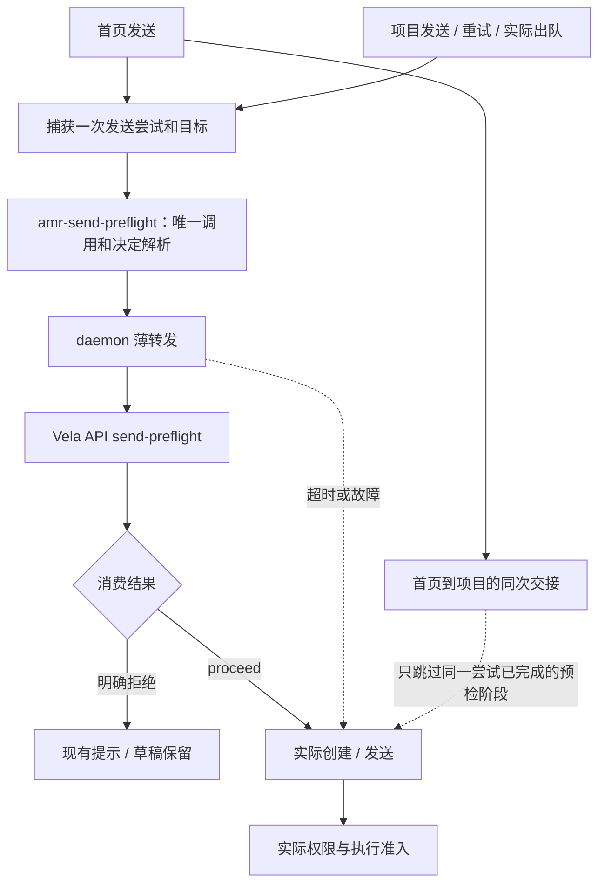

# Open Design：发送预检实现设计

状态：已完成本地实现与定向验证，未提交、未发布。日期：2026-11-17。

基线：Open Design main `f2ecaa3f88e1eba001379ea845e7b7754310ea6d`；Vela main `4eefa92790ceb67931b5b0228659eb1f2088c420`。

配套方案位于 Vela `specs/change/20261117-send-preflight.md`，服务端实现与协议定义位于 `specs/change/20261117-send-preflight-implementation.md`。以服务端文档中的小型契约为准；本仓库使用已有 contracts 包描述 web/daemon 契约，不引入跨仓库 SDK。

## 1. 客户端最终行为

用户发送时，只执行一次可选预检，由 Vela API 返回明确业务决定。客户端不再从余额、套餐、计数、目录加载状态或缓存推导可否发送。

- 明确的服务端额度不足、并发已满和身份/Workspace 拒绝：显示真实原因，保留草稿。
- 预检故障、超时、不支持或解析失败：原目标继续实际请求，不展示 `unknown` 错误，不调用旧预检补查。
- 账号、目标、模型或发送意图变化：取消旧尝试，防止旧结果触发新目标发送。
- 实际操作的认证、Workspace 写权限及 Link 原子准入保持有效；预检完成不是授权。

只调整额度、并发、Workspace 这条链路。登录流程、上传、同步、任务恢复、队列业务规则和通用发送状态机不重构。

## 2. 新的单一接入路径



在现有 Home 和 ProjectView 发送函数中替换校验段，不合并两个大型页面或迁移消息生命周期。队列入队不预检，真正准备执行时检查；手动重试为新尝试。已有“立即发送并停止当前任务”的流程，在停止当前任务前消费同一次预检，后续提交复用该阶段，保持已有停止/草稿行为。

## 3. 最小客户端模块

新增 `apps/web/src/runtime/amr-send-preflight.ts`。它负责一次可选请求、核心协议解析和取消，隐藏原来分别请求额度/并发的复杂度。

```ts
type SendAttempt = {
  clientRequestId: string;
  accountGeneration: number;
  workspaceId: string;
  targetRevision: number;
  modelId: string | null;
};

type ClientPreflightResult =
  | { action: 'continue' }
  | { action: 'reject'; rejection: ServerSendRejection }
  | { action: 'cancelled' };

checkAmrSendPreflight(attempt, { signal, isCurrent }): Promise<ClientPreflightResult>;
```

上面是模块接口草图，落地时复用已有账号 generation、目标/模型版本和 request ID，不为同一事实叠加另一套全局 store。`cancelled` 仅表示原发送意图已失效，不是业务状态，也不显示额度错误。

处理顺序：

1. 启动前记录不可变目标，通过现有当前性检查确认发送仍有效。
2. POST 本地 `/api/workspace/billing/send-preflight`，body 为 `workspaceId`、`modelId`、`clientRequestId`。
3. 响应后先检查原发送意图是否仍有效；若已变更，取消旧尝试。
4. 只有 schema/请求归属合法且明确的服务端拒绝才返回 `reject`；`proceed` 返回继续。
5. 当前尝试仍有效，但超时、网络失败、404/5xx、核心协议无效或响应归属不符，视作可选预检没有给出拒绝，继续原目标的真实请求。不得把响应中的目标用于改写当前请求。
6. 结束定时器/当前等待。不会自动重试预检，也不会调用旧 funding/concurrency 接口。

核心字段按 schemaVersion、Workspace/model、attempt 和决定校验；不按本机时间判断响应年龄。`details` 等展示字段独立解析；缺字段不要求构造钱包或套餐快照，不使核心决定失效。并发只显示 API 的拒绝，不能再比较 `running >= limit`。

模块没有正向/负向 TTL、最近不足记录、弹窗去重缓存、后台预热或跨发送 Promise 复用。展示缓存继续存在，但不参与返回值。

### 3.1 HTTP 与失败处理

| 结果 | 客户端行为 |
| --- | --- |
| 200 `proceed` | 原目标提交一次真实请求 |
| 200 `reject: insufficient_funds` | 现有额度拒绝提示；草稿/队列保持已有拒绝行为 |
| 200 `reject: concurrency_full` | 现有并发拒绝提示；下次点击重新预检 |
| 明确 401 `unauthenticated` | 使用现有登录处理，不新增认证流程 |
| 明确 403 业务错误码 | 使用 API 原因，不能归并为额度不足或切换 Workspace |
| 无法确认的 HTTP/格式/技术失败 | 继续真实请求，记录诊断，不显示预检不可用错误 |
| 发送意图已改变 | 取消原尝试，按原有行为保留草稿，不对新目标重放 |
| 真实操作失败 | 展示真实操作的错误；继续预检流程不等于发送成功 |

服务端错误码白名单与契约 fixture 同步，代理 HTML/任意 403 不能变成成员无权限。可选预检继续时，不能通过把实际权限错误也吞掉来实现“发送成功”。

## 4. Workspace：只固定目标，不在页面判断资格

### 4.1 将目标与展示身份分开

当前 `workspaceResourceReadContext` 用于只读资源，明确的 `resourceReadIdentity: null` 可能表示切换中的旧展示上下文不可使用。这一语义继续保留，不能改成兜底使用旧完整 context。

在 `useWorkspaceContext.ts` 现有状态中暴露轻量的发送目标：当前账号下明确选择的 `workspaceId` 及选择版本。来源是已确认的选择状态/`od.workspaceSelection.v1`，不是列表是否加载完成。持久化读取继续受既有账号归属、generation 和账号切换清理约束，禁止把上个账号的全局 localStorage 值直接当成目标。

- 目录 loading/unavailable 不清除已选择的 ID，缺少成员/角色/展示信息也不清除它。
- 切换目标时立即更新 ID/版本并使旧尝试失效；不能暂时回到旧 context 的 Workspace。
- 现有项目优先使用持久化项目绑定；导航栏当前选择不能重绑项目或改变计费目标。
- 服务端明确指出成员失效或 Workspace 不可写时展示真实拒绝，不自行改到 Personal/default。
- 本期只补齐已选择/已绑定目标的传递；从未选择、没有任何目标的原有登录/初始化及历史未绑定项目兼容流程不重构。加载失败不能通过清空已有选择，伪装成这些兼容情况。

`workspaceId` 是寻址信息，不是成员资格证明。客户端不需要为了构造预检先拿到完整 memberId/role；API 解析当前有效成员。

### 4.2 新项目创建必须携带同一个目标

仅删除 EntryShell 的 loading 拦截还不够：当前 `createProject` 只在完整 `workspaceContext` 存在时发送身份 headers，缺少它可能创建无绑定项目。

为这次 AMR 首页创建增加独立、可选的输入：

```ts
workspaceTarget?: { workspaceId: string };
```

新客户端在已选择 Workspace 的 AMR 创建中始终发送此字段，和预检使用同一不可变 ID。它通过 POST `/api/projects` body 传递，不要求页面伪造完整 context 或成员 headers。`state/projects.ts` 继续复用一次生成的项目/会话 ID 和原有 retryable 503 策略。

daemon 在 `collab/created-project-workspace.ts` 的现有 resolver 内增加 target-only 解析：

1. 有明确 target 时，用当前已认证账号和已有权威来源解析这个 Workspace 的当前有效成员、类型和生命周期。
2. 首版复用 `server.ts` 已注入的 fresh mutation directory，避免另建权限来源、缓存或 API 端点；不能读取展示目录缓存代替真实操作鉴权。
3. 客户端旧的完整 headers 仅为兼容声明。若与 target 的 Workspace ID 冲突则返回明确格式错误，不选择任意一方；新 target 路径不把缓存 memberId 当当前成员依据。
4. 解析成功后按既有逻辑建立持久化绑定。现有写前再校验继续保留，覆盖复制文件期间成员被移除的情况。
5. 无法取得权威结果仍返回真实操作的 `WORKSPACE_AUTHORITY_UNAVAILABLE`，非成员返回原权限错误；绝不退成无绑定创建或默认 Workspace。
6. 未发送新字段的旧客户端/非 AMR 本地创建沿用现有行为；不借此改动全部创建、分享、同步或 run 路由。

该真实创建 resolver 仍在 daemon 负责本地写边界，但权限事实取自服务端；它不是另一套额度/并发判断。API 预检通过不能替代这一步。真实成员权威服务故障时，新建项目仍可能暂时失败，这是保留现有写权限要求的结果，不能承诺预检放开后任何故障下都能运行。

已有项目继续使用已绑定 Workspace。历史未绑定项目不在本期批量补绑或迁移；有显式绑定的项目不能因读取失败改走 unbound/account 路径。

## 5. daemon 的薄转发

新增 `apps/daemon/src/integrations/vela-send-preflight.ts`，通过现有 `readVelaControlApiContext` 读取当前环境的 control session，直接请求 Vela API 新入口。一次调用捕获环境、会话和目标，不在等待中重新解析到另一环境。

`routes/collab-context.ts` 新增本地 POST 路由，沿用本地路由访问保护及参数校验。只做转发、核心协议校验与取消，不拉取完整 Workspace 目录、展示账单或 Link runtime key，不进行余额/计数计算。

- 不使用旧 `parseBillingPreflight` 的完整展示 DTO 解析。
- 不启动 CLI、不探测 CLI help，不因 control session 暂时不可读取而改用旧重接口。
- API 明确的 401/403 及业务错误码保持区分，不能统一映射成 403。
- 缺少可用 session、协议失败或技术异常可返回本地 503，由统一客户端 helper 继续真实请求；这不能被伪造为服务端确认未登录。
- renderer→daemon 连接关闭/取消时终止本次上游等待；响应正常结束不能误触发取消。不得因一名等待者离开取消仍有其他订阅者的共享工作。

预算建议：API 总预算 2 秒；daemon 上游截止 3 秒；renderer 仍保留最多现有 5 秒端到端兜底。各阶段使用剩余时间，不叠加 CLI/60 秒旧预算。这里只限定可选预检，不修改真实发送的执行超时。

## 6. 发送入口与代码删减

| 文件 | 计划变化 |
| --- | --- |
| `packages/contracts/src/api/collab.ts` | 增加小型 send-preflight DTO 与本地请求类型；与 Vela 契约 fixture 对齐 |
| `apps/web/src/runtime/amr-send-preflight.ts`（新增） | 单一调用/解析/取消；无准入缓存 |
| `apps/daemon/src/integrations/vela-send-preflight.ts`（新增） | 直接 API 适配；与旧展示适配分开 |
| `apps/daemon/src/routes/collab-context.ts` | 增加薄 POST 转发，注入上游适配器 |
| `apps/web/src/components/EntryShell.tsx` | 替换双请求、快速不足拦截和发送专用后台预热；不再因目录 loading/unavailable 抛额度不可用 |
| `apps/web/src/components/ProjectView.tsx` | 统一资金/并发校验段、队列实际执行和重试；删除并发拒绝后额外 funding 补查 |
| `apps/web/src/App.tsx` | 传递不可变发送目标与同次交接标识；不再通过完整展示 context 缺失判定目标丢失 |
| `apps/web/src/collab/useWorkspaceContext.ts` | 暴露账号隔离的 selected target；保留资源读取身份的既有隔离语义 |
| `apps/web/src/state/projects.ts`、项目创建契约/解析 | 传递 `workspaceTarget`，保持现有项目 ID、重试与响应处理 |
| `packages/contracts/src/api/version.ts`、daemon `/api/version` 接线 | 在已有 capabilities 中增加可选 `workspaceTargetCreate: true`，表明支持精确 target-only 创建；不新增能力探测端点 |
| `apps/daemon/src/collab/created-project-workspace.ts`、`routes/project/index.ts` 及必要接线 | 将 target 解析到现有写权限 resolver，保留写前复核与精确绑定 |
| `amr-funding-feedback.ts`、`amr-request-concurrency.ts` 及其消费者/测试 | 迁移后删除发送准入用缓存/分支；对仍有展示消费者的代码只保留展示用途 |

删除原 positive/recent-insufficient/home-block/presented 等发送判断状态。先检查消费者，能删整个旧模块就删，不留下包装旧路径的新 helper。展示账单缓存、SSE、last-good 快照和已有登录处理不在删除范围。

Home→Project 的同一次自动首发，用现有 pending send 上下文携带 `attemptId + target/model + 预检阶段已完成`，只消费一次。它只用于消除重复预检，不能跳过真实权限/额度/原子并发准入。不要把旧 `amrGatePrechecked` 的登录含义扩大成完整服务端授权。

不把 `proceed` 存入 sessionStorage 供以后发送复用。页面重载、用户再次点击、重试或真正排队等待后执行均重新预检；自动首发的阶段标记仅在原活跃交接中有效。沿用现有实际请求幂等/防重处理，不为本期新增持久发送票据。

拒绝后的富弹窗可以消费现有有效展示快照，展示读取不成为必需步骤。缺少完整快照时显示现有基础提示中的服务端原因与重试入口，不伪造零余额、套餐或购买权限，不为了补齐弹窗再阻塞发送链路。恢复后下一次手动发送重新调用 API；展示刷新不维护新的拦截缓存。

## 7. 必须验证的用户路径

| 场景 | 验收结果 |
| --- | --- |
| 首页正常发送到项目自动首发 | 同一尝试只有一次新预检、一次真实提交，目标保持一致 |
| 项目内、重试、实际出队 | 共用相同 helper；新尝试重新检查，不在入队时缓存决定 |
| “立即发送” | 停止当前任务前使用同一次预检，后续不重复；原草稿/队列行为保持 |
| 本地残留不足、展示快照过期/失败 | 不影响准入，无后台旧响应恢复拦截 |
| API 200 正常但展示字段缺失、本机时间偏差 | 核心决定仍消费，无客户端年龄错误 |
| 预检超时/404/5xx/坏响应/无 session 能力 | 原目标进入真实请求一次，无 unknown、旧接口补查或预检自动重试 |
| 服务端明确不足/已满/401/403 | 展示真实拒绝，草稿保留；不切换目标 |
| 目录失败但已选择 Team | 仍带 Team ID；服务端解析有效成员，不能创建 Personal/unbound 项目 |
| 已绑定项目遇到目录/绑定展示读取失败 | 保留绑定目标；不得套用当前导航 Workspace 或账号默认 |
| 切换账号/Workspace/model 或取消发送 | 旧响应不发送、不弹新目标的错误；不复用上一账号选择 |
| target 与旧声明冲突、伪造成员、创建期间成员被移除 | 真实操作保持拒绝，无错误绑定或提前写入 |
| 旧客户端/旧服务配合 | 旧接口不变；新预检不支持时继续真实请求，不能因新字段被忽略而静默丢失已有显式目标 |

新客户端对 `workspaceTarget` 的支持不能仅凭预检 200 推断。target-only 创建必须在 daemon 新版本完成后使用；打包 web/daemon 应同步发布。使用已有 `/api/version` 的 capabilities 通道新增一个可选 `workspaceTargetCreate: true` 标记，缺失只表示支持情况未确认，不据此判断额度或成员资格。针对旧 daemon，优先使用已有完整且同目标的 Workspace 声明；若只有 target 而 daemon 不支持精确创建，则保留草稿并报告真实创建能力问题，不能静默发送 headerless。这是目标保护，不是额度或目录预检拒绝。不新增后台探测循环或另一套能力缓存。

验证使用相关 runtime 单测、EntryShell/ProjectView 现有发送回归、daemon 薄转发和项目创建 resolver 测试，覆盖取消与真实错误传播；已有过时缓存测试按新契约替换，不为了通过旧测试恢复旧拦截。发布前按仓库要求运行 `pnpm guard`、`pnpm typecheck`；完整 web/daemon suite 交 CI，本地不默认全跑。

## 8. 接入与当前完成状态

1. Vela 新契约与 API 先就绪，完成原运行态同源核对和一致性验证。
2. 本仓库先完成 daemon 转发、target-only 安全创建，再同时迁移 Home/Project/队列调用并删除旧发送判断。
3. 两仓库做同场景集成回放，统计旧/新 HTTP 次数与服务端 SQL/池等待，不能仅凭客户端调用变少宣称性能提高。
4. API 先发布，再发布 web/daemon 同版客户端；无需 Link 发布。保留旧服务契约供旧客户端使用。

本地实现已完成：统一 renderer helper、direct control-session daemon 转发、固定目标与账号/模型/意图隔离、target-only 创建和 capability、Home 同次内存交接、Project/重试/实际出队/Send now，以及旧发送缓存与专用预热删除。原展示缓存、SSE、实际写权限与 Link 准入保持原路径；登录回归仍覆盖交接、取消、队列保管及恢复。

本地验证（2026-11-17）：

- Web：10 个受影响测试文件，336 项通过。覆盖核心/可选字段、错误白名单、错绑与过期意图、Home 登录及冷目录、真实 composer 草稿/附件、乐观上屏、实际请求错误、队列与 Send now 的单次预检、target-only body。
- Daemon：`vela-send-preflight`、`created-project-workspace`、`collab-context-routes` 三个文件，96 项通过，原有 1 项跳过。覆盖 direct control-session 请求、断连取消、无 session/坏协议退让、target 权威成员解析与再次读取。
- `pnpm guard`、`pnpm typecheck` 通过；`git diff --check` 通过。Vela 所有的 `send-preflight-v1.json` fixture 在 contracts 测试目录保留一份相同内容。
- 未运行完整 web/daemon suites；未运行混合版本或发布包验收。现有本地测试证明的请求次数不等于线上端到端结果。

本地运行验收（2026-11-18）：隔离 namespace `send-preflight-ui-20261117`，真实 renderer → daemon/SQLite → Vela route/business module，外部认证/目录/钱包及 API reader 数据源使用合成 fixture，模型使用既有 fake ACP CLI，无生产凭据或真实模型。`ui/send-preflight.test.ts --workers=1` 在最终 API 源码下 11 项通过：Home 单次交接、404/503/3 秒超时继续实际提交、资金/并发及坏可选展示拒绝保留草稿/附件、目录实际 503 后保留 Team target 并在写权限恢复后精确绑定、模型及跨标签账号边界取消且不重放、Send now 拒绝不停止原任务及随后单次允许执行。账号边界场景使用原生 storage 事件，未验证真实身份提供方切号。

另用 named `agent-browser` 从 Home → 项目列表 → 已有绑定 Team 项目，实际后续发送记录一次 preflight 200、一次 run POST 202 和 fake ACP 回复。验收 CLI 最初缺少目录数组造成 catalog 502，补齐任务 fixture 后通过，未改变产品权限逻辑。证据保存在工作树 `.tmp/send-preflight-ui/acceptance-20261118/evidence/`，最终批次日志 `/tmp/od-send-browser-final-source.log`；任务浏览器与独占 daemon/web/mock 已停止。

仍待验收：Vela 运行态 Redis 与 Link 同源核对、真实 Go/API reader 一致性、旧/新混合流量与 SQL/主库/连接池容量测量、真实数据源的两仓库同场景 HTTP 回放、CI、打包、部署及线上用户结果。不能仅凭本地通过宣称性能改善或上线完成。
