# 协作交互规则修复验收

2026-10-28；规则来源为飞书《协作评论通用交互原则》revision 13。按确认保留 authorKey hash 映射 30 色，不采用顺序分配。本记录只覆盖本轮修复；不是全部 30 条、真实 SSO、生产或跨设备验收。

|范围|客户端|网页 Viewer|
|---|---|---|
|CV03 身份色|既有 workspace context 带当前 authorKey；首次无历史评论及 seed 后到聚焦测试通过|光标、草稿头像、发送后图钉同色，受控浏览器通过|
|CV07–12 定位|浮层跟随实际簇内头像，12px 间隔、16px 安全区；不足空间隐藏保留输入节点|u/v 从选点、API、存储、读回及登录草稿完整传递；28px 图钉，安全区，宽度阶梯及内部滚动|
|CV13–15 悬停与草稿|150ms 等待、180/120ms 进入、200+100ms 退出；窄窗口保留同一 textarea、全文和选区|连续阅读、点击固定、草稿抑制、移动跟随和离屏隐藏；登录同版本重新定位，换版本保留正文提示手动重选；均不自动提交|
|CV17–19 堆叠与版本|实际簇内头像定位验证|同点最多5，不同 u/v 分开；离屏按原落点隐藏；旧版本说明渲染，虚化图钉保留|
|CV21–22 输入|长按 Enter repeat 不发送；既有400字限制|401保留全文禁发，删回400恢复；前后端按可见字符计数|
|CV25–27 文本与键盘|19种正文样本、双倍文案、240px压力无横溢；局部RTL、计数LTR；减少动效|19种文本样本、10个已支持locale挂载及fallback布局；真实Tab/Enter与减少动效通过|

## 实际截图与规则对照

客户端当前簇内头像到浮层实测12px；受控 GET 响应临时增加两条同点副本，未写API/DB，验收后撤回。

窄窗口隐藏再恢复：同一个输入节点、全文、选区[2,6]保留。

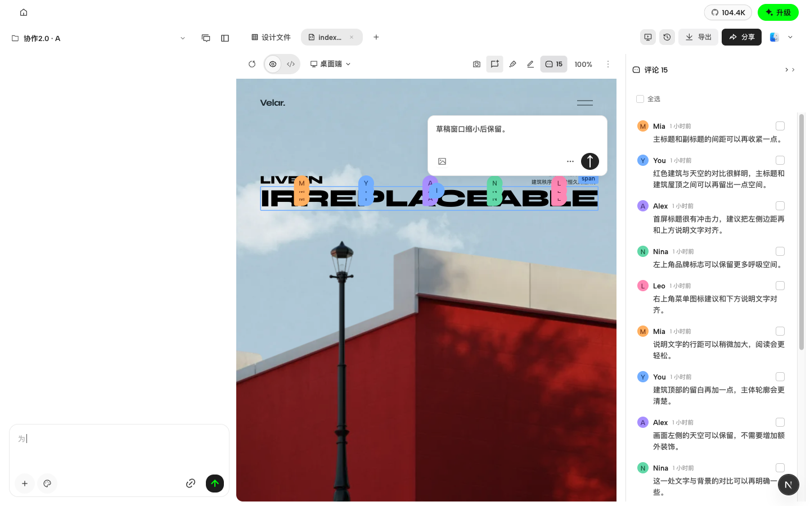

Viewer 真实浏览器运行产品组件，API/auth使用受控fixture；保存分数u/v、元素移动后更新真实矩形，发送前后点位与配色一致。

Viewer 280px 浮层，长文内部滚动，关闭和发送可达；不足160px时隐藏但保留正文。

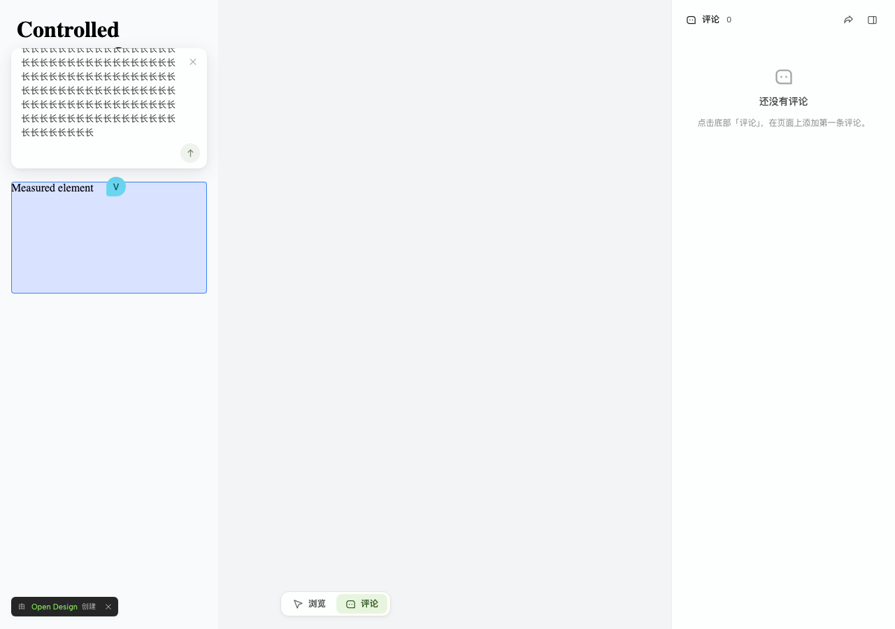

## 验证证据

- 客户端：最终6个相关web文件67项通过；contracts两文件89项通过；workspace context daemon83项通过。根guard/typecheck通过。
- Vela：身份目录相关API65项、锚点API37项、读回/草稿27项、geometry/runtime42项，以及输入/版本/桥等聚焦测试通过。分组可能重叠，不累加总数；根lint包含workspace typecheck通过。
- Viewer最终浏览器：geometry5+草稿3共8项，hover/多语言/键盘7项通过。另400字/版本说明2项、旧401路径已验证；非全量回归。
- 审查与实屏发现后修复：首次lazy详情延迟、跨iframe离开事件关闭正在阅读的浮层、hover移动/离屏陈旧位置、客户端hover边界与隐藏卸载、浮层1px可用高度、协议生成回退完整首字符。

## 明确未验证的边界

- 客户端真实服务器的首次 authorKey seed 尚未部署联合实测；本地源代码、契约与组件回归通过，不能替代生产证明。
- Viewer登录续接使用受控401及认证完成跳转；真实IdP流程未验证。
- Viewer现有10个locale的分享译文存在fallback；19种正文压力测试不等于19套完整翻译验收。本轮未新增locale。
- 不改发布生命周期、同步队列、权限边界或数据库结构；逐条已读仍仅本地。旧ghost历史矩形模型未扩展为额外坐标迁移。
- CI需绑定推送后的新SHA单独检查；未合并、未部署。

## 评论浮层结构清理（2026-10-28 补验）

用户反馈旧式标题栏、拖拽柄和大按钮重新出现。本次直接删除草稿标题栏、拖拽状态及事件、查看全部评论入口；详情直接渲染作者、菜单和关闭按钮。评论组件自行提供完整样式，删除无调用的全局评论样式，保留元素参数预览及其他入口仍使用的共享样式。附件区增加留白，避免缩略图删除按钮被卡片裁切。

针对本次工作树：10个聚焦测试文件69项通过；FileViewer草稿与切换目标8项通过；根guard/typecheck通过。未跑全量套件。本次不改Vela、发布或同步逻辑。

浏览器使用本地隔离场景及受控评论数据，经冷加载和再次刷新验证：

- 草稿不含旧标题栏、拖拽柄和查看全部入口；详情只保留新头部。
- 400字可发送，401字禁发、保留全文并显示超出字数，无红色输入框。
- 窄窗隐藏再恢复，保留同一个输入节点、全文及选区[1,4]。
- 附件入口、删除按钮及更多菜单可达。附件采用透明1px图片fixture，仅证明容器与操作，不代表真实图片内容验收。
- 临时禁用评论CSS模块后，旧控件仍不存在；恢复样式后截图。无样式状态不是视觉验收结果。

截图与设计对比仅覆盖评论浮层；场景中的作者、评论内容、目标位置及背景画布尺寸不完全相同，不作为逐像素一致的证明。

## 评论 CI 修复（2026-10-28）

`50a8f0d7b1` 的 CI 发现旧标题栏/附件类名选择器、缺少实际头像矩形的 JSDOM fixture、列表与图钉共用 data-comment-id 导致的误选，以及超限提示400字重不符合产品500/600/700规范。本轮更新这些评论测试和提示字重，没有恢复旧界面结构。

多客户端测试另发现真实重复已读请求：同一评论的 PUT 尚未返回时，锚点或评论数据更新会重新触发请求，并丢弃第一次响应。现在按账号/项目/文件/评论对正在发送的请求去重，响应继续交给已有 scope 校验后合并；失败后仍可关闭、重开详情重试。没有增加自动重试或跨设备同步。

新增受控回归先复现2次PUT，再验证修复后只有1次且成功响应清除未读。相关组件与样式11文件74项、原失败用例及新回归13项、已读相关5项通过（分组有重叠，不累加）。

两个针对性 Playwright 闭环通过：评论发送后打开后续产物（含附件、401禁发、保存/重开只读详情）；多客户端内容/在线状态/已读/取消分享（保留精确1次已读请求断言）。根guard/typecheck通过。远端CI以本次新提交另行核对，未合并或部署。

## 八类确认缺口（2026-10-28）

以客户端 `94ebfebbb7` / Vela `99014c9c8` 为修复前基线，规则 revision 14；只处理以下八类。CV05 暂不处理。Terra 独立实施与只读范围审查，FileViewer / Viewer route 由父 agent 串行集成。

|规则|本次结果|针对性证据|
|---|---|---|
|CV04|客户端及两种 iframe C 快捷键尊重菜单、对话框和 defaultPrevented|组件/桥测试；实际 host 和 URL iframe 控件保护及普通 C 触发|
|CV16|原生更多菜单内第一次 Esc 仅关菜单；第二次关评论浮层|实屏保留正文与新附件，再关闭回焦|
|CV06|Viewer 空草稿可换目标，非空草稿保留原目标和输入锁|浏览器空草稿换点、输入后保护及原 pending/error 回归|
|CV19|客户端列表/详情显示 reanchored/stale 说明；Viewer 同版本 missing 显示原位置不可用|客户端两态列表+详情组件测试；stale 列表实屏；Viewer missing 与旧版本列表/详情实屏|
|CV21|CRLF/CR 统一为 LF 后 trim，计数、发送与存储一致|contracts 2项、daemon HTTP/CLI/SQLite/同步22项；Vela API相关104项；400/401浏览器回归|
|CV25|客户端窄列表时间可换行，姓名仍省略且 title 完整|240px resizer 实屏、长姓名与日期测量，无横溢|
|CV26|客户端列表姓名/正文各自 dir=auto|组件及阿拉伯文/中文/英文混合实屏|
|CV27|客户端关闭回原列表/图钉/创建入口；Viewer 桌面关闭回列表或 iframe 图钉|客户端三个入口组件测试与创建/列表实屏；Viewer 列表及异步重绘后图钉回焦浏览器断言|

### 本轮验证与边界

- 客户端4个聚焦文件23项、保存边界/未发送草稿与新增回归4文件19项通过（两组共享10项，不累加）；contracts2项、daemon22项通过；根 guard/typecheck 通过。
- Vela 浏览器16项通过，API相关104项、桥/提交聚焦41项通过；根 lint（含workspace typecheck）通过。额外单测发现旧点击fixture位于元素外，修正坐标及已有 visible 字段预期；runtime32与33均复现相同行为，未修改CV05产品规则。
- 浏览器使用实际产品组件、受控评论/auth/API。客户端临时HTML与GET响应覆盖均还原；附件为透明图片fixture，仅证明操作/保留。
- 客户端个人fixture没有合法workspace publishedVersion，reanchored尚未实屏；旧ID stale详情受现有定位/隐藏边界影响，此项仅列表实屏及两态组件验证，不冒称详情浏览器验收通过。CV05没有为验收而修改。
- 设计比对使用已有B08/D05/D06结构参考；内容、头像、时间和画布尺寸不同，新增位置提示也无一一对应设计状态，不宣称像素全等。Viewer使用既有自身皮肤；旧1.0设计不冒充2.0完整标准。
- 不改发布生命周期、权限、同步调度、数据库结构或跨设备已读；只统一评论正文在既有写链路中的换行形式。未跑全量本地套件，真实IdP、生产及全部设计状态未验收。CI需按本次提交SHA另查，未合并、未部署。

### 本轮实际截图

第一次Esc后正文/附件仍在，菜单已关闭：

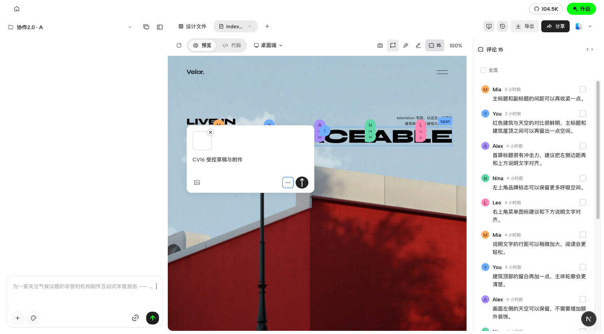

窄列表长姓名、时间换行与局部RTL：

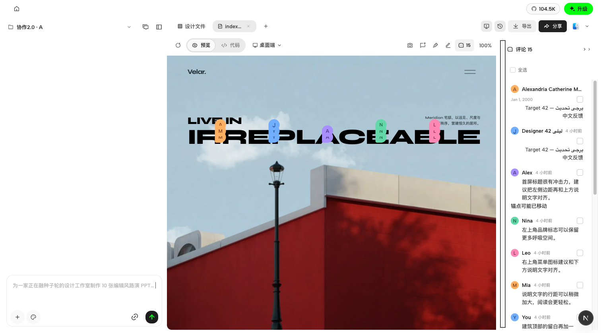

Viewer空草稿可换目标，输入后固定：

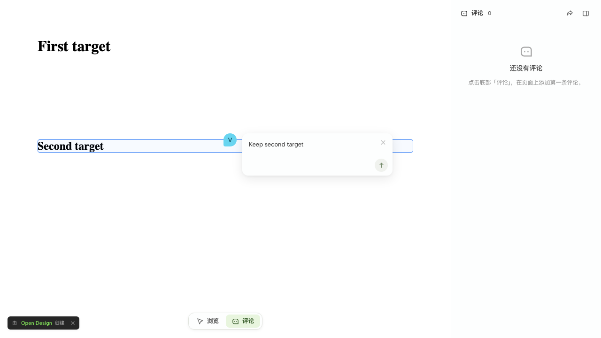

Viewer同版本目标不可用，保留既有虚线兜底头像和明确提示：

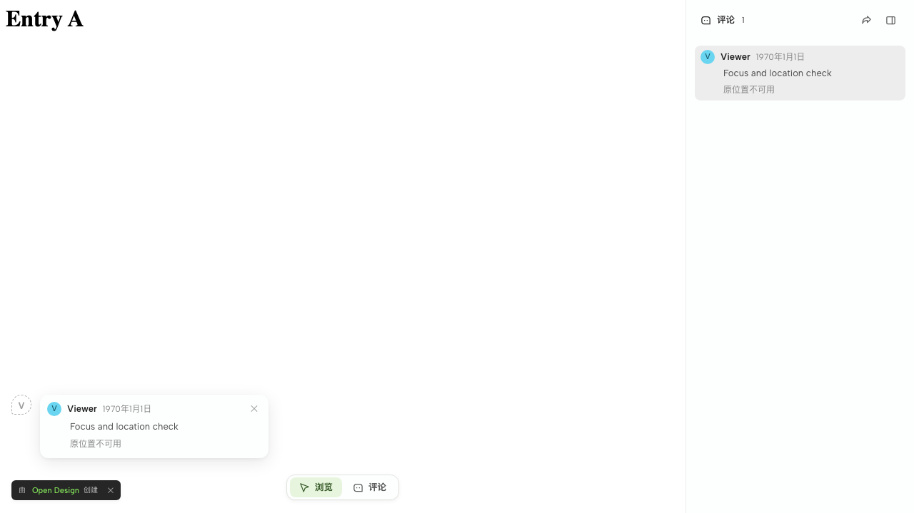

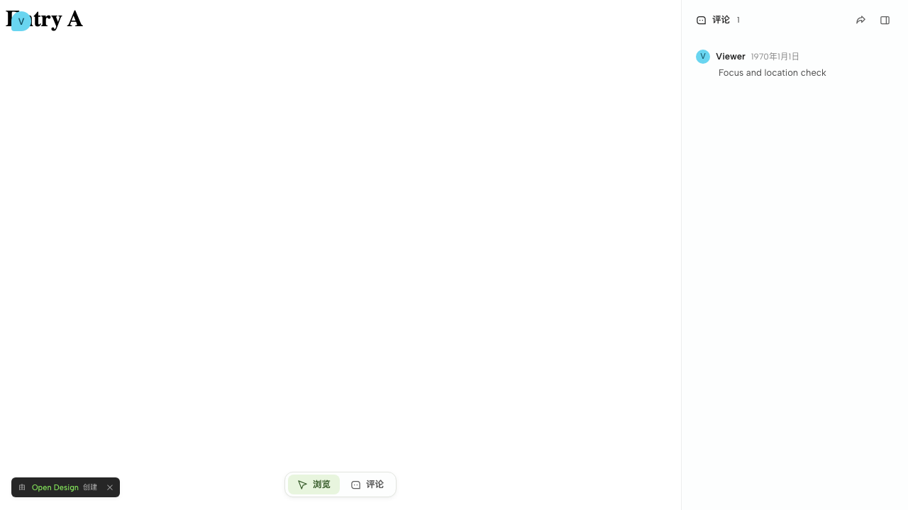

## 评论 suite 适配与 CI 接入（2026-10-28）

本轮只改测试、测试夹具、既有 CI 选择和本记录，无产品代码改动，CV05不动。

- `CommentBrowse` 原2条失败断言补上准确 opener 参数，评论ID、数量不可点击和旧hover计时器断言全部保留；11/11通过。
- 新 `e2e/ui/comment-interaction-rules.test.ts` 四个独立P0场景：D05可见160×96图片/native菜单两次Esc；B08真实键盘resizer、长姓名title、省略、日期换行、局部RTL及D06准确回焦；CV04 host/活动iframe的菜单/dialog/handled/input/IME保护；CV19协作版本与真实DOM的reanchored/stale列表→详情。
- 四场景在fullyParallel=1、2 workers下4/4通过（52.7秒）。CV19使用真实daemon和既有fake Vela hub产生的权威发布状态，不手工伪造DOM定位回包；仍不是生产Vela/真实账号验收。先前CV19详情实屏缺口在这个受控协作场景中补齐。
- B08精确验证外层面板240px，内部dock=外层宽度−边框（当前239px）；这是shell.css既有1px边框模型，不用宽松误差范围。姓名/日期只是受控展示元数据，不代表真实身份同步。
- 客户端新文件注册到现有project-workspace P0 group，原app与多客户端套件保留；相关拓扑2项通过。新夹具显式success标记保留失败证据，使用parent watchdog并清理本次进程。
- Viewer固定蓝色预期改为明确作者key的颜色契约，CSP/28px/热点/恢复/安全断言保留；非空草稿单测只改名称，401=true保护保留。
- Viewer现有Share CI步骤保留原3文件，再加入cursor、stage1-input/draft、stage2-geometry、stage3-hover-text、eight-gaps、input-lock共7文件。同CI文件集合、默认workers合跑38/38（27.6秒），unit2/2通过。工作流解析与10个唯一文件存在检查通过。
- 客户端根guard/typecheck及最终独立e2e typecheck通过；Vela根lint（含workspace typecheck）通过。没有跑全量本地测试，没有删除或弱化发布/同步/权限/精确一次请求等断言。

设计对比沿用B08/D05/D06原始状态及Viewer原有皮肤。以下为实际产品截图：正文、画布和合成身份与原稿不同，仅核验评论组件结构/交互；不宣称像素全等。行为截图不自动成为视觉快照基线。

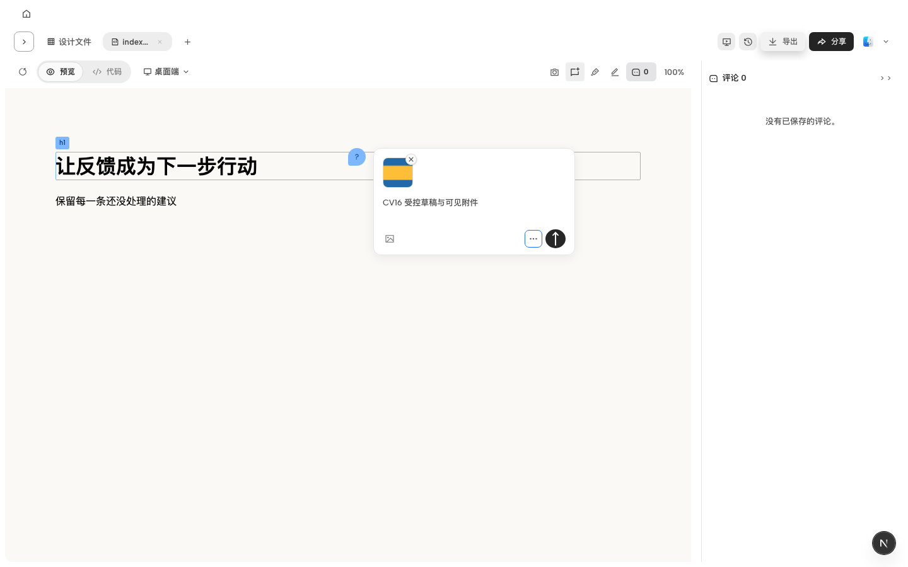

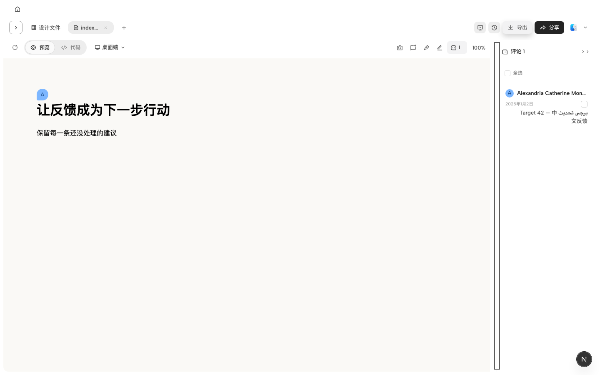

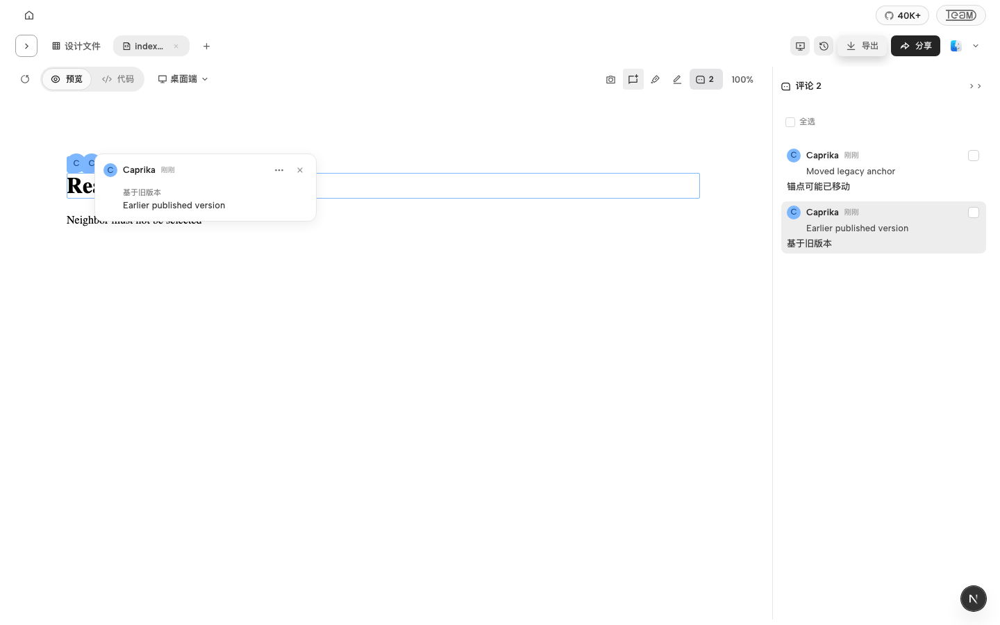

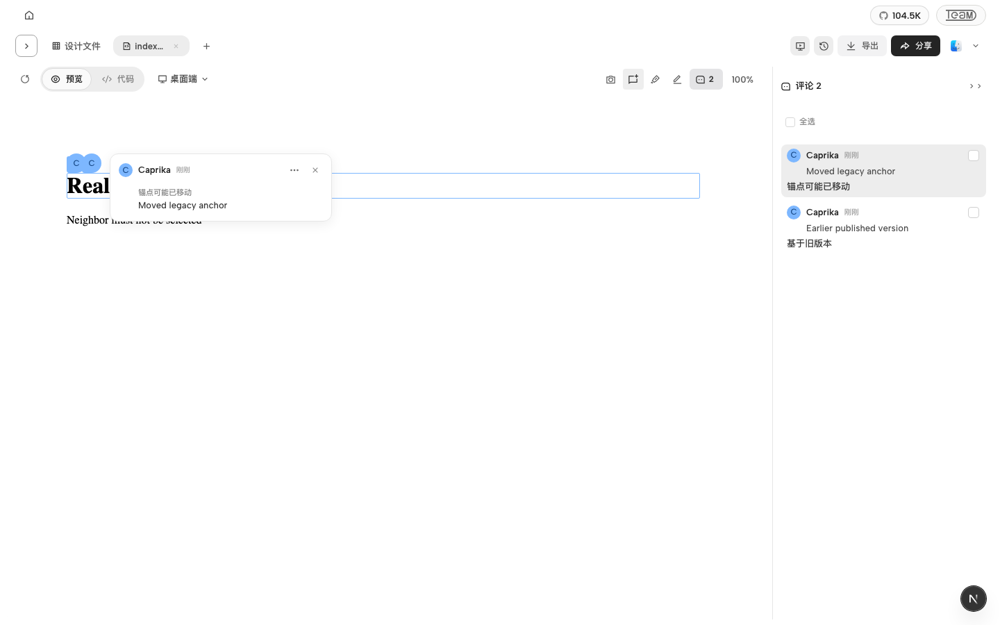

另保留首轮聊天展开导致预览工具栏被隐藏时的回焦失败证据，标准设计布局通过不能覆盖这个额外窄布局边界；本轮未扩展产品修复。远端CI以新提交SHA单独检查；未合并、未部署。

### CV05 scoped follow-up: real bounds and clipping (2026-10-28)

The user subsequently authorized only real-element bounds, small targets and canvas-intersection feedback. Target selection priority and region/free-pin fallback remain unchanged. Client single-element clipping already satisfied this geometry rule; the change adds a real iframe browser witness to the existing P0 suite. Vela now clips hover/selected feedback to its viewport while retaining the original element rectangle and fractional anchor in submission. Its bridge runtime revision advances to invalidate old injected variants.

Controlled browser evidence covers a 4×4 target and left/right/top/bottom intersections, hover without creation, and selected feedback. Client `comment-interaction-rules` passes 5/5; client canvas geometry passes 11/11. Viewer `shared-artifact-stage2-geometry` passes 10/10, including five independent CV05 cases that assert the submitted full rectangle and original u/v. Existing suites already route through PR CI; no CI topology or prior assertions were relaxed. Screenshot comparison is local at `.tmp/collab-lanes/evidence/cv05/index.html`; fixtures are controlled product renders, not production data or original design screenshots. Geometry criteria correspond to CV05 and design states F05/F10; existing client/Viewer skins remain intact.

Region protocol audit: Viewer `share:target` strictly requires elementId/selector/htmlHint/rect, with optional u/v; no region discriminator exists. The public create API requires nonempty elementId/selector/htmlHint and optionally accepts position. Storage can carry geometry, but that is not an independent region-anchor contract; subsequent resolution uses the element selector. Client free-pin's synthetic selector is not evidence of a Viewer region workflow. No protocol, service endpoint, storage or region capability was added. No merge or deployment.
