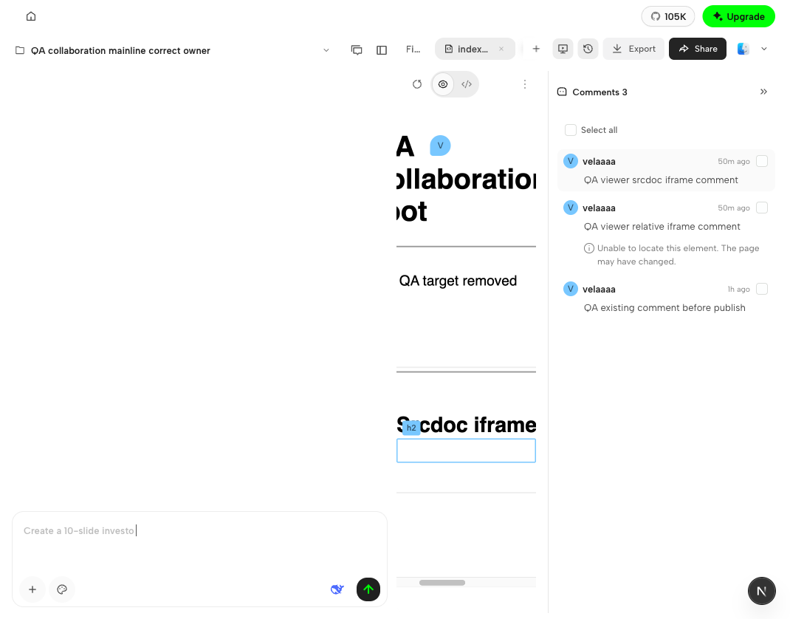
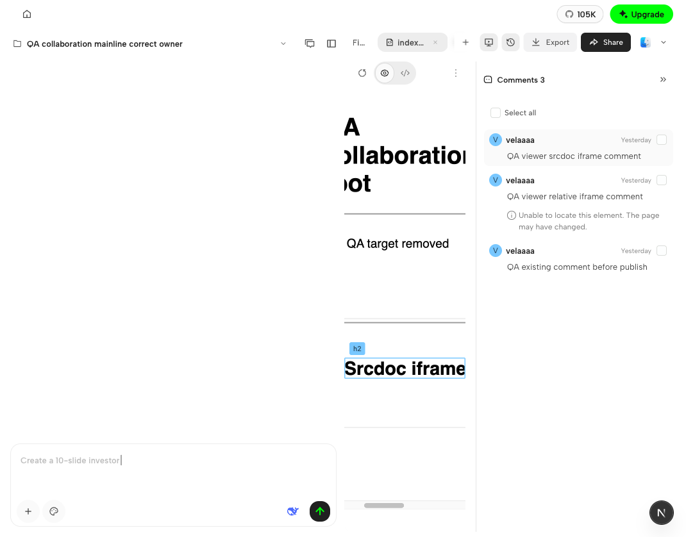
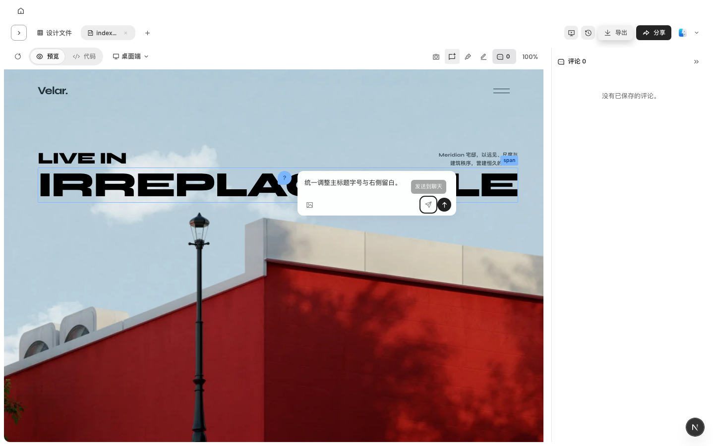

# 协作联合验收（2026-10-29）

## 最新主链验收（2026-10-31）

客户端评论投影产品提交为 `4ca9533880`，对应干净、基于 main 的 QA 客户端 `f42ece6aab`；Vela 专用泳道部署 `02a70110c`，四应用 ready/healthy。CLI 固定 npm 测试版 `0.1.9-test.0`。未合并主分支，不影响其他环境。

本次在原视觉整合后，进一步拆开发布、评论登记/回填和定位生命周期。Vela 最小增加不可变版本的 `sourceIdentity`；客户端透传，资格和跨文件隔离等业务校验由服务端裁决。定位不再以内容指纹作为门禁，失配评论保留列表/详情，不画假图钉；现有 Agent 发送行为不额外限制。下文旧日期的“不新增协议”“Vela 无代码改动”和测试计数是此前轮次记录，不能代表本次主链范围。

| 真实场景 | 观察结果与版本边界 |
| --- | --- |
| 发布及评论回填 | 真实分享成功，发布前评论在 Viewer 出现；网页根元素、relative iframe、srcdoc iframe 评论创建均返回 201。初次发布使用服务 `0db051c50`，不冒称初始发布在最终服务 tip 重跑；最终 `02a70110c` 的 API/CLI 源码相同 |
| 干净客户端回拉与定位 | 回拉全部 4 条评论，既有 root 评论和 srcdoc 评论可定位；最终几何在 QA `f42ece6aab` + lane `02a70110c` 验证 |
| 删除同步 | 客户端删除一条 root 评论，Owner 列表 4→3，已打开的 lane02 Viewer 自动移除该评论；其他评论保留 |
| 目标失配 | 仅删除专用 QA fixture 的 relative 目标并 Update link 成功；Viewer 显示新内容，原评论仍在列表，选中也不产生图钉。最终客户端同样保留失配提示且无图钉 |
| 窄视口与隐藏恢复 | 展开聊天栏产生裁切区滚动，iframe 比评论画布高 35.5px；修复后窄→宽→窄均框住 srcdoc 文字，Code→Preview 恢复后仍对齐 |

设计/规则约束仍是跟随真实目标的可见边界、图钉固定 CSS 尺寸及既有边界避让；不通过移动预览布局或改写持久化评论坐标修饰截图。修复仅把评论层的投影起点改为当前 iframe 相对画布的实际起点，并处理画布边框及外层滚动。原 scale、bridge 协议、发布和评论状态机不变。

| 修复前：定位框落在文字下方 | 修复后：定位框覆盖目标文字 |
| --- | --- |
|  |  |

截图直接复制真实产品截图，未裁切、缩放或重绘。最终窄视口的稳定值：iframe top=104.5、bridge y=476.992、scale≈0.951087、overlay top=558.156；宽视口 iframe top=140、bridge y=384.992、overlay top=524.992。子 iframe 为跨进程 frame，未取得其独立 DOM BCR，结论基于可见截图与桥接、外框和覆盖框坐标核对。实际 fixture 的 iframe 边框为 0px；1px 画布边框和 portal 由 composition 回归覆盖，不冒称该布局的真实浏览器实测。

本地回归：新增 11 项在修复前分别复现滚动 35.5/47px、边框 1px 和隐藏恢复偏差；修复后 22 个直接消费者文件共 550 项通过，保留权限、原始坐标、失配无图钉、旧回复不复活及保存/发送断言。guard、typecheck 通过。当前提交 CI 及每次 push-gate 的最终绑定记录以两个 PR 最新状态为准，不拿 `a0a642b4d6` 的历史成功代替后续提交。

保留边界：此前间歇 HTML 403 引发的会话失效，以及一次原生 CLI 登录未兑换凭据的原因仍未确定；后续同 scope 官方 CLI 登录成功不等于修复了旧失败。没有为验收增加认证特判、改网络配置或代用户批准。Vela 当前主 CI、Browser QA 等 8 组通过，API legacy billing 用例仍失败且关联性未定；没有扩大到计费修改。正式安装包、旧 CLI 发布 run 未执行的跨平台 startup 和生产迁移审批均不以本轮结果替代。

## 以下为此前轮次记录

## 范围与设计依据

整合 PR：[客户端 #9180](https://github.com/nexu-io/open-design/pull/9180)、[Vela #720](https://code.powerformer.net/core/amr/pulls/720)。客户端基于前置 #9069，Vela 面向 main。本轮仅复核协作评论相关视觉和功能，不新增服务协议、区域兜底或跨设备已读同步，不合并主分支。

核对当前设计来源：客户端增量文档 NriOdk7aBoUOCDxLdEFc17cQnfD 修订 33、交互规则 RklPdukjPoEhv6xGaL9crMpOnzb 修订 14、Viewer 设计 QaQKdrCl7o4usEx0ebucoUsynHf 修订 86。组件截图直接使用原设计附件及真实组件，未重绘参考图或缩放局部截图来掩盖差异。

**身份色采用现有 authorKey hash 分配。文档中的依次分配、31 位循环规则错误，不作为验收标准。** 客户端同点评论簇最多 60 条、5 列，小窗口可滚动；Viewer 最多 5 个图钉，两端不互相套用增量规则。

## 本轮修复

- 评论浮层按原设计 SVG、排版、间距、阴影及按钮状态实现，清理旧结构；独立 Agent 操作保留原权限、队列及发送回调。
- 保存、发送中、失败重试和 400/401 字状态对照原设计；失败保留正文，保持原业务断言。
- hover 阅读复用正式详情组件，保留 Agent、菜单、附件和折叠内容；滚动/缩放重新定位，关闭返回图钉焦点，目标消失清理悬停状态。
- 已保存评论阅读与新建选点分离；URL/srcdoc 桥接只定位明确的已保存目标，保留严格目标身份、删除后的失效提示及嵌套裁切，不回退绑定邻近元素。
- Viewer 修复登录保存失败后的重试锁、匿名 C 快捷键、缺姓名时的原始头像字符；保留现有身份与草稿协议。
- Viewer 浮层、400 字中性计数、超限红色状态、移动关闭图标和文字几何按最终设计样式核对；新浏览器用例接入现有分享回归 CI 步骤。

## 改动与验证对应

| 改动边界 | 使用者与验证 |
| --- | --- |
| 评论浮层、头像栏、tooltip、FileViewer | 客户端评论专项 26 文件、263 项通过；推送前另对 FileViewer 全部通用使用者及预览运行时等 88 个相关测试文件复核，1173 项通过；保留权限、队列、失败、同步等业务断言 |
| URL/srcdoc 定位与观测 | runtime 纳入上述 88 文件复核；daemon 累计相关 7 文件、227 项通过；contracts 85 文件、905 项通过；浏览器覆盖 URL/srcdoc 与团队/个人四种路径 |
| 客户端实际交互 | 综合浏览器 18/18；最终共享 hover 调整后另跑 4/4；最终发送状态调整后另跑 1/1，不将三批视为互不重复的场景数 |
| Viewer 评论与草稿 | 最终浏览器 73/73、针对性单元测试 76/76；推送前 web 单元测试 1478 项通过、2 项原有 TODO；现有 CI 命令包含新增视觉场景文件 |
| 仓库检查 | 客户端 guard、typecheck；Vela lint（包含 typecheck）；两端 diff-check 通过 |

浏览器覆盖包括客户端 19 种现有语言、长姓名和混合 RTL、CV05 真实边界/小元素/交集裁切及 100/75/50% 缩放、400/401 字、发送中/失败重试、原始文件发布、取消恢复、滚动评论簇及失效目标。Viewer 按其已有 10 种 UI 语言能力验收，没有新增 19 语言包。

上述为本地代码证据；远程 CI 必须以本轮推送后的提交单独核对，旧提交 CI 不替代本轮验证。

## 当前截图与完整报告

本地完整报告：`.tmp/joint-acceptance/index.html`。证据清单为同目录 `current-evidence-manifest.json`，包含 33 张独立图片及来源记录；Viewer 使用最终 `viewer-final-manifest.json`，不再混入旧“修复前”截图。报告按规则列出检查结果、设计对比及证据边界。

客户端原设计目录共 85 个状态，已按共享组件与规则对应关系审计；不声称逐个完成 85 个整页像素比对。原尺寸对比包含详情、hover、空草稿、输入、发送中、失败、超限及 Viewer 八组同状态组件。

## 证据边界与保留差异

- 身份、云 API 和 Agent 响应包含受控夹具，不宣称真实 IdP、线上 relay、生产部署或真实用户身份链路通过。
- C07 部分拒绝/异常由组件断言覆盖；浏览器验证子集接受和取消恢复。没有为截图改变 BYOK 预检跳转行为，也没有把运行失败当作提交拒绝。
- hash 配色替代静态样例颜色；语言格式、运行时最大高度/滚动及移动端 44px 点击区域保留现有规则。Viewer 显式关闭入口为草稿关闭和无障碍保留，报告已说明与静态样例的差异。
- CSS 为 320px 的组件可能因小数坐标产生 321px 截图包围盒，未据此改变组件尺寸或缩放图片。
- 不关闭前置 #9069。四个被替代旧 PR 的关闭仍以整合结果及当前 CI 确认完成为前提；本轮没有合并、部署或关闭 PR。

## 推送前覆盖复核

按整个 PR 累计 diff 重新核对“改动 → 使用者 → 测试 → CI”。客户端补跑通用 FileViewer 测试时发现 15 项旧测试失配：阅读态直接注入选点、旧样式值及失效提示旧 DOM 层级。改为显式通过 C 进入新建态后选点，保留发布/草稿独立性、身份一致及失效提示断言；视觉值直接对照原设计最终样式，不删除断言或跳过用例。失败日志保留于本地 push-gate 日志，最终结果与 gate 记录分别绑定。

## Vela 业务规则为准（2026-10-30）

- 公开分享的容量策略由 Vela 决定，移除客户端 20 MiB 常量及预检超限判定。预检只返回文件数量、实际字节数、依赖排除及本地结构冲突；旧 `exceedsSizeLimit` 字段仅保留可选类型兼容，当前 daemon 不再返回它。CLI 帮助明确预检不裁决云端资格或容量。
- 移除公开文件预检中的团队共享权限预判；本地文件归属、请求身份、未完整下载项目、路径及文件读取安全仍校验。发布时原样传递 Vela 的权限或容量拒绝，不把本地预检成功当作服务端准许。
- 回归验证同一份文件可由 Vela 拒绝后再接受，无需修改客户端阈值；保留 403/413 错误码、不留下成功发布记录等断言。停止/恢复继续消费云端状态，保留本地待停止队列、回执身份和并发提交保护；没有新增第二套云端状态机。
- 本轮 daemon/CLI 236 项、web 分享相关 188 项、contracts 37 项通过；Vela 现有 API 单元测试通过。本轮 Vela 无代码改动，不修改纯本地评论和即时输入提示。
