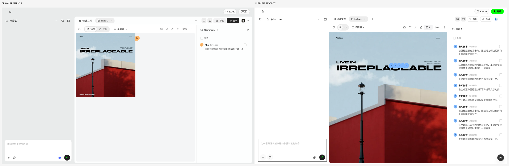
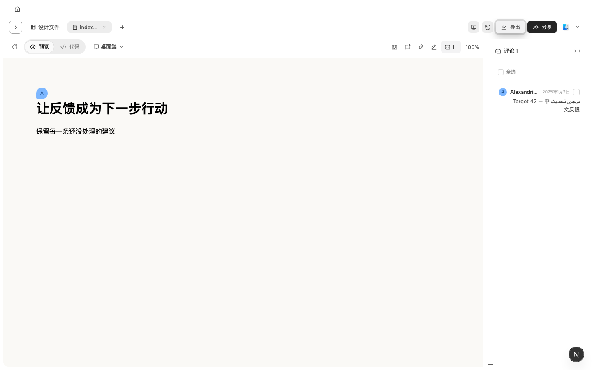
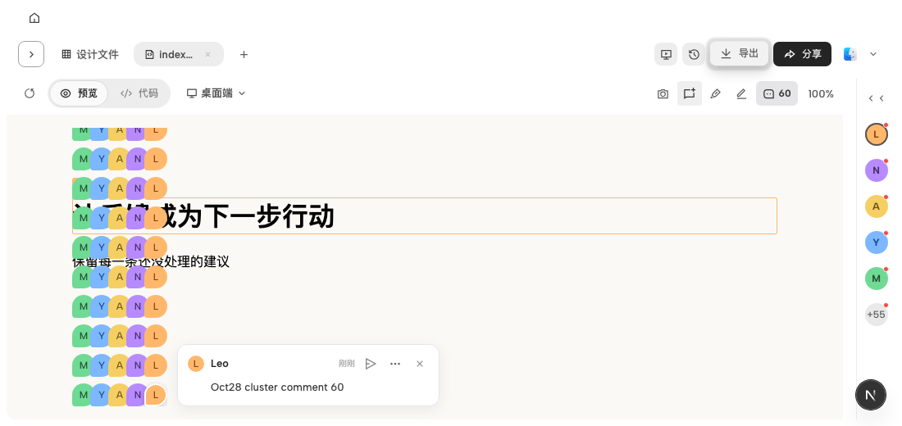
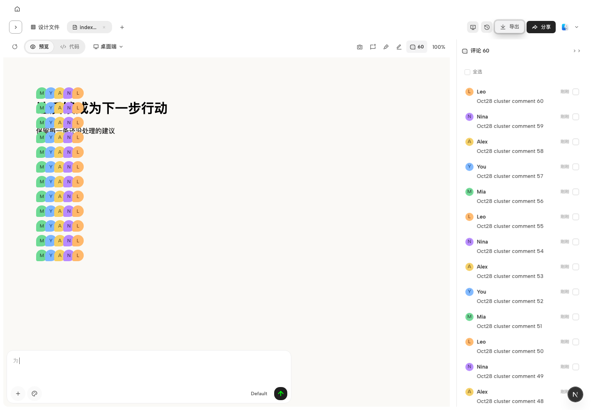
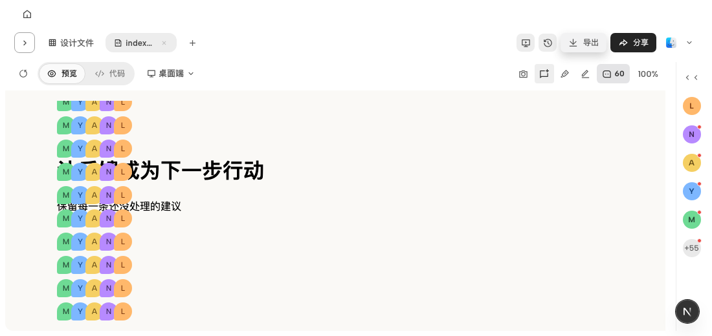
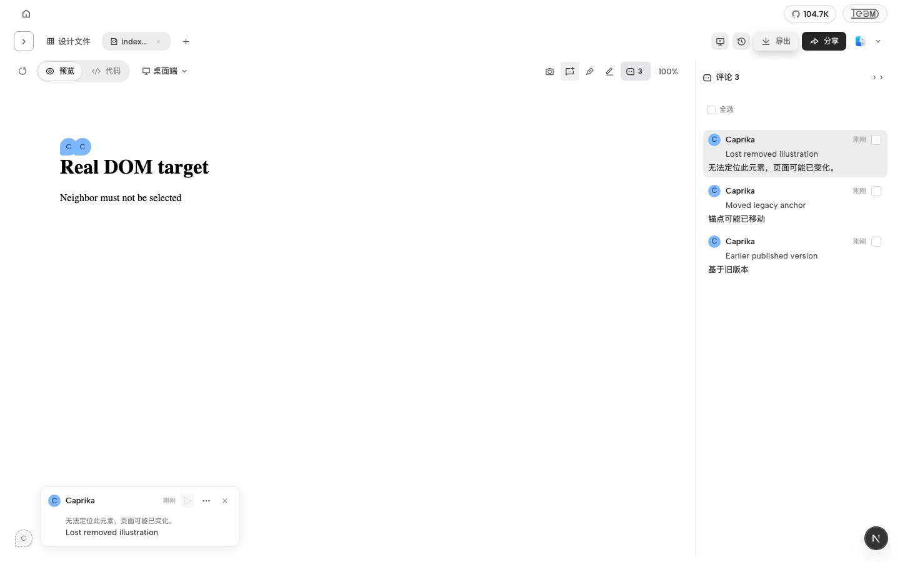

# Collaboration 2.0 client UI — OPEND-4408

This increment is based on the phase-one integration branch at `eb7ca6b734`; it must not merge the temporary integration branch into main. The approved scope is client comment browsing/input, canvas marker presentation, and batch/sync feedback, plus the already agreed exact anchor and 400-grapheme mainline changes.

## Scope review

Two independent reviews checked requirement coverage and implementation. No new publication lifecycle, workspace visibility rule, synchronization queue, authentication API, dependency, or database migration was added.

Four findings were corrected before submission:

- Saved Pod details no longer expose member removal or change the saved context through that control.
- Clearing or replacing a draft clears its save failure; saved details never show a previous draft's retry error.
- C originating in the preview iframe reaches the existing entry, with input/IME/modifier filtering and host-side active-frame source checks.
- Draft marker, target and cursor reuse the current member's known server-issued author color seed. No author key is synthesized from a name or member ID. Until that seed is available, the existing shared fallback remains; no new identity endpoint was introduced.

The manual synchronization notice uses the existing alignment endpoint. Its pending/failure/success state is local presentation state; it does not change synchronization success criteria or retries in the background.

## Visual evidence

Left: supplied design reference. Right: running product with synthetic comments. These are representative states, not a claim that all 84 catalog states were individually recaptured. Shell chrome, fixture identities, timestamps and anchor placement can differ. The screenshots were captured during visual acceptance. Subsequent review fixes have focused tests; CI follow-up also normalizes nine text-weight declarations from 400 to the existing 500 weight step, so these images predate that typography correction.

## Validation

- Scope/implementation review: completed, findings above corrected and independently rechecked.
- Review follow-up: 14 focused tests across composer, browse state, mainline and srcdoc bridge; 27 author identity tests; URL bridge shortcut/cursor test.
- Browser: iframe C → create → persist exact point → reload → read-only detail → selector resolution in original file bytes passed against a real local daemon.
- Earlier lane acceptance: A 46 tests; B 61 tests; C 28 tests and controlled-response browser retry/batch scenario. These groups overlap with follow-up checks and must not be summed as a unique total.
- Real local daemon Agent failure and cancellation restoration smoke passed before review; those business paths are unchanged by the review fixes.
- Root guard and typecheck passed. Full web/daemon suites were not run locally.

Cloud fault responses in the sync screenshot scenario are controlled fixtures. Personal-project browser creation currently yields structural `dom:` anchors; identity `cmt:` missing-target behavior is covered by focused tests, not by a fabricated identity in browser evidence. Per-comment read acknowledgement remains local; cross-device read synchronization is out of scope.

CI, merge, deployment and production verification are separate stages; no merge or deployment was performed for this change.

## CI follow-up

The first PR run exposed old UI expectations in the existing comment suites: the list button no longer enters creation mode, saved details are read-only, avatar markers replace the old pin presentation, and only opening an individual detail acknowledges it. Tests now use the approved interactions while retaining publication, source validation, persisted comment ordering, retry and Agent payload assertions. The local daemon still stores individual read acknowledgements; this is not a cross-device synchronization change.

Nine new CSS weight declarations now follow the existing typography ladder. A ShareTab test fixture now supplies the existing Workspace capabilities consumed by the sync banner. No publication or sync production logic changed in this follow-up.

- FileViewer: 352 tests passed.
- Share editing guards and ShareTab: 28 tests passed.
- Save boundaries and style contracts: 15 tests passed.
- Browser: comment save/reload/Agent follow-up artifact, adjacent comment attachment, and two-client publication/live content/presence/detail-read/unshare workflows passed.
- Root guard/typecheck, e2e typecheck and diff whitespace checks passed.
- The unrelated Pi process-close failure passed all five local cases and the same-commit CI job rerun; its runtime and tests were left unchanged.
- Vela companion #655 adds only ES2022.Intl to the Web type libraries to typecheck the approved grapheme counter; root lint/typecheck and 95 focused tests passed, and all remote checks passed on 183041dc1.

## Visual recheck after review feedback

The earlier lane B fixture omitted all author fields and placed every comment at the same anchor. Its unknown-author screenshots do not establish named-author fidelity. Rechecked with complete synthetic author snapshots: names and stable palette render in list, pin, detail and the five-avatar rail (+10). A development hot update reproduced a white Share button because the CSS Module rules disappeared; a full reload restores the existing dark Share style. No Share/publication/sync production code was changed.

Two bounded client fixes: the collapsed rail now uses the same existing member-directory name fallback as the list (without borrowing member identity for public users); Enter/Space on a selection button no longer bubble to the comment row and open details. Native browser keyboard selection, rail labels and read-only details passed; 46 focused identity, browse, mainline and canvas tests, root guard/typecheck and diff checks passed locally.

Remaining differences are explicit: existing desktop zoom expands iframe layout before scaling, unlike the reference's half-width artboard; first-comment draft color can change when its authoritative author key first becomes available. Neither was redesigned here. At 50% and 75%, the saved pin measured 28×28 CSS px. The selected target uses its author color; the reference hover target is a different state. These results are not a claim of complete pixel parity. New repair CI is separate from the prior green CI, and no merge/deployment was performed.

## 2026-10-29：10/28 设计增量验收

本节仅补充[本轮设计](https://powerformer.feishu.cn/docx/NriOdk7aBoUOCDxLdEFc17cQnfD)的客户端增量，不替代前述历史证据，也不表示网页 Viewer 已同步更新。

- 已保存评论的发送入口独立为纸飞机按钮，更多菜单保留删除；原有发送权限、草稿、400 字限制和队列接收语义保持。
- 折叠栏按创建时间倒序逐条显示，最多五个头像及可点击的剩余数量；点击头像打开画布详情，保持折叠，不再悬停预览。完整列表原有手动排序保持。
- 长姓名省略并保留完整 title，时间保持同排；选中画布图钉增加白色描边与阴影，折叠栏不使用该选中样式。
- 无法定位的元素在画布左下角显示灰色虚线头像，仍能读取内容及原因；不恢复虚假目标、不借用邻近元素。区域评论和整页评论不误报失效。
- 同点 60 条评论全部保留，每行最多五个，28px 图钉、22px 横向步长、36px 行距、16px 安全内缩。小窗口仅评论簇滚动，窄画布减少列数，原始锚点不变。
- 批量选择区移到列表上方，拒绝提交时显示左对齐错误并保留未接受项；已有禁用状态显示原因。Agent 接收后运行失败仍走原有恢复流程。

### 本轮证据与边界

本地针对性组件/几何/权限/保存边界测试 35 文件、662 项通过；最后的共享入口调整后，FileViewer 综合 355 项及补充 21 项通过。这些测试有重叠，不累加为独立总数。浏览器 `comment-interaction-rules.test.ts` 7/7 通过，保留原 D05/D06/CV19 断言与 CV05 精度；该文件已由既有 `project-workspace` UI P0 执行入口覆盖，无新增 CI 路由。

**C07 的完整浏览器拒绝路径尚未验收。** 组件测试已验证拒绝/异常时保留选择、原位错误、禁用原因；现有可触发的 BYOK 拒绝会导航设置页，运行接口 503 则发生在队列接受之后，均不能冒充原位提交拒绝。未为截图改变业务行为，下面不提供伪造的 C07 浏览器成功截图。

截图使用本地实际界面；60 条评论由真实 daemon 写入，五名作者仅为 GET 展示夹具，不代表真实账号。测试画布、位置和作者颜色不复刻参考页内容，核对的是本轮控件和交互规则。小窗口图处于滚动位置，顶部半行是滚动裁切。

本轮不修改 Vela、发布/同步协议或身份配色规则；本地验证与新提交 CI 分开记录，不合并、不部署。
