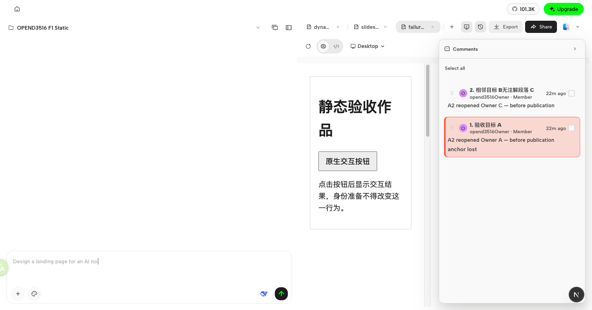
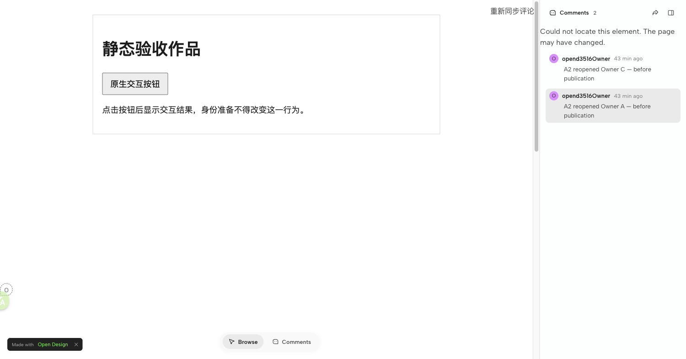

# OPEND-3516 C1 — lost-comment publication acceptance

Local real-loop result: **PASS**, 2026-10-15. Scope: current C1 only; this is not full OPEND-3516, CI, merge, deployment or production acceptance.

## Defect and fix

Selecting a saved identity comment whose target is strictly missing prefills its saved note, but leaves no visible composer. The nonempty prefill incorrectly blocked normal Share → Update link with `COMMENT_EDITING_UNSETTLED`, even though the user had not edited it.

Only exact unchanged persisted-note prefill for the selected saved comment, with current-document strict-loss evidence and no active target, is now treated as settled. No draft state is cleared. Actual typed changes, clearing/whitespace changes, fresh images and queued notes remain blocked; existing authorization, source-edit, generation and current-document guards remain intact. No identity restoration or fuzzy targeting is introduced.

## Genuine closed loop

Used the existing isolated Owner/anonymous Viewer environment and normal file-save, preparation and sharing entrypoints; publication used real object storage, not a mock receipt.

1. On prepared F1 `failure.html`, normally saved deletion of A and a same-text replacement at its original position (v4), without the old heading identity. Explicit preparation saved v5 with a fresh replacement identity; the other 13 identities remained unchanged.
2. After the fix, explicitly reselected the original saved A comment. Owner showed **anchor lost**, without revealing or highlighting the replacement.
3. With that lost selection still present, normal **Share → Update link** succeeded on the original URL, with no alert. This did not rely on clearing the selection to bypass the defect.
4. Reloaded that same URL in the actual anonymous Viewer (`session` HTTP 200, `authenticated:false`). Selecting the original A note showed **Unmatched comment pins** and **Could not locate this element. The page may have changed.** It did not reveal or highlight the replacement; the canvas stayed at its native header.
5. Reading the currently loaded iframe URL confirmed replacement markup/new identity present and old heading identity attribute absent. The two original notes and authors remained visible.

The iframe was URL-backed: an initial srcdoc-only read was empty and inconclusive; the actual iframe URL read supplied the published-source evidence.

### Screenshots

Owner strict-loss feedback during case setup (before the publication-guard fix; loss rendering was unchanged):

Anonymous Viewer after the successful original-link update:

## Focused regression evidence

On parent revision `8238de8193`, the focused saved-row regression selected the strictly missing comment and exercised normal Share → Update: expected one `/publish-public` POST, observed zero. It passed after this fix.

- 54/54 affected tests passed across `FileViewer.preparation-barriers.test.tsx`, `FileViewer.personal-comment-location.test.tsx` and `FileViewer.comment-preparation.test.tsx`.
- Eight-case matrix: initially missing/saved prefill may publish; typed/cleared/whitespace edits, fresh image and queued note remain blocked; removing the fresh image restores settlement.
- Root `pnpm guard`, root `pnpm typecheck`, and Web typecheck passed.
- Component tests use controlled HTTP/bridge/composer dependencies; they are not the real publication proof. The separate real loop above supplies that proof.
- LSP was inconclusive (large-file limit/test timeout); no clean-LSP or independent-review claim. No broader acceptance checks were added for this delivery.
