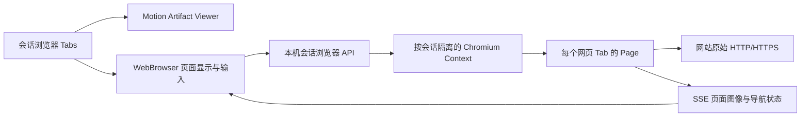

# 会话内的网页浏览器

更新：2026-11-05。状态：当前实现。产品关系与嵌入契约见 [会话架构](session-architecture.md)。

## 用户问题与选择

创作者需要在会话右侧直接打开百度等网站，输入文字、浏览页面、前进、后退和刷新，同时保留正在编辑的 Motion 工程。原来的 sandbox iframe 受站点 `X-Frame-Options` / `frame-ancestors` 限制，也无法可靠读取跨域导航历史。因此用独立的本地 Chromium 承载网页，替代外部网页 iframe；没有改写站点响应或移除其安全头。

Motion Artifact Viewer 仍直接运行本仓库的原生 React 编辑器。网页与产物共用标签容器，但不是同一种资源：从 Motion 地址栏输入网站会新建网页 Tab，保留原工程；网页内的导航历史由 Chromium 管理。此能力不代表已经提供网页原型生成模式。

## 数据与进程边界

- `browser.ts` 按需启动单独 Chromium，通过进程管道连接；不开放调试端口，不连接用户正在使用的 Chrome，也不读取其个人资料、Cookie 或登录态。
- 同会话网页共享一个临时 BrowserContext；不同会话的 Cookie、缓存及网站存储隔离。实现依据 [Puppeteer BrowserContext](https://pptr.dev/api/puppeteer.browser.createbrowsercontext) 和 [Chrome DevTools Page 协议](https://chromedevtools.github.io/devtools-protocol/tot/Page/)。
- `WebBrowser.tsx` 显示帧图像并传回受限的鼠标、滚轮、文本、IME 和编辑按键；网页 HTML/脚本不进入工作区 DOM。`shared/browser.ts` 是前后端共用的地址与输入协议，仅允许 HTTP(S) 地址，拒绝文件、脚本、data URL 和内嵌凭据。
- 原生编辑状态、会话消息与 Chromium 存储分别归属各自模块。浏览网页不创建 Motion 工程，也不改写工程 revision。隐藏原生 Viewer 时仍保持其组件和未提交表单，暂停影片播放并隐藏所属浮层。
- Tabs 的 ID、网址、标题和布局按会话保存到浏览器本地偏好；Chromium 历史与登录态只在本次服务运行期间存在。关闭网页 Tab 关闭其 Page；最后一个网页关闭时释放该会话 Context。暂时隐藏/切走页面停止画面流并冻结页面，重新打开恢复历史；无观察者超过 30 分钟回收页面。工作区最多保留 30 个运行中网页，服务停止时统一关闭。

## HTTP 契约

以下接口均位于 `/design-api/sessions/:sessionId/browser/:tabId`，沿用 `/motion-api` 别名和本机 Host / 同源写入校验。先校验会话存在，再定位所属网页；Tab ID 不能跨会话访问另一张页面。

| 方法与后缀 | 行为 |
| --- | --- |
| `POST /`，`{url}` | 创建或重新连接该 Tab；重复连接保留已有页面历史 |
| `GET /events` | SSE 返回 `state`（URL、标题、前进/后退能力、加载及错误）和 `frame` |
| `POST /command` | `navigate`、`back`、`forward`、`reload`、`stop`；导航由实际浏览器执行 |
| `POST /resize` | 同步页面视口，限制为 240–2560 × 160–1800 |
| `POST /input` | 顺序传递受限指针、滚轮、文字和按键，不接受任意 CDP 或 JS 执行 |
| `DELETE /` | 关闭网页 Page；不删除会话或产物 |

网络错误显示真实错误和重试入口。断开 SSE 后可重新连接，关闭 Tab 才销毁页面；只收起右侧浏览器不删除 Tabs。

## 运行与当前限制

网页浏览需要本机 Chrome / Chromium。优先使用 `MOTION_BROWSER_PATH`，其次 `HYPERFRAMES_BROWSER_PATH`，再检查系统安装路径。主分支的 Mac / Windows 测试包已通过 bootstrap 设置后者，继续使用包内固定浏览器；源码开发可指定绝对路径。Puppeteer 按固定依赖版本从实际运行时目录加载，因此薄插件仍能调用包外完整应用。普通 Motion 编辑器不因未安装独立浏览器而无法打开。

这是具备真实网络与页面交互的浏览器模块，当前没有桌面浏览器的全部设施：未提供扩展、开发者工具、书签、网站音频传输、跨重启登录持久化、下载管理、文件上传或系统权限提示；下载被拒绝，页面对话框被关闭，网站弹窗当前在同一 Tab 导航。需要这些能力时可用「在浏览器打开」。基于帧图像的页面也没有完整网站无障碍树与原生文字选择/复制；这属于后续浏览器宿主能力，不能报告为已实现。

自动化验收使用真实 Chromium 和设置禁止 iframe 的本地站点，覆盖文本/中文输入、点击链接、前进后退、刷新、画面帧、会话隔离、重连保留和关闭释放。百度的实际地址输入、搜索、前进后退另经界面验证。本轮未重发 Mac / Windows 完整包、未重复目标机原生验收，主分支既有测试包证据保留在 [测试包专题](test-packages.md)。
