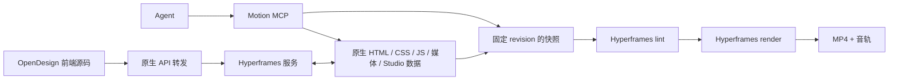

# Hyperframes 集成

当前实现基线：OpenDesign 0.6.1 / Hyperframes 0.9.7。本文维护引擎与工程关系；产品能力和演进准则见 [产品架构](product/architecture.md)。

目标是封装原生 Studio 与渲染能力，让 Agent 创作和手工编辑共享原生工程。

Studio 前端从上游 0.9.7 的固定 commit 迁入 `studio/src/` 并在本仓库构建，维护自有顶栏、主题、面板与模板入口。CLI/runtime/SDK/parser/renderer 继续使用锁定 npm 包，保留原生工程和编辑语义。`gsap@3.15.0` 随工程复制为本地资产；lockfile 固定依赖，undici 使用同主版本的 7.30.1 修复版。

启动链是 `motion_open_preview` → Motion 本机服务 → `hyperframes preview --foreground --force-new --no-open --json`。插件校验生命周期 JSON、实际 `/__hyperframes_config`、引擎版本与工程目录后才返回 ready。原生服务监听独立回环端口。Motion 服务直接提供本地前端构建产物，并转发 `/api/` 和 `/__hyperframes_config`，保留流式上传、SSE、Range 和 If-Match。产品 API 位于 `/motion-api/`，避免与原生工程列表冲突。

工具所需的后台服务与编辑器启动分离：`ensureService` 以后台模式启动服务和渲染队列，不运行 `store.initialize` 或启动当前工程的 Studio。`motion_apply_template` 可用空工程原始 revision 打开选中模板；`motion_request_export` 可用服务启动前已读的 revision 固定快照。`motion_open_preview` 会通过同源的 `/motion-api/preview/open` 在同一个服务中启动编辑器。健康响应中 `ready` 表示服务可用，`editorReady` / `studioUrl` 表示编辑器已就绪；导出下载无需编辑器。正常直接启动开发服务器仍打开编辑器。

这消除了服务自己初始化/补写 `data-hf-id` 造成的陈旧版本冲突，没有规范化或忽略 revision，也不自动重试为最新 revision。快照、切换工程和源文件写入原有的外部并发保护保留。

写入链是 Agent 原生源文件 → 同一工程目录 → Studio 文件监听；人工编辑反向落在同一目录。旧 `shots[]` 仅保留在迁移读取代码中。内容 revision 覆盖源文件、媒体与上游的两份 Studio manifest，排除预览/缩略图缓存。进程间锁约束插件工具，不能把外部编辑器视为同一事务；版本拒绝可以保护读写间已经发生的改动，不能承诺与正在写盘的 Studio 完全串行。

导出链是版本校验 → 复制并校验内容快照 → 记录快照尺寸/fps/时长 → 后台独占领取 → 上游 lint/render → 实际 MP4 头检查 → completed。渲染日志和预期规格保留，结束后删除媒体快照，查询返回原请求版本。`motion_verify_export` 用该任务的规格检查实际 MP4、完整解码视频/音频并执行代表帧 seek；视觉、声音内容与实际播放器检查仍独立执行。旧浏览器 WebM 上传端点、claim/fail 协议、Canvas renderer、MediaRecorder、离线打包和 IndexedDB 草稿已删除。

测试包含真实 Studio API 的 If-Match 编辑、MCP 反向编辑、原生模板 lint/timeline、旧文件保留、路径/链接隔离、缓存与 manifest 的区别，以及无浏览器页面参与的带音轨渲染。集成测试验证 320×180、24fps、H.264、音频、时长、移动图形帧差和下载字节。没有本机渲染依赖时显式跳过集成测试。

官方参考：[代码与包结构](https://github.com/heygen-com/hyperframes)、[Composition 格式](https://github.com/heygen-com/hyperframes/blob/main/skills/hyperframes/references/format.md)、[Studio CLI](https://github.com/heygen-com/hyperframes/blob/main/packages/cli/src/commands/preview.ts)。具体行为按锁定的 npm 版本验证，更新上游版本时应复测原生 API、Studio manifests、生命周期输出和渲染链路。

官方模板位于 `template-library/`，保留固定上游 commit、Apache-2.0 许可证及真实 snapshot 缩略图。选择模板时创建新的 `projects/<uuid>/` 原生工程，启动并验证对应 Studio，再在文件锁内原子更新 `projects.json` 的当前选择，最后关闭旧 Studio。失败时清理尚未激活的新副本，当前工程不被覆盖。各 MCP 进程读取相同选择；最近工程菜单重新打开保存的目录，不重新复制模板。导出继续使用不可变快照，切换工程不影响已排队任务。

Motion 工程现在属于通用会话，完整 Studio 作为 Artifact Viewer 加载。会话生命周期和 Codex 嵌入不由引擎承担，详见 [会话技术架构](session-architecture.md)。
