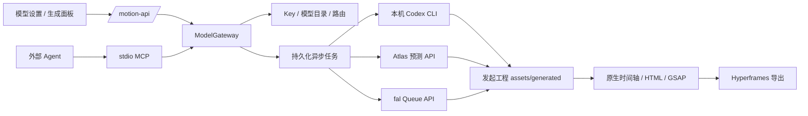

# Model Router / Gateway

更新：2026-11-04。关联需求：[REQ-20261104-005](product/changes.md#req-20261104-005模型网关与时间轴素材生成)。

本文维护当前能力、接口和运行限制。跨模块的产品目标、对象归属、D1–D11 设计取舍、时间轴交互和扩展准入条件见 [素材生成设计与架构决策](product/media-generation-design.md)，整体分层见 [产品架构](product/architecture.md#职责分层与依赖方向)。

## 用户问题与交付边界

已有 Agent 用户需要在制作视频时知道哪些图片、视频、音乐或语音模型可以调用，并让生成结果继续参与手工编辑。此前只能自行生成文件后导入；Studio 与 MCP 没有共同的生成入口。

当前实现为工作区级 Model Gateway：本地 Agent 检测、供应商 Key、模型目录、默认路由、异步任务和素材落盘共用一个服务。工程格式、时间轴与渲染仍使用 Hyperframes。它不提供新的聊天模型或用户账户系统。

在 OpenDesign 通用会话架构中，Gateway 服务于 Motion 产物：会话拥有产物，产物引用原生工程，生成任务固定该工程。模型设置管理工作区配置，完整视图入口在侧栏、嵌入视图在编辑器顶栏；时间轴生成入口和浮层仍属于 Motion Artifact Viewer。两种视图复用同一 Gateway。创作模式与媒体模态、供应商模型的职责划分见[会话技术架构](session-architecture.md#会话编排与媒体生成的分层)。

验收条件：检测结果可解释；Studio 与 MCP 查询一致；真正生成的文件落在发起工程；可以预览、放入指定时段并撤销；重复提交、取消与失败不会产生静默重试；图片可以组合为可编辑工程并导出真实 MP4。

## 当前入口

- 侧栏底部「模型设置」（嵌入模式在编辑器顶栏）：本地 Codex 检测，Atlas Cloud / fal.ai Key 的保存、移除与启停，图片/视频/音频默认路由，在线模型发现及按 Endpoint ID 注册模型。
- 空时间轴：导入文件、生成素材。生成面板在时间轴上方打开，显示待放置时段。
- 时间轴选中片段、Shift 拖出时间范围，或点击空选区的标尺后，自动出现就地操作栏。输入描述后可打开「生成素材」；选中本地图片时还提供「修改图片」，也可将选区描述交给 Agent。关闭后再次操作时间轴可重新唤起；播放、拖动及只读期间隐藏。
- 时间轴工具栏与素材面板仍保留「生成素材」入口，支持图片、视频、音乐、语音、模型、比例、数量、时间位置与高级 JSON 参数。初始位置依次取已选时间范围、所选片段、播放头和 3 秒默认时长。图片时长表示在时间轴中的展示时间。
- 「修改图片」把原图交给支持参考图的模型，当前为本地 Codex；开始时间与时长固定为原片段。结果入库后显式点击「替换所选图片」，仅修改原生图片元素的 `src`，保留时长、样式与动画，沿用原生撤销。也可将结果作为独立片段放入时间轴。视频、音乐、语音目前提供生成，不宣称具备原素材修改能力。
- 结果先进入 `assets/generated/`；用户选择「放入时间轴」才写合成。数量选项创建 1–4 个独立请求，保留候选供选择。再次点击生成是新任务；一次批量提交中途失败后重试，已提交项用幂等键复用。
- 素材卡片和音频行提供可见的操作菜单：预览、在播放头处添加、复制路径、下载、重命名、删除。添加与撤销沿用原生历史；重命名沿用原生引用改写。删除仍有确认步骤。

图片/视频预设将比例与时长映射为相应模型输入；无法可靠映射的模型通过高级参数填写供应商字段。Wan 2.2 预设支持 16:9、9:16、1:1 和 1–10 秒。其他模型的分辨率、声音、参考图等必填项以供应商接口为准，目录发现不等于所有模型都有完整的表单。

## 能力状态与路由

| 状态 | 含义 |
| --- | --- |
| Agent installed | 发现可执行程序；不代表登录或支持生成 |
| authenticated / imageGeneration | Codex CLI 登录检查、功能开关检查通过 |
| provider configured | 存在本地或环境 Key；不证明权限、额度、余额有效 |
| available | 允许发起请求：供应商启用且本地能力通过，或云 Key 存在且没有已知拒绝 |
| verification unverified | 云 Key 尚无已记录的成功生成证据；公开目录不会验证 Key |
| verification verified / rejected | 云供应商生成请求返回过媒体结果，或收到 401/403；更换 Key 重置状态。验证通过不保证后续下载/入库或未来请求成功 |
| job completed | 文件已下载、类型校验并保存；不是仅收到远端任务 ID |

本地检测包括 Codex、Claude Code、Gemini CLI。当前只有 Codex 注册了本地媒体适配器，其他 Agent 的安装结果不会被当成生图能力。Codex 要求 CLI 支持 `--ephemeral`，`codex login status` 显示已登录，`codex features list` 的 `image_generation` 开启。使用用户已有 CLI 配置和登录，以独立临时工作目录运行 `codex exec`；不读取或复制 OAuth token，不调用私有后端接口。成功与否最终以真实输出文件为准。

请求中的明确模型优先，其次是该模态的默认路由，最后才自动选择可用的文本生成模型（图片优先本地 Codex）。已配置的路由不可用时明确失败，不自动换成另一个付费供应商。

`capabilities[].available` 表示至少有一个该模态候选允许请求；若配置的默认模型不可用，`selectedModelId` 仍可能缺失。调用方应同时核对所选模型、Provider 状态与具体操作能力。云 Key 的 `verification` 记录供应商侧证据；本地 Codex 使用安装/登录/功能检测和实际 job 结果，当前不会在成功后把该字段切成 `verified`。

Atlas / fal 通过公开目录发现模型，输出模态依据任务类别判定，例如 image-to-video 归为视频，image-to-text 不列为生图。保留标明来源的内置目录和最近缓存；目录访问失败显示原因，不伪装成实时结果。缺失端点可自行注册，目录查询按 `nextOffset` 分页。

## 结构与扩展

| 源码 | 职责 |
| --- | --- |
| `shared/gateway.ts` | 无凭据的 Model、Provider、Capability、GenerationJob 合约 |
| `gateway/agents.ts` | 本地检测与 Codex 内置生图调用 |
| `gateway/catalog.ts` | 目录规范化、来源、模态识别与默认候选 |
| `gateway/providers.ts` | Atlas / fal 提交、查询与可用的远端取消 |
| `gateway/network.ts` | HTTP 边界、响应脱敏、媒体下载与文件签名校验 |
| `gateway/service.ts` | 配置、路由、幂等任务、并发与工程绑定 |
| `studio/src/motion/gatewayClient.ts` | Studio 可复用的生成 API 客户端 |
| `studio/src/motion/MediaGatewayContext.tsx` | `openGenerator`、`usage` 与 `onComplete` 编辑器接入口 |
| `studio/src/motion/MotionTimelineMedia.tsx` | 选择范围与原生导入/放置的桥接 |
| `studio/src/motion/TimelineMediaBar.tsx`、`timelineMediaSelection.ts` | 片段/标尺/范围的上下文入口，项目素材定位与图片替换保护 |

新增供应商应实现 `ProviderAdapter`，扩展 Provider ID、目录与凭据来源，不另建任务队列。支持参考图时必须显式声明 `supportsImageReference` 并实现适配器；不能仅依据模型名称推断支持。后续属性面板可传 `usage: {compositionId, elementId, property}` 并消费 `onComplete`；目前只有时间轴的图片修改流程显式替换目标，不自动替换任意元素。完整 motion 视频由 Agent 查询能力、生成素材，再用已有源文件/MCP 工具编排和导出，不把单个模型的媒体生成伪装成完整影片生产。

## HTTP 与 MCP

所有 HTTP 写请求沿用本机 Host / 同源校验。

Studio 与 MCP 复用 `ModelGateway` 业务层及工作区文件，但不要求处于同一进程。`motion_generate_asset` 先确保工作区服务启动；HTTP 提交要求原生 Studio 服务就绪。持久化任务由 `server.ts` 的 worker 领取执行，关闭生成面板不会取消任务，本地服务停止则影响执行。

| HTTP | MCP |
| --- | --- |
| `GET /motion-api/models/capabilities` | `motion_get_capabilities` |
| `GET /motion-api/models` | `motion_list_models` |
| `PUT /motion-api/models/providers/:provider` | `motion_configure_provider` |
| `PUT /motion-api/models/routes/:modality` | `motion_set_model_route` |
| `POST /motion-api/models/custom` | `motion_register_model` |
| `POST /motion-api/generations` | `motion_generate_asset` |
| `GET /motion-api/generations/:id` | `motion_get_generation` |
| `GET /motion-api/generations?projectId=…` | `motion_list_generations` |
| `POST /motion-api/generations/:id/cancel` | `motion_cancel_generation` |

典型 Agent 流程：

1. `motion_get_capabilities` 检查状态；`motion_list_models` 取得模型键及生成模式。
2. 发起 `motion_generate_asset({modality:"image", prompt:"…", model:"codex:image-generation", idempotencyKey:"scene-1-image-v1"})`。
3. 轮询 `motion_get_generation({jobId})`。只使用 `completed` 且 `assets[].available !== false` 的素材。不要将任务 ID 当作文件。
4. 核对 job 的 `projectId`，读取该工程的新 revision，再将 `assets[].path` 写入 HTML 的原生 image/video/audio 元素。
5. 使用现有 lint、预览、导出和验证工具完成影片。

参考图修改使用同一 `motion_generate_asset`，增加 `referenceAsset:"assets/original.png"` 并选择 `supportsImageReference:true` 的图片模型。输入只接受发起工程内不超过 20 MB 的 PNG/JPEG/WebP 文件。提交时创建不可变副本并记录路径、SHA-256、字节数；原文件在排队后变动不会改变该任务输入。任务仍只生成新文件，MCP 调用方另行决定是否写入合成。

## 数据、并发与限制

配置、目录、任务、临时输出位于 `MOTION_DATA_DIR/model-gateway/`，不在工程目录中。`secrets.json` 为本地明文文件，权限 `0600`，目录 `0700`；目前未接入操作系统 Keychain。API/MCP 不返回 Key；插件和工程导出不包含它。可改用 `ATLASCLOUD_API_KEY` 或 `FAL_KEY`；已存 Key 优先，移除后环境 Key 仍可能有效，停用供应商才完全禁止路由到它。

- 任务提交时固定工程、模型和参数；切换当前工程不改变输出位置。前端的放置回调固定工程/合成，切换或卸载后拒绝旧放置操作。
- 凭据不进入任务快照；开始执行时读取当前供应商配置并复查可用性。服务关闭时中断本地运行，保留任务记录；当前不提供远端任务的自动续接或断点恢复。
- 图片替换还核对捕获的元素与原素材路径，并在源文件提交前再次检查。原图已被其他编辑替换、片段被删、合成切换或写入受阻时明确失败；不会覆盖新的选择。参考图副本在任务完成、失败或取消后清理。
- 最多 20 个待处理/执行任务，同时执行 2 个。工作进程消失后将运行任务标为中断，不自动再次请求供应商。相同工程与幂等键的相同输入返回原任务，不同输入被拒绝。
- 单任务总超时 15 分钟；Codex 子进程 10 分钟。取消停止本地执行和入库，fal 在支持时请求远端取消。Atlas 远端任务可能继续执行/计费。
- 下载仅允许公共 HTTPS（或媒体 data URL）；逐跳校验 DNS，禁止内网/本机目标，不将 Key 发送到媒体 CDN。限制大小 256 MB，并检查图片、视频或音频文件签名；Codex 文件另外限制 80 MB。
- 在工作区锁下将完整文件链接进目标工程并写完成状态；不修改合成，现有原生文件监听负责刷新素材库。源文件与素材的 revision 会随新增文件改变。
- 任务保留初始素材路径。之后在素材库重命名/删除，任务查询会将原路径标记 `available:false`；从素材库使用新路径。生成成功记录不会被改写成失败。
- 不提供统一计费、价格估算、余额管理、自动收费重试或跨供应商故障转移。远端可用性、输入约束和收费由用户账户及供应商决定。

## 验证与依据

服务端测试见 `tests/gateway.test.ts`；Studio 流程测试见 `studio/src/motion/MediaGateway.test.tsx`。本轮真实验收记录见 [模型网关验收](model-gateway-acceptance.md)。云接口的协议测试使用受控响应；未配置云 Key 时不能将这些测试称为付费生图/生视频/语音的真实验证。

实现参考：本地 Codex Canvas 的能力目录与 Agent 检测分层，以及 [Codex Slides agents](https://github.com/nexu-io/codex-slides/blob/master/src/lib/agents.ts) / [image adapter](https://github.com/nexu-io/codex-slides/blob/master/src/lib/codex-image.ts) 的能力入口；本项目选用本机 CLI，不复制其中的 OAuth 私有接口方案。UI 参考用户提供的 Hyperframes Studio 截图，并复用仓库内 Hyperframes 0.9.7 的原生素材/时间轴逻辑。

供应商协议依据：[Atlas predictions](https://www.atlascloud.ai/docs/en/predictions)、[fal Queue API](https://fal.ai/docs/documentation/model-apis/inference/queue)、[fal 模型目录](https://fal.ai/docs/platform-apis/v1/models)，核查日期 2026-11-04。
