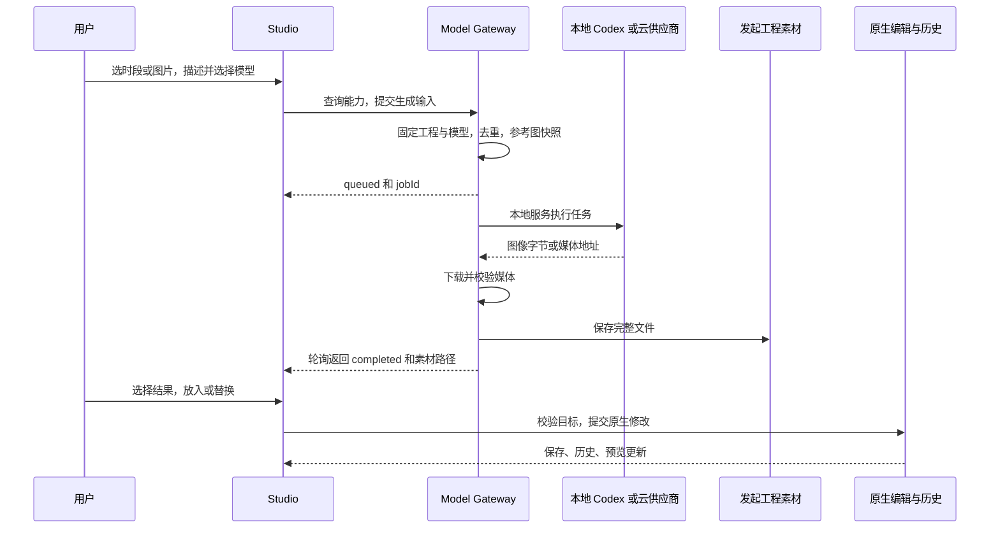
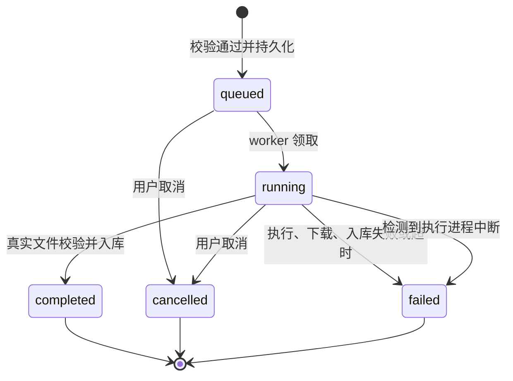

# 多模态素材生成：产品设计与架构决策

本文维护本机模型网关与编辑器的设计依据、取舍和约束；当前接口、配置与限制见 [Model Gateway](../model-gateway.md)。

## 用户问题与产品目标

用户希望在视频制作过程中，利用已有本地 Agent 或自己配置的供应商 Key 生成素材，既能从 MCP 调用，也能在手工编辑的具体位置调用。用户随后指出：仅有工具栏上的生成按钮，选中时间轴后仍缺少就地操作入口。这两次明确反馈是本设计的需求来源；参考界面和技术验收不能替代用户研究。

服务对象是已有 Agent 的创作者，以及需要继续修改工程的人。预期交付是“知道能用什么 → 生成真实素材 → 放到正确位置 → 继续编辑 → 导出可验证成片”。

| 用户要完成的任务 | 产品应给出的结果 | 验收观察点 |
| --- | --- | --- |
| 判断本机和 Key 是否能生成所需素材 | 分开显示安装、登录、配置、允许请求和真实任务结果 | 安装了 Agent 或填了 Key，不能直接显示为生成成功 |
| 为一段时间补充画面或声音 | 从当前时段打开生成面板，保留位置上下文 | 结果进入原工程，确认后放入预期时段 |
| 改变现有图片的内容 | 以原图生成候选，保留原片段结构 | 替换只改素材引用；时长、布局、动画和撤销可继续使用 |
| 从外部 Agent 制作完整 motion 视频 | 同一套模型能力、素材结果和原生工程工具可组合调用 | MCP 取得真实文件，再编排、检查、导出；任务 ID 不能当作媒体文件 |

## 产品中的三类“模型 / Agent”角色

外部创作 Agent 负责理解需求、制定分镜、选择素材和组织工程；Model Gateway 负责发现与执行多模态生成能力；Hyperframes 编辑与渲染体系负责工程、时间轴、预览和成片。三个角色分别承担不同阶段的工作，不能因为都使用“生成”一词就合并成同一个模型调用。

Codex 在这里可以有两种身份：作为用户的创作 Agent，通过 MCP 操作工程；作为本地生图执行器，由 Gateway 启动 CLI 完成一次素材任务。其他 Agent 即使能接入 MCP，也不自动成为本地媒体执行器。用户在创作宿主里选择的聊天模型，与 Gateway 中选择的媒体模型是两套选择。

因此，这一层命名为 **Model Router / Gateway**：Router 选择执行模型，Gateway 统一配置、能力查询和任务边界。它位于素材生产链中；没有把全产品的聊天、编辑和渲染接管为一个新的“root”层。

## 对象与归属

下面是产品概念与当前代码的对应关系，不表示新增了同名数据库或独立服务。

| 对象 | 负责表达什么 | 归属与边界 |
| --- | --- | --- |
| 工作区 | 一组工程及共享模型配置 | `MOTION_DATA_DIR`；配置一次可供本工作区的 Studio/MCP 使用，不是所有工作区的全局账户 |
| Agent 检测结果 | 程序是否存在、是否登录、媒体适配能力及原因 | `Agent`；检测是证据，不是执行授权或额度承诺 |
| Provider | 由谁执行、是否启用、凭据来自哪里 | `ProviderState`；不包含 Key 本身，Codex 使用自身登录 |
| Model | 供应商端点、输出模态、输入模式和已声明的扩展能力 | `Model`；`provider:modelId` 区分不同供应商的同名模型 |
| Capability / Route | 有哪些候选、当前默认选择是谁 | `GatewayStatus`；候选可用与默认路由可用需要分别判断 |
| GenerationJob | 一次已受理生成的工程、模型、参数、阶段和结果 | 持久化任务；供应商请求完成后仍需下载、校验和入库 |
| GeneratedAsset | 生成结果的工程相对路径、MIME 和字节数 | 真实工程文件；当前没有独立的全局素材 ID / 血缘数据库 |
| 选区与放置上下文 | 时间范围、片段、原素材、目标合成及写入回调 | Studio 会话中的 `MediaRequest` / `TimelineMediaTarget`；不作为供应商参数传递 |
| 原生片段 / 合成 | 素材如何参与布局、时间与动画 | HTML/CSS/JS 和 Studio manifest；同一素材可被多个片段引用 |
| Export job | 一个确定 revision 的最终交付文件 | 原生工程快照与后台渲染；与单个素材生成任务分别查询和验收 |

这种归属让“生成一个文件”和“把文件用到作品里”有各自明确的完成条件。关闭面板、改变选择、改写工程不会重新定义已经发起的素材任务；素材生成也不会决定作品的最终结构。

## 关键决策与取舍

| 决策 | 选择依据与实际后果 | 本轮未采用的做法与代价 |
| --- | --- | --- |
| D1：工作区共享服务 | Studio HTTP 与 MCP 调用相同业务层、配置和持久化任务；外部 Agent 能看到界面配置出的同一能力 | 两个入口各写供应商客户端会造成路由、凭据、错误和任务状态不一致；当前共享服务仍需要本地服务进程存活 |
| D2：能力分级表达 | 安装、登录、Key 配置、允许发起请求、任务完成分别有证据；失败原因可以指导下一步 | 不用一个“已连接”承诺权限、余额和结果，也不为验证 Key 隐式发起收费生成；用户仍可能在首次调用时遇到账户限制 |
| D3：按输出模态和操作能力筛选 | image-to-video 属于视频输出；图片修改还需要明确的 `supportsImageReference`，不能只检查输出为 image | 仅根据模型名称或输入出现 image 来分类会误导调用方；当前目录覆盖比专用参数表单更广，发现一个模型不等于所有输入模式都可直接操作 |
| D4：显式路由优先 | 指定模型 → 该模态默认路由 → 未配置默认时的可用文本生成候选。已指定路由不可用则报错 | 不自动换供应商或重试收费请求；牺牲部分自动恢复便利，保留用户对账户、质量与成本的选择 |
| D5：持久化异步任务 | 视频等生成耗时不确定，提交后即得到任务 ID；本地服务执行，前端轮询结果 | 不把执行生命周期绑到一个页面请求，也不把内存 Promise 当作任务记录；进程中断的运行任务标为失败，不自动重放 |
| D6：素材入库与作品修改分两步 | 生成结果有候选价值，用户可比较、复用或不采用；先保存文件，显式放置/替换才改合成 | 不在生成完成时自动覆盖当前选择；多一次选择操作换取结果可控，以及生成失败与编辑失败的清晰区分 |
| D7：从编辑上下文发起 | 空时间轴、素材库和时间轴选区服务不同阶段，共用同一面板；选区入口带入时间、片段和参考图 | 仅保留顶栏/工具栏按钮会要求用户重新描述位置；浮动栏需要处理关闭、播放、拖动、只读和窄窗口状态 |
| D8：固定参考输入，校验替换目标 | 排队前复制原图并记录 hash；采用结果时再次校验工程、合成、元素和源文件中的原引用 | 不在执行时读取可能已被覆盖的原图，也不使用生成结束时“当前选中的元素”；引用校验不是对所有外部并发修改的分布式事务保护 |
| D9：复用本机 Codex CLI | 使用用户已有安装、配置和登录，临时目录中完成一次内置生图/改图；不迁移 OAuth 凭据 | 不建立私有登录协议或调用私有后端；可用性仍依赖已安装 CLI 版本、功能开关及账户实际能力 |
| D10：保留原生编辑与渲染 | 图片替换只改 `src`，通过原生文件保存队列与撤销历史提交；预览和导出继续读取同一工程 | 不维护第二套“生成时间轴”或让模型整页重写作品；扩展必须遵守原生目标定位、源路径、历史与 revision 约束 |
| D11：将素材工具组合为影片流程 | 现有 Agent 可以查询能力、生成多个素材、写合成、检查并导出；Gateway 只负责素材执行 | 暂不增加一个承诺任意完整影片的一键模型接口；独立工作流执行器、依赖调度和预算系统属于后续候选 |

### 参考产品的使用方式

用户提供的 Hyperframes Studio 参考说明了三个交互需求：空时间轴有下一步指引、在具体时段发起生成、素材菜单与作品联动。实现复用仓库已采用的原生编辑逻辑，并使用 OpenDesign 设计变量。参考中的模型卡片、价格和名称不是本产品已接入能力或收费规则的依据，因此不照搬价格文案。

Codex Slides / Canvas 参考用于理解本地 Agent 检测与能力目录的分离。本项目选择的执行边界是公开可安装的本机 CLI；相关参考入口保留在 [模型网关的依据](../model-gateway.md#验证与依据)，避免把参考项目的具体授权实现当作本产品的默认方案。

## 从生成到编辑的端到端流程

MCP 路径复用图中的 Gateway、任务和素材阶段。调用方通过 `motion_get_generation` 轮询，取得 `completed` 且文件可用的结果后，重新读取工程 revision，再通过原生源文件工具完成编排。两者的生成规则相同；MCP 源文件写入与 Studio 内的撤销栈属于不同入口，不能据此承诺所有外部写入都成为一条 Studio 撤销记录。

`motion_generate_asset` 会确保工作区服务启动，由 `server.ts` 的 worker 处理队列。HTTP 生成入口要求 Studio 服务已就绪。关闭生成面板本身不取消任务；关闭本地服务会影响执行。持久化让任务结果可被重新查询，但当前没有自动断点续传远端生成的语义。

### 两种“固定”保护不同问题

- **生成输入固定：** 任务固定发起工程、选中的模型、参数和参考图副本。用户切换工程或改写原图，不会让正在生成的任务换用另一份输入。凭据在执行时按当前供应商配置读取，未为每个任务复制 Key；执行前仍检查供应商是否可用。
- **编辑目标固定：** Studio 捕获目标工程/合成、元素标识、原路径和时段。采用结果时重新校验；原图片引用已被其他编辑改变时拒绝写入。它避免把结果覆盖到新选择上，不是对原路径下所有文件字节的二次 hash 锁。

图片替换使用原生 `handleDomAttributeBatchCommit`，在文件队列内用 `validateContent` 校验**修改前**的源文件，再 patch `src` 并记录历史。`prepareContent` 是 patch 后处理；验收中已发现并纠正把它用于写入前验证的错误。这个区别作为后续属性面板、音视频替换等扩展必须保留的约束。

## 时间轴交互规则及原因

| 入口 / 情境 | 当前行为 | 设计目的 |
| --- | --- | --- |
| 空时间轴 | 同时提供导入文件和生成素材 | 用户可以从已有素材或新素材开始，第一次操作可见 |
| 素材面板 | 获取、预览和管理文件；通过原生操作放入作品 | 素材可先收集，不强制立即决定剪辑位置 |
| 完成时间范围选择 | 以该范围优先带入开始时间和时长 | 用户已经表达了“这一段需要内容”，不重新询问位置 |
| 选中单个片段 | 带入片段的开始时间、时长与轨道；本地图片增加修改入口 | 将“再生成一个”与“修改这张图”明确为两种意图 |
| 未选片段时点击标尺 | 以点击位置为开始时间，默认 3 秒 | 为时间点快速补内容，时长可在生成面板调整 |
| 模型 / 比例 / 数量 | 常用参数直接展示；模型特殊字段进入高级 JSON | 保留常用操作可见性，同时承认供应商输入差异；当前没有完整通用 schema 表单 |
| 图片修改 | 显示参考图，只列已声明参考图能力的图片模型，锁定原时段 | 改的是片段内容；需要改变编排时另做时间轴编辑 |
| 结果采用 | 提供放入时间轴；图片修改另有替换按钮 | 一次生成得到候选，用户决定采用方式；撤销编辑不删除生成文件或撤销供应商费用 |
| 播放、拖动、上下文菜单、只读状态 | 隐藏就地操作栏；实际写入还检查渲染/写入阻断 | 生成入口不抢占当前手势，隐藏 UI 也不能代替写入保护 |
| 关闭与重新选择 | 可以关闭浮动栏，再次操作时间轴可唤起 | 这是上下文辅助入口，不是必须一直遮挡画面的面板 |
| 交给 Agent | 沿用原生弹框，复制带时段与元素上下文的指令 | 保留更广泛修改的出口；当前不从该按钮自动发送聊天或执行生成 |

图片的时长表示在时间轴展示多久；视频预设可能把时长映射为供应商生成参数；音频模型有自己的长度和输入限制。界面上的时段不能被解释为所有供应商都会返回完全相同时长的媒体。音乐与语音在界面分别选择，网关均归为 `audio`，再按 `mode` 区分文本转语音等任务。

数量表示独立候选请求，当前 1–4 个。生成按钮会创建新一批任务；批量提交中途失败后重试复用已提交项的幂等键。任务历史是恢复结果的入口，尚未实现持久化的整个生成表单、候选选择组或跨设备编辑草稿。

## 状态与失败的产品语义

提交前的无效参数、不可用模型和队列已满直接拒绝，不创建成功受理的任务。`submitted`、`generating`、`downloading` 等是 `phase`，不是另一套终态；`completed` 的判断不能提前到供应商返回一个请求 ID 或 URL 时。

| 情况 | 当前处理及用户可观察结果 | 不能据此承诺的能力 |
| --- | --- | --- |
| 有其他模型可用，但默认路由不可用 | 能力列表仍可列出候选；本次默认请求失败，需要显式选择 | “有一种模型可用”不代表已选择的路线必然可执行 |
| 目录离线 | 返回已标明来源的内置项 / 缓存及警告 | 缓存不证明模型仍在售、当前价格、Key 权限或完整表单支持 |
| 云生成返回结果但下载失败 | Key 可能已记录为验证通过，素材任务仍然失败 | 供应商执行证据与本地素材可用证据不能合并 |
| 已受理的同一请求重复提交 | 同工程、同幂等键、相同输入返回原任务；输入不同则拒绝 | 本地幂等不等于供应商端的 exactly-once；网络中断后仍可能需要核对供应商记录 |
| 运行中取消 / 超时 / 进程中断 | 停止本地执行和入库，保留终态与原因，不自动重放 | 远端取消与退款不是保证；已计费的生成可能仍在供应商侧完成 |
| 生成期间切换工程 | 产物仍进入原工程；旧编辑回调失效，不能误放到新合成 | 不会自动把跨工程素材迁移或重新绑定到新的选择 |
| 生成已完成，编辑目标过期 | 保留生成素材，拒绝替换；用户可从素材库重新使用 | 素材成功不代表作品修改成功，不应重新生成来“修复”目标冲突 |
| 素材之后被重命名或删除 | 任务保留初始结果路径，查询标记原路径不可用 | 当前没有自动迁移所有历史任务引用的全局素材注册表 |

这套状态使成本与编辑错误可以分别解释。账户权限、真实输入约束和供应商收费仍需在实际调用时验证；详细超时、队列上限、凭据和下载边界见 [模型网关](../model-gateway.md#数据并发与限制)。

## 扩展方向与准入条件

| 方向 | 状态 | 后续实现应复用什么 | 完成前需要证明什么 |
| --- | --- | --- | --- |
| 新云供应商 / 新模型 | 已有适配结构；当前内置 Codex、Atlas、fal | Provider / Model 合约、路由、队列、媒体入库；修改供应商枚举与发现方式 | 可解释的鉴权失败、真实任务完成、取消边界、输出校验和协议测试；不能只注册名称 |
| 属性面板需要一张图时调用 | 用户已确认方向；已有 `openGenerator`、`usage`、`onComplete` 接口，独立属性入口未实现 | 同一面板、任务与 native commit；`usage` 只是上下文记录，不是自动赋值指令 | 属性类型、目标捕获、过期拒绝、撤销及真实替换；先确认当前属性是 `src` 还是其他表达 |
| 更多本地 Agent 产生媒体 | 扩展方向；Claude/Gemini 当前只做安装检测 | 检测与执行适配分离、原因说明、临时任务目录 | 该 Agent 的实际媒体入口、登录状态、产物与失败行为；不能把 MCP 接入能力等同于本地生图 |
| 参考图生视频 / 视频或音频修改 | 候选，本轮未实现统一输入链 | 任务、原生素材引用与显式采用 | 输入类型、参考数量、上传生命周期、权限及可撤销的目标修改；不能复用一个图片布尔字段承诺所有编辑模式 |
| 完整 motion 制作 | 用户已确认方向；当前由 Agent 组合已有工具与制作流程执行 | 能力查询 → 素材任务 → 原生编排 → 固定 revision 导出 → 验证 | 原料与成片分别有真实文件、时长和声音符合 brief，局部失败可解释；不能把图片缩放当成视频模型生成 |
| 独立的多步骤生成工作流执行器 | 候选，未实现 | 现有任务作为子任务，不再复制供应商客户端 | 分镜/依赖、预算、部分失败处理、恢复与用户采用规则；是否需要新服务由真实任务复杂度决定 |
| 价格、余额、自动重试或自动切换 | 候选，未实现 | 显式路由和可追溯任务 | 可验证的价格来源、成本授权和收费幂等；“生成成功率”不能单独作为引入自动付费操作的理由 |
| 系统 Keychain、云端团队凭据与资产 | 候选，未实现 | 配置与作品文件分离的边界 | 平台迁移、访问控制、数据归属与分发方案；不能直接把当前本机服务暴露为多人服务 |

供应商 `ProviderAdapter` 当前用于云端请求，Codex 是 `agents.ts` 中的本地分支；尚未实现一套运行时自动发现任意适配器的插件注册系统。新增来源应集中扩展网关，不让 Studio、MCP 或属性面板各自开始管理 Key 和远端任务。

## 验证层次与待验证假设

| 层次 | 已有证据入口 | 证明范围 |
| --- | --- | --- |
| 合约与故障 | [后端测试](../../tests/gateway.test.ts) | 路由、Key 脱敏、参考图快照、取消、幂等、供应商协议、工程绑定与真实文件校验 |
| 上下文与原生保存 | [操作栏测试](../../studio/src/motion/TimelineMediaBar.test.tsx)、[生成流程](../../studio/src/motion/MediaGateway.test.tsx)、[替换桥接](../../studio/src/motion/MotionTimelineMedia.test.tsx)、[保存前校验](../../studio/src/hooks/useDomEditPersist.test.tsx) | 参数与目标传递、过期拒绝、保存与历史边界 |
| 本机端到端 | `tests/` 中的相应用例 | 按当前提交运行；模型调用、实际播放器和目标平台需要独立验收 |
| 真实产品价值 | 尚待任务观察 | 就地入口能否减少位置重述、候选选择是否减少返工、用户能否理解可用/验证状态；技术测试不证明留存或付费意愿 |

后续观察应记录用户在哪一步离开、失败原因、如何采用结果和是否继续编辑；不预设未经采集的转化率或阈值。供应商真实 Key 的跨模型验证、专用参数表单覆盖、长队列下的操作体验和参考图权属/传输说明，仍需在对应接入任务中补证据。

调用使用用户自有账户，产品没有统一收费或托管额度。产品架构、协议、实现和验收分别维护；后续变更应补充本页对应决策的替代理由，并更新 [需求记录](changes.md)，保留历史依据。
