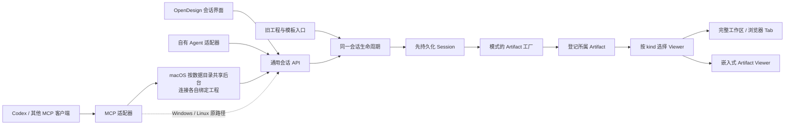

# 会话、模式与 Artifact Viewer 技术架构

更新：2026-11-05。需求与产品行为见 [会话与 Artifact 浏览器](project-workspace.md) 和 [变更记录](product/changes.md)。本文描述当前代码的扩展边界；一期只实现 Motion，不把网页原型等后续模式写成已上线功能。

## 一套领域模型，多种调用入口



`Session` 的身份不依赖宿主 Agent，也不等于工程身份。`mode` 选择制作能力、模板分类和 skill；`Artifact` 记录实际产物身份与资源定位；`Viewer` 按产物 `kind` 选择展示/编辑实现。浏览器 Tab 只引用 Artifact ID，关闭 Tab 不删除产物。自有 Agent 使用同一 HTTP 契约，不需要另一套项目索引或会话存储。

`activeSessionId` 表示通用会话选择，可以指向还没有产物的会话；原生工程状态中的 `sessionId` 始终是该活动工程的真实所属会话，两者不能混用。创建空会话不会把之前工程重新归属给它。

当前适配映射：

| 模式 | Skill | 产物 kind | 资源 | Viewer |
| --- | --- | --- | --- | --- |
| `motion` | `motion-production` | `motion-project` | 本地原生工程 `projectId` | 完整 Hyperframes Studio App |

`ArtifactIdentity` 保存共用的 `id/title/templateId?`，`MotionArtifact` 扩展 Motion 资源字段。`SessionArtifact` 是可扩展的判别联合，不把网页地址当成 Motion 工程。`creationModes` 与 `artifactViewers` 的公开描述保存在 `shared/session.ts`；实际生成工厂在服务端，Viewer 组件注册在前端，各自独立。

## 会话编排与媒体生成的分层

创作模式（目前为 `motion`）决定产物和编辑能力；媒体模态（`image` / `video` / `audio`）描述素材类型；供应商模型决定一次素材请求由谁执行。这三个维度各自独立，选择 Motion 不会固定某个模型，切换图片模型也不会改变会话模式。

| 层次 | 当前职责 | 不拥有的状态 |
| --- | --- | --- |
| 会话与 Agent 接口 | 保存需求、真实回复、模式和产物归属；提供自有 Agent / Codex 共用的 HTTP / MCP 契约 | 供应商凭据、原生时间轴状态 |
| 模式 / skill / 模板 | 定义制作规范、模板选择及产物工厂；Motion 创建可编辑原生工程 | 浏览器 Tabs 和宿主聊天记录 |
| Model Gateway | 检测本地能力、配置供应商、选择模型、异步生成并入库媒体素材 | 会话消息、完整影片是否制作完成 |
| Artifact Viewer | 预览和调整产物，调用原生保存、素材放置、撤销、导出 | 会话身份、另一套工程文件 |

[Model Gateway](model-gateway.md) 由 Studio 与 MCP 共用，完整工作区的模型设置位于侧栏，嵌入模式在 Motion Viewer 顶栏保留同一设置入口；时间轴素材生成仍由 Motion Viewer 拥有。任务提交时固定 `projectId`；切换会话或 Tab 不改变生成结果的工程归属。只有 `completed` 且素材仍可用，才进入后续编辑步骤；新增素材后须重新读取 revision。生成素材、创建可编辑工程和完成影片是不同的状态，不能互相代替。

目前会话中的推理与工具回合由外部 Agent 编排，Gateway 可以直接调用本地 Codex 生图或用户配置的云模型。这个媒体执行能力不等于内置聊天 Agent。以后接入自有 Agent 运行器，应消费同一会话与产物 API，并显式写回消息；不能另建会话数据库，或把供应商任务状态充作助手回复。

## 生命周期与失败语义

关键选择与取舍：

| 选择 | 解决的问题 | 当前代价或边界 |
| --- | --- | --- |
| 会话、产物、工程分离 | 对话可先存在，一次任务可产生多个版本或不同类型的产物 | 不再用工程 ID 代表所有会话；旧数据必须显式兼容 |
| 会话先持久化，产物后生成 | 生成失败不丢问题、模板选择和上下文，可继续提问或重试 | 客户端必须支持零产物会话，不能将创建会话当成制作完成 |
| 模式工厂与 Viewer 注册分开 | 模型/skill 决定制作，Viewer 决定展示，自有 Agent 与 Codex 共用数据 | 新模式必须同时补齐资源、生成和编辑适配，不能只加下拉选项 |
| 两个索引在同一目录文件原子发布 | 避免工程已选中而产物归属尚未写入的中间状态 | 当前为本地单工作区存储，没有分布式事务或云协作 |
| 完整原生 App 放进 Artifact Tab | 原生编辑、历史、导出与保存逻辑复用，会话不从属于工程工具 | 同时只激活一套 Motion 原生服务；跨工程必须重新建立编辑上下文 |
| Viewer 拥有浮层可见性 | 关闭浏览器或切到网页时，时间轴菜单、素材生成和编辑浮层随产物隐藏，不留在自由会话上 | 编辑器与生成表单仍保留状态；已提交任务继续在服务端执行，不因隐藏界面取消 |
| 嵌入是视图配置 | Codex 和自有界面看到同一份可编辑产物，无需导出再导入 | 隐藏界面不等于权限隔离；嵌入仍受本机服务和宿主浏览器能力约束 |
| 外部 Agent 执行，显式写回回复 | 兼容不同宿主，保留真实来源，不制造自动执行假象 | 当前没有网页内聊天 Agent 运行器、宿主聊天自动同步或流式工具回合协议 |

1. `POST /design-api/sessions` 验证模式和模板，先持久化会话及初始需求。可以只有会话、没有产物；此操作不改写当前视频。可提供稳定 UUID `id`，相同初始请求重试返回同一会话，冲突内容被拒绝。
2. `POST /design-api/sessions/:id/artifacts` 根据会话模式调用 `artifactFactories`。首个产物默认使用会话所选模板，也可传具体模板；后续产物默认空白。
3. Motion 工厂建立候选工程与原生服务，重查 revision 和活动工程后，才把产物登记到该会话并切换。失败清理候选文件，但保留已创建的会话、消息和其他产物。
4. 客户端按产物 kind 打开 Viewer。空会话中外部 Agent 创建产物后，网页轮询会打开同一所属产物；待提交草稿留在会话下。
5. 后续需求和真实 Agent 回复写入同一个消息流；产物继续通过其模式工具编辑。网页不伪造模型回复或执行完成状态，也不包含聊天 Agent 运行器。

旧 `/motion-api/projects` 与模板创建入口转接到这条“先会话、后产物”流程。已有工程/旧书签仍映射到兼容会话；`motion_apply_template` 在当前或指定会话新增产物。启动旧工作区时，原先默认工程映射为一个兼容会话，不因重复打开预览重复创建会话。

## HTTP 与 MCP 契约

macOS 的 `mcp.ts` 只负责 stdio 和连接选择，业务位于 `mcp-tools.ts` 并在共享后台执行。每条连接绑定返回的工程/会话，网页或其他连接切换全局选择不会改变它；九个工程工具也接受显式 `projectId`。空会话不能沿用上一个会话的工程写入。旧 27 个工具和会话/产物 ID 保留，initialize 与纯流程/目录读取不启动后台。目录、停止与故障语义以 [共享编辑器](shared-editor.md) 为准。

通用 HTTP 命名空间为 `/design-api`；`/motion-api` 是兼容别名。模式、会话、消息和产物的业务实现共用服务函数，MCP 创建/打开操作请求相同接口。原生编辑器继续使用 `/api/projects/:id/...`，不与通用会话路由混用。

| MCP | 对应职责 |
| --- | --- |
| `design_create_session` | 先创建会话；默认继续生成首个产物，`createArtifact=false` 可先讨论。生成失败返回 `artifactError` 和已保存会话链接 |
| `design_get_session` | 读取会话、模式配置、skill、消息和所属产物 |
| `design_append_message` | 用稳定消息 UUID 记录真实 `user` / `assistant` 内容；无模型执行副作用 |
| `design_create_artifact` | 向已有会话生成产物，返回完整/嵌入链接 |
| `design_open_artifact` | 校验 session/artifact 归属并打开对应资源 |
| `motion_get_project` | 读取当前原生工程与 revision，同时返回其所属会话和兼容 conversation 字段 |
| `motion_open_preview` | 兼容启动入口；默认返回纯编辑器 `previewUrl`，显式 `embedded=false` 可返回完整会话链接 |

消息 API 接受 `{id, role?, content}`，HTTP 默认 `user`、MCP 追加默认 `assistant`。仅保存调用方实际提供的内容；不会从外部客户端自动抓取私有对话。网页定期读取共享消息流。MCP 与 HTTP 都是本机工作区接口；HTTP 修改需要同源 Origin，现有宿主与回环地址校验仍有效。

所有原生写操作必须读最新 revision，并确认 `projectId` 属于目标会话。请求切换可同时传 `expectedProjectId`。保存门禁与来源文件竞争保护延续既有设计；这不等于多 Agent 可以不协调地并行修改同一文件。

## 展示参数与 Codex 嵌入

完整与嵌入链接只改变视图，不创建第二套会话或复制产物：

```text
/?session=<sid>&project=<pid>#project/<pid>
/?session=<sid>&project=<pid>&embed=1#project/<pid>
/?session=<sid>&project=<pid>&sidebar=0&conversation=0#project/<pid>
```

- `embed=1`：隐藏全局导航、会话和浏览器自身的 Tab/地址栏，仅呈现完整 Artifact Viewer，包括产物自己的编辑工具。不会覆盖完整工作区的浏览器布局偏好。
- `sidebar=0`：初始收起全局会话列表，会话顶部按钮可恢复；会话隐藏时按钮在浏览器顶部。
- `conversation=0`：有产物时初始收起对话，保留浏览器标签栏与恢复入口。
- 嵌入参数在新产物和工程切换的整页导航中保留。只有会话、还没有产物时保留会话与生成入口，不显示空白 Viewer。
- MCP 创建会话产物、创建/打开产物、应用模板、读取工程和打开预览时返回 `sessionUrl`、`embeddedPreviewUrl`；有产物时默认将嵌入地址作为 `previewUrl`。`embedded=false` 显式选择完整工作区（读取工程仅返回两种链接）；空会话/生成失败没有 Viewer 时回到完整会话。模板复刻指南要求保留完整参数与工程 hash，不截成服务根地址。Codex 和自有 Agent 均使用同一组链接；工具不声称替宿主打开了浏览器。

这些参数不是授权控制，也不隐藏数据访问权限；它们只配置受信任本机工作区的界面。外部网站 Tab 由独立本地 Chromium 承载，不在工作区执行网站 HTML；其导航、输入、隔离与生命周期见 [浏览器运行架构](browser-runtime.md)。

## 代码边界与下一种模式

| 扩展点 | 当前文件 | 责任 |
| --- | --- | --- |
| 模式 / Artifact 类型 / Viewer 描述 | `shared/session.ts` | 模式到 skill、模板目录、产物 kind 的映射；宿主无关 DTO |
| URL 与展示参数 | `shared/workspace-url.ts` | 会话/产物链接，完整与嵌入视图，导航参数继承 |
| 会话持久化 | `workspace.ts` | 归属校验、消息去重、兼容映射、原子目录发布 |
| 会话 API 与产物工厂 | `server.ts` | `createSession`、`createArtifact`、`artifactFactories`；旧入口复用 |
| Agent 适配 | `mcp.ts`、`mcp-tools.ts`、`editor-runtime.ts` | stdio、共享业务、同一 HTTP 生命周期、连接身份与链接返回 |
| Viewer 注册 | `studio/src/motion/ArtifactViewer.tsx` | 按 artifact kind 懒加载编辑器；不拥有会话状态 |
| Viewer 可见性 | `studio/src/motion/ArtifactViewState.ts` | 通知原生浮层和媒体生成界面当前产物是否可交互；与保持挂载的编辑状态分离 |
| 浏览器与会话容器 | `MotionSessionFrame.tsx`、`artifactBrowser.ts` | Tabs、面板可见性、保存等待、关闭/恢复和嵌入 |
| 网页运行时 | `browser.ts`、`shared/browser.ts`、`WebBrowser.tsx` | 按会话隔离 Chromium、导航/画面/输入协议；与产物和工程状态分开 |
| 原生编辑桥 | `MotionStudioHost.tsx` | 向容器注册保存/渲染门禁，保留原生编辑状态 |

后续网页原型模式需要新增模式/模板与 skill 定义、具体产物资源类型、生成/打开适配器及 Viewer 注册，再验证保存与嵌入能力；不得仅在选择器加入一个没有实现的选项。会话索引、消息、宿主接入和浏览器面板继续复用。当前仍只有一个活动 Motion 原生服务；多个 Tabs 是可切换入口，不是多工程同时运行。

## 验收

测试覆盖先有空会话、生成失败保留、MCP/HTTP 共用数据、真实回复去重与角色、旧工程兼容、跨会话归属拒绝、保存与 revision 竞争、完整/嵌入 URL 身份一致、嵌入偏好隔离、空会话生成后的 Viewer 激活。实际运行证据与剩余产品假设记在[需求记录](product/changes.md)。
